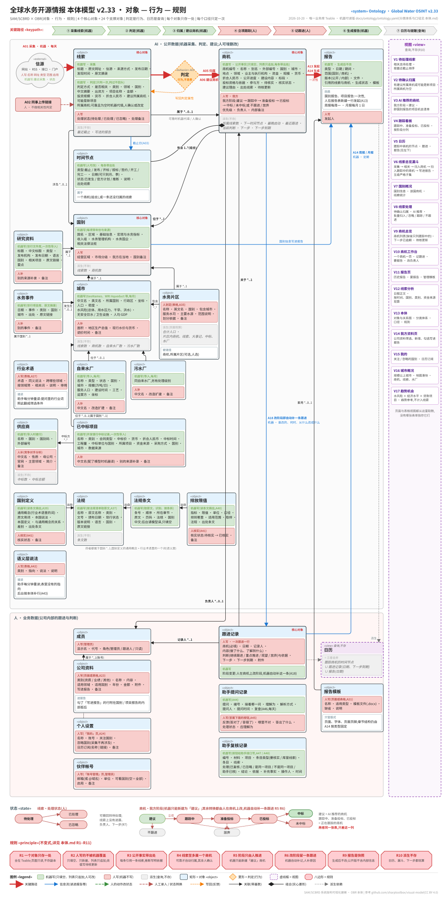

# osint-water 本体 v2.0(2026-10-04)

> 依据 [visual-model](https://github.com/sharptoolbox/visual-model) 的 OBR 本体建模(对象本体 M1、行为本体 M2、规则本体 M3,加事件 ME、主体 M5、查询 M7、对象数据映射 MM)与 SAM/SCBRD 五维框架画成。
> 机器可读版 [ontology.yaml](ontology.yaml)(`tests/test_ontology.py` 检查它自洽);图 [本体模型.svg](本体模型.svg)。
> v1.1 并入使用方 2026-10-03 的四个决定(见第十节),据此的架构见 [docs/架构方案_2026-10-03.md](../架构方案_2026-10-03.md);
> v1.2 按 [架构方案审查](../架构方案审查_2026-10-03.md) 修订 R2 与 A03、A06、A07、A18(见第十一节);
> v2.0(细化版)对照真实库、后台任务与页面补齐分类体系、口径、写法与新对象、新行为(见第十二节)。
> 第三、三之二、四、五、六、八、八之二、九节的表由 [gen_md.py](gen_md.py) 按 ontology.yaml 生成,改本体后重跑 `python docs/ontology/gen_md.py`。
> 页面读的 [portal/ontology.json](../../portal/ontology.json) 由 [gen_json.py](gen_json.py) 按 ontology.yaml 生成,改本体后也重跑 `python docs/ontology/gen_json.py`(v2.2 起后台与页面在运行时读本体,不再抄枚举;`tests/test_ontology.py` 检查两个生成物都已同步)。

**一句话**:系统里只有九种东西——四个核心对象(线索、国别、商机、跟进记录)和五个支撑对象(信源、时间节点、报告、报告模板、成员)。
判定是线索上的一个行为,不是一张表;日历、线索总览的漏斗、线索处理是查询,不是表。每种对象只存一处(Teable 的一张表);每个属性要么机器写、要么人写、
要么现算,机器永不覆盖人写的;每个选项值有定义与边界(第三之二节),每个统计口径只定一次(第八之二节)。

## 一、建模前置分析

- **领域**:海外水务工程承包商的项目机会情报与跟进。
- **要回答的问题**:网上公开的项目信息(线索)怎样变成我方要跟的项目(商机);跟的过程(跟进)怎样留痕、排进日历、写成报告。
- **包含**:九种对象的定义、属性与写入方、关系、行为、规则、事件、视图,以及现状对照;v2.0 起还有每个选项值的定义与边界(分类体系)、页面与报告共用的口径、长文本一行怎么写。
- **不包含**:采集器怎么抓、模型提示词怎么写、页面长什么样、数据放在哪个库——这些是架构设计,下一步按本体定。
- **用途**:改造的唯一口径。表结构、机器任务读写什么、页面显示什么,都以本文和 ontology.yaml 为准;现有做法与它冲突的,改做法。

## 二、对象总览

| 对象 | 一句话 | 谁产生 | 状态 | 对应使用方流程图 |
|---|---|---|---|---|
| **线索** | 网上一条与水务项目有关的公开信息;也是商机上每条事实的出处 | 机器定时采集;同事上传 | 处理状态:待处理 → 已处理 / 已忽略 | 线索(绿:AI 定时采集;粉:用户上传) |
| **国别** | 一国一行:经济、人口、水资源、机构、法规,我方在当地 | 机器采集;人补充 | — | 国别基础信息 |
| **商机** | 一个值得投入的项目机会,一个项目一行 | 机器建议(阶段 = 建议);人立项、推进、结束 | 我方阶段:建议 → 跟踪中 → … | 商机(绿:AI 判定的项目清单;粉:用户增删改查) |
| **跟进记录** | 一次跟进一行:做了什么、怎么判断、下一步 | 人 | — | 更新操作跟踪记录 |
| 信源 | 机器采集的网站、接口、订阅 | 人配置;机器记采集状态 | 启用 / 停用 | 线索的来处 |
| 时间节点 | 公开的日期:截止、发布、开标、授标、签约、开工、完工 | 机器从线索与资料里抽;人可改;过期的后台改成已发生 | 已发生 / 官方计划 / 推断 | 日历里的"公开时间节点" |
| 报告 | 国别报告、项目报告(一次性),周报、月报(定期) | 机器生成;一次性的由人发起(表格或页面) | 待生成 → 生成中 → 完成 / 失败;生成后不改 | 国别报告、项目报告、周期性报告 |
| 报告模板 | 生成 Word 时套用的版式(.docx):页面、字体、页眉页脚 | 人上传、换文件、设缺省 | 缺省 / 非缺省 | — |
| 成员 | 部门同事,一个登录账号一行 | 管理员 | 角色 | 负责人、记录人 |

流程图里的"判定"画成虚线框,本体里它就是线索上的行为(A03),结果写回线索自己的属性;流程图里的"日历视图"在本体里是视图 V5。

**两组阶段互不相干**:商机的「公开进度」说项目本身走到哪(规划 → 前期 → 融资已落实 → 采购进行中 → 已定标 → 在建 → 已完工,或暂停 / 取消),机器从公开信息推;
「我方阶段」说我们对它做到哪(未立项:建议、不跟进;在跟踪:跟踪中、准备投标、已投标、中标;已结束:未中标、放弃),只由人改。一个在建的项目可以是「建议」,一个还在规划的项目可以是「准备投标」。

## 三、对象本体(M1):属性按写入方分三类

- **机器写**:采集程序或模型写,而且**只填空值、只新建记录、列表只追加**(列表类属性可追加新项,不改不删已有项);发现与已有值不同的新信息,写进商机的「待核更新」,由人确认后改(R2)。例外只有机器自己的运行状态(信源最近采集、报告生成状态)与按期替换的国别指标。人可以随时改机器写的属性;要否定机器写的值时写明确的文字(「无」「不详」),不要清空——清空了机器会再填。
- **人写**:只有人写,机器永不写(机器新建记录时给的初值除外,如新线索的处理状态"待处理"、机器建议的商机阶段"建议")。
- **派生**:用时由其他属性算出,不存(R10)。比如商机的"下一步"就是它最近一条跟进记录的下一步,不在商机上另存一份。

<!-- gen:objects -->
### 线索(核心)

网上一条与水务项目有关的公开信息(公告、新闻、报告、文件)，由机器定时采集，或同事上传链接。它也是商机上每条公开事实的出处。标识:线索号(信源 + 原文键的指纹);原文网址唯一。

| 写入方 | 属性 |
|---|---|
| 机器写 | 标题 · 原文网址 · 信源 · 来源方式(机器采集 / 用户上传) · 发布日期 · 发现时间 · 原文摘录 · 是否相关 · 类别 · 领域 · 国别 · 中文摘要 · 出资方 · 项目名称 · 金额 · 投资规模 · 货币 · 折合人民币(万元) · 建议所属商机 · 归属可靠 · 可能是新项目 · 所属商机 · 判定方式(模型 / 规则 / 不判定) |
| 人写 | 城市 · 处理状态(待处理 / 已处理 / 已忽略) · 处理备注 |
| 派生(不存) | 最近截止 · 写进的报告 |

状态(只由人改):待处理 → 已处理;待处理 → 已忽略;已处理 → 待处理(撤回);已忽略 → 待处理(撤回)。

属性细则(怎么写、示例、派生的在哪算):

- **原文网址**:示例:`https://www.ebrd.com/work-with-us/procurement/p-pn-240101a.html`
- **金额**:示例:`EUR 25 million(EBRD 贷款)`
- **投资规模**:示例:`25000000`
- **折合人民币(万元)**:示例:`18000`
- **处理备注**:写法:一行一条，「YYYY-MM-DD 谁:做了什么」;只想记一笔「看过了」写这里，不开跟进(R7)
- **最近截止**:在哪算:teable 汇总(最早的「未过截止」);含 TODAY()，隔天不重算，页面与报告自己按当前日期算(R12)
- **写进的报告**:在哪算:teable 关联的反向字段(报告.引用的线索)

### 国别(核心)

一个国家一行:经济、人口、水资源、水务管理机构、水务国企、相关法律法规，以及我方在当地的情况。标识:ISO3 国家代码。

| 写入方 | 属性 |
|---|---|
| 机器写 | 国名 · 大洲与区域 · 基础信息 · 宏观与水务指标 · 收入组与贷款类别 · 用水压力 · 2030 年用水压力 · 2050 年用水压力 · 干旱风险 · 河流洪水风险 · 人均 GDP(PPP 美元) · 世行涉水项目数 · 世行涉水承诺额(百万美元) · 风险数据来源 · 水务管理机构 · 水务国企 · 相关法律法规 · 市场准入与竞争 |
| 人写 | 经营区域 · 市场分级(重点 / 市场 / 其他) · 我方在当地 · 国别备注 |
| 派生(不存) | 线索数 · 商机数 |

属性细则(怎么写、示例、派生的在哪算):

- **基础信息**:写法:一行一项「名称:值(来源)」;示例:`首都:巴库(世行国别元数据)`
- **宏观与水务指标**:写法:一行一项「指标:值 单位(年份，来源 链接)」;每月整体替换(R2 例外);示例:`人均 GDP:7，155 美元(2023，世行 WDI https://data.worldbank.org/…)`
- **风险数据来源**:示例:`WRI Aqueduct 4.0 国别排名(2023);Kummu 等 2025;世行项目库 2020-10 至 2024`
- **水务管理机构**:写法:一行一个「机构名(职责)官网」;示例:`阿塞拜疆水资源署 ADSEA(供水与污水运营)https://adsea.gov.az`
- **水务国企**:写法:一行一个「企业名(主业、隶属)官网」
- **相关法律法规**:写法:一行一部「[类别] 名称(年份)链接」;类别 = 水法与水资源 / 供水排水与污水 / PPP 与特许经营 / 公共采购 / 环境 / 外资与投资
- **市场准入与竞争**:写法:一行一条「[线索号] 事实」或「[R012] 事实」(R 号是国别成稿条目号，只提示不跳转)
- **国别备注**:写法:一行一条「YYYY-MM-DD [备注|情报|建议动作] 内容」;国别页按标签着色、日期单列
- **线索数**:在哪算:teable 汇总(关联「线索」计数)
- **商机数**:在哪算:teable 汇总(总数);按阶段分的数页面现算

### 商机(核心)

一个值得我方投入的项目机会，一个项目一行。机器建议的(阶段为「建议」，写进国别报告的项目机会清单)与人立项跟踪的是同一张表里的同一种对象，区别只在「我方阶段」。公开事实由机器维护、每条带出处线索;我方的判断与进展由人写。标识:商机编号(国别-序号，如 AZE-003)。

| 写入方 | 属性 |
|---|---|
| 机器写 | 商机编号 · 名称 · 原文名称 · 别名 · 外部编号 · 国别 · 地点 · 领域 · 业主与执行机构 · 资金 · 公开进度 · 进度说明 · 建设内容与规模 · 标段 · 投标资格(可直接投标 / 推定可投 / 有条件 / 受限 / 待核实) · 资格依据 · 建议理由 · 核实状态(已核实 / 部分核实 / 未核实 / 来源冲突) · 参与方 · 待核实 · 出处线索 · 规模(美元) · 投资规模 · 货币 · 折合人民币(万元) · 待核更新 |
| 人写 | 城市 · 所属片区 · 我方阶段(建议 / 不跟进 / 跟踪中 / 准备投标 / 已投标 / 中标 / 未中标 / 放弃) · 优先级(A / B / C) · 负责人 · 内部备注 |
| 派生(不存) | 所属线索数 · 下一时间节点 · 最晚启动 · 最近跟进 · 当前判断 · 下一步 · 下一步到期 |

状态(只由人改):建议 → 跟踪中(立项跟踪);建议 → 不跟进;不跟进 → 建议(撤回);跟踪中 → 准备投标;准备投标 → 已投标;已投标 → 中标;已投标 → 未中标;跟踪中 → 放弃;准备投标 → 放弃;已投标 → 放弃。机器新建时只能是「建议」。

属性细则(怎么写、示例、派生的在哪算):

- **商机编号**:写法:ISO3-三位序号;序号 = 该国已有最大序号 + 1，只增不复用(见 glossary.opp_code);示例:`AZE-003`
- **别名**:写法:一行一个，原文或缩写照抄;机器只追加;示例:`Absheron Water Supply Project ⏎ AWSP`
- **外部编号**:写法:一行一个「标签: 编号」(core.jobs.common.parse_ids 读);标签如 WB、ADB、EBRD、AIIB、Loan、Tender;示例:`WB: P178412 ⏎ EBRD: 54321`
- **资金**:写法:一行一笔「[线索号] 出资方 · 工具 · 金额 币种 · 状态」;工具 = 主权贷款 / 非主权贷款 / 赠款 / 技术援助赠款 / 国家预算 / PPP 股权 / PPP 项目融资 / 企业自有资金 / 待核实;状态 = 仅见报道 / 备忘录 / 储备 / 拟议 / 已批准 / 已签署 / 已生效 / 拨付中 / 已完成;示例:`[3f9a1c2e] 亚开行 · 主权贷款 · 150 百万 USD · 已批准`
- **标段**:写法:一行一个「[线索号] 标段名 · 类型 · 状态」;类型 = 工程 / 货物 / 咨询 / 设计施工 / PPP;状态 = 计划 / 在招 / 已截标 / 已授标 / 取消;示例:`[3f9a1c2e] Lot 2 输水干管 DN800 · 工程 · 在招`
- **资格依据**:示例:`EBRD 采购规则，各国企业均可;需本地注册(约 90 天)`
- **参与方**:写法:一行一个「[线索号] 名称(角色)」;角色 = 业主 / 执行机构 / 咨询 / 承包商 / 投资人 / 竞争者
- **待核实**:写法:一行一条「[线索号] 什么没核实、为什么」;与待核更新的区别:待核实是没有一手来源的事实，待核更新是与现值矛盾的新值;示例:`[7b2d0e11] 总投资 2.1 亿美元仅见报道，未见官方文件`
- **投资规模**:示例:`150000000`
- **折合人民币(万元)**:示例:`108000`
- **待核更新**:写法:一行一条「[线索号] 字段:新值(现值:…)」;人驳回在行首加 ✗ 保留，采纳后改事实、删该行;「商机总览」页有专门一页;示例:`[9c4e2a70] 公开进度:已定标(现值:采购进行中)`
- **所属线索数**:在哪算:teable 汇总(关联「所属线索」计数)
- **下一时间节点**:在哪算:teable 条件查找(未发生、日期 ≥ 今天的最早一个);含今天，隔天不重算，页面与报告自己算(R12)
- **最晚启动**:在哪算:teable 汇总(时间节点的「最晚启动(辅助)」最小值);周期来自 profile 的 lead_times，只对采购截止类节点算;含今天(R12)
- **最近跟进**:在哪算:teable 汇总(跟进记录日期最大值)
- **当前判断**:在哪算:teable 条件查找(最近一条判断非空的跟进)
- **下一步**:在哪算:teable 条件查找(最近一条下一步非空的跟进)
- **下一步到期**:在哪算:teable 条件查找(最近一条到期非空的跟进);「逾期」= 到期 < 今天且阶段在跟踪，页面现算(R12)

### 跟进记录(核心)

我方一次跟进一行:做了什么、了解到什么、怎么判断、下一步做什么。公司内部业务数据，与公开时间节点一起排成日历。标识:记录号(自动)。

| 写入方 | 属性 |
|---|---|
| 机器写 | 阶段变更(建议 / 不跟进 / 跟踪中 / 准备投标 / 已投标 / 中标 / 未中标 / 放弃) |
| 人写 | 商机 · 日期 · 记录人 · 内容 · 判断(继续跟进 / 重点推进 / 观望 / 放弃) · 判断依据 · 下一步 · 下一步到期 · 附件 |

属性细则(怎么写、示例、派生的在哪算):

- **内容**:示例:`与业主 ADSEA 采购处通话，确认 Lot 2 资格预审 11 月发布;对方希望有本地合作方`
- **下一步**:示例:`约见执行机构项目主任，确认联合体要求`

### 信源

机器定时采集的一处网站、接口或订阅;另有一个固定信源「人工上传」。标识:信源编号。

| 写入方 | 属性 |
|---|---|
| 机器写 | 最近采集 · 最近状态(正常 / 无条目 / 出错 / 被拒) |
| 人写 | 名称 · 网址 · 类型(网页列表 / RSS / 接口 / 采购门户 / 人工上传) · 范围 · 启用 |
| 派生(不存) | 线索数 |

属性细则(怎么写、示例、派生的在哪算):

- **范围**:示例:`AZE`
- **线索数**:在哪算:teable 汇总

### 时间节点

一个公开的日期:截止、发布、开标、授标、签约、开工、完工等。属于一个商机或一条线索，是日历的公开那一半。标识:记录号(自动)。

| 写入方 | 属性 |
|---|---|
| 机器写 | 商机 · 线索 · 国别 · 类型 · 日期 · 状态(已发生 / 官方计划 / 推断) · 说明 · 出处线索 |

属性细则(怎么写、示例、派生的在哪算):

- **日期**:写法:表里两个字段:日期(区间起点)+ 日期原文;原文写法 2026 / 2026-H2 / 2026-Q4 / 2026-12 / 2026-12-15;示例:`2026-Q4`
- **说明**:示例:`Lot 2 投标截止;原文 deadline 15 Dec 2026 17:00 Baku time`

### 报告

机器生成的 Word 报告:国别报告、项目报告(一次性，人发起)与周报、月报、日报(定期)。生成后不改，再生成即新版本。标识:报告号(类型 + 范围 + 日期 + 版本);文件名唯一——迁移与再生成按它增量(机器写的标识字段，同线索号)。

| 写入方 | 属性 |
|---|---|
| 机器写 | 类型(国别报告 / 项目报告 / 周报 / 月报 / 日报) · 日期 · 期间 · 范围国别 · 范围商机 · 版本(公开版 / 内部版) · 文件 · 引用的线索 · 写进的商机 · 生成状态(待生成 / 生成中 / 完成 / 失败) · 模板 · 简报正文 |
| 人写 | 发起人 |

属性细则(怎么写、示例、派生的在哪算):

- **期间**:写法:周报 YYYY-Www(ISO 周)，月报 YYYY-MM，日报 YYYY-MM-DD;国别周报前面带 ISO3;示例:`2026-W40`

### 报告模板

生成 Word 报告时套用的版式模板(.docx 文件):页面、字体、字号、页眉页脚取自它，正文章节仍由机器按报告类型生成。一行一个模板;同事在页面或表格里上传、换文件、设缺省。标识:名称。

| 写入方 | 属性 |
|---|---|
| 人写 | 名称 · 适用类型 · 模板文件 · 缺省 · 说明 |

### 城市

一国规模以上的城市(人口达到门槛，缺省 10 万):所属国别、所在行政区、坐标、人口、面积、密度、地区生产总值。机器按 GeoNames 等公开数据建行、填空，人可改、可补;线索与商机可选择关联到一座城市。国别页「规模以上城市」页签列出。标识:城市码(GeoNames 编号;去重按它)。

| 写入方 | 属性 |
|---|---|
| 机器写 | 中文名 · 英文名 · 所属国别 · 所在行政区 · 坐标 · 人口 · 人口年份 · 面积(平方公里) · 密度(人/平方公里) · 地区生产总值(亿美元) · 生产总值年份 · 总体水风险 · 用水压力 · 2030 年用水压力 · 2050 年用水压力 · 干旱风险 · 河流洪水风险 · 无安全饮用水(%) · 无卫生设施(%) · 未处理污水(%) · 人均 GDP(PPP 美元) · 风险数据来源 · 数据来源 |
| 人写 | 现行水价 · 水价货币 · 最近调价时间 · 水价说明 · 水价来源 · 备注 |
| 派生(不存) | 线索数 · 商机数 · 自来水厂数 · 污水厂数 |

属性细则(怎么写、示例、派生的在哪算):

- **坐标**:写法:纬度,经度(小数);示例:`40.4093,49.8671`
- **总体水风险**:示例:`4.24`
- **用水压力**:示例:`5`
- **人均 GDP(PPP 美元)**:示例:`25089`
- **风险数据来源**:示例:`WRI Aqueduct 4.0(2023);Kummu 等 2025 人均 GDP`
- **现行水价**:示例:`3.45`
- **水价说明**:示例:`第一档 0-180 m³/年 3.45 元(含污水处理费 0.95);2024-07 上调 0.5 元`
- **水价来源**:示例:`市发改委价格通知 2024-07`
- **数据来源**:示例:`GeoNames cities15000(2026-10)`
- **线索数**:在哪算:teable 汇总
- **商机数**:在哪算:teable 汇总
- **自来水厂数**:在哪算:teable 汇总
- **污水厂数**:在哪算:teable 汇总

### 公司资料

我方的资质证书、历史业绩与其他公司资料,一行一项。人维护;生成国别报告、项目报告的内部版时按适用国别与领域挑出勾了「写进报告」的行,附在正文后。公开版不附,游客看不到。标识:名称。

| 写入方 | 属性 |
|---|---|
| 人写 | 类别(资质 / 业绩 / 其他) · 名称 · 内容 · 适用领域 · 适用国别 · 年份 · 金额 · 附件 · 写进报告 · 备注 |

属性细则(怎么写、示例、派生的在哪算):

- **名称**:示例:`市政公用工程施工总承包特级`
- **年份**:示例:`2023`
- **金额**:示例:`1.2 亿美元`

### 个人设置

一个登录账号一行:关注的国别、忽略的国别、保存的日历订阅。「我的」页读写;不存密码、不管权限(那些在 Teable 的帐号设置里)。标识:账号(一个账号最多一行)。

| 写入方 | 属性 |
|---|---|
| 人写 | 名称 · 账号 · 关注国别 · 忽略国别 · 日历订阅 · 备注 |

属性细则(怎么写、示例、派生的在哪算):

- **忽略国别**:写法:国别码(ISO3),英文逗号分隔;示例:`USA,CAN,MEX`
- **日历订阅**:写法:一行一个「名称 | 链接」;示例:`跟踪中商机 | https://…/calendar.ics?…`

### 自来水厂

一座供水厂(含海水淡化厂):规模、服务人口、建设与改造扩建时间、工艺。机器从公开数据导入(A25),人可改、可补;挂在所属国别下,在规模以上城市里的再挂到城市。城市概况页列出。标识:编号(导入数据的原编号;人新加的可留空)。

| 写入方 | 属性 |
|---|---|
| 机器写 | 名称 · 类型(自来水厂 / 海水淡化厂) · 状态(运行 / 在建 / 停用) · 所属国别 · 所在城市 · 规模(万吨/日) · 服务人口 · 建设时间 · 工艺 · 运营方 · 坐标 · 数据来源 |
| 人写 | 中文名 · 改造扩建 · 备注 |

属性细则(怎么写、示例、派生的在哪算):

- **建设时间**:写法:年份,或「开工—投运」;示例:`1998`
- **工艺**:示例:`常规处理(混凝、沉淀、过滤、消毒)`
- **改造扩建**:写法:一行一次「年份 | 改造或扩建 | 内容」;示例:`2015 | 扩建 | 二期 10 万吨/日`
- **坐标**:写法:纬度,经度(小数)
- **数据来源**:示例:`water-tracker 导入(OSM)`

### 污水厂

一座污水处理厂(含中水回用厂):规模、服务人口、建设与改造扩建时间、工艺与处理级别。机器从公开数据导入(A25),人可改、可补;挂在所属国别下,在规模以上城市里的再挂到城市。城市概况页列出。标识:编号(导入数据的原编号;人新加的可留空)。

| 写入方 | 属性 |
|---|---|
| 机器写 | 名称 · 类型(污水厂 / 中水回用厂) · 状态(运行 / 在建 / 停用) · 所属国别 · 所在城市 · 规模(万吨/日) · 服务人口 · 建设时间 · 处理级别(一级 / 二级 / 深度) · 工艺 · 运营方 · 坐标 · 数据来源 |
| 人写 | 中文名 · 改造扩建 · 备注 |

属性细则(怎么写、示例、派生的在哪算):

- **建设时间**:写法:年份,或「开工—投运」;示例:`2006`
- **工艺**:示例:`A2/O + 深度过滤`
- **改造扩建**:写法:一行一次「年份 | 改造或扩建 | 内容」;示例:`2019 | 提标改造 | 一级 A 提到准四类`
- **坐标**:写法:纬度,经度(小数)
- **数据来源**:示例:`water-tracker 导入(HydroWASTE)`

### 已中标项目

一份已经授出的合同(中标结果):类别、中标价、中标时间、工程量、中标单位,属于哪个国家、哪座城市,数据从哪来。机器从开发银行和各国采购网公开的中标记录导入(A28),人可改,也可在表格里补录别的来源(A29)。国别概况「历史信息」里的「已中标项目」页签、城市概况页最下面列出,按类别、合同类型、承包模式、金额、年份筛选,可按时间或金额排序,作报价与竞争对手的参考;不计入线索、商机的数。标识:编号(来源缩写 + 原合同号,如 WB-1543858、MA-1048722;人补录的可留空)。

| 写入方 | 属性 |
|---|---|
| 机器写 | 名称 · 中文名 · 类别(供水 / 污水 / 水利 / 海水淡化 / 雨水排涝 / 水环境 / 其他) · 合同类型(工程 / 货物 / 运营 / 咨询服务 / 非咨询服务) · 承包模式(施工 / 设计施工 / DBO / BOT/PPP / 运营) · 主体工程 · 中标价 · 货币 · 折合人民币(万元) · 招标估价 · 评标天数 · 投标家数 · 中标时间 · 工程量 · 中标单位 · 中标方 · 中标单位国别 · 所属项目 · 资金来源 · 采购方式 · 采购方 · 所属国别 · 所属城市 · 数据来源 · 原文链接 |
| 人写 | 备注 |

属性细则(怎么写、示例、派生的在哪算):

- **名称**:示例:`Construction of Water Supply System in Osh City`
- **中标价**:示例:`25720221`
- **折合人民币(万元)**:示例:`18500`
- **招标估价**:示例:`576000`
- **评标天数**:示例:`21`
- **投标家数**:示例:`4`
- **工程量**:写法:主要工程量,「、」隔开;示例:`配水管网 17 km、净水厂 5 万吨/日`
- **中标单位国别**:写法:中文国名,联合体各家用「、」隔开(同一国家只写一次);示例:`中国、印度`
- **所属项目**:写法:项目编号 项目名;示例:`P151416 Urban Development Project`
- **资金来源**:示例:`世界银行`
- **采购方式**:示例:`国际竞争性招标`
- **采购方**:示例:`ONEE 国家电力与饮用水办公室(水务分支)`
- **数据来源**:示例:`世界银行合同授予数据(STEP,2026-10-12 取)、摩洛哥公共采购网结果公告`

### 供应商

一家在已中标项目里中过标的公司(联合体的每一家各是一行)。机器从中标记录建行(A28),只写名称、国别与外部编号;中文名、性质、母公司、官网、主营领域、简介由人补(A30),以后做国别范围的竞争对手分析时在这里展开。供应商页列出它在各国的全部中标。标识:标识(名称规范化:大写、去标点与公司后缀,如 CHINA GEZHOUBA GROUP;同一家公司的不同写法暂不自动合并)。

| 写入方 | 属性 |
|---|---|
| 机器写 | 名称 · 国别 · 国别码 · 外部编号 |
| 人写 | 中文名 · 性质(国有企业 / 民营企业 / 外资或国际企业 / 设计咨询机构 / 其他) · 母公司或所属集团 · 官网 · 主营领域 · 简介 · 备注 |
| 派生(不存) | 中标数 · 中标总额(万元) |

属性细则(怎么写、示例、派生的在哪算):

- **名称**:示例:`CHINA GEZHOUBA GROUP COMPANY LIMITED`
- **国别码**:写法:ISO3;示例:`CHN`
- **母公司或所属集团**:示例:`中国能源建设集团`
- **外部编号**:写法:来源:编号,英文逗号分隔;示例:`WB:316882`
- **中标数**:在哪算:teable 汇总
- **中标总额(万元)**:在哪算:teable 汇总

### 研究资料

一份公开的水务研究或调研文件:开发银行投资前做的项目评估、完成后的完成报告、环境社会评估、行业研究,以及本系统读这些文件整理的综述。属于一个国家;机器从世界银行文件库导入(A31),人可改、可补录别的来源(A32)。国别概况页「水务历史资料」页签列出,看一国水务怎么走到今天、规划里还要投什么;不计入线索、商机。标识:编号(来源缩写 + 文件号,如 WB-34180924;综述为 SUM-国别码;人补录的可留空)。

| 写入方 | 属性 |
|---|---|
| 机器写 | 标题 · 中文标题 · 类型(综述 / 行业研究 / 项目评估 / 完成报告 / 环境社会评估) · 发布机构 · 发布日期 · 语言 · 所属国别 · 相关项目 · 原文链接 · 要点 |
| 人写 | 备注 |

属性细则(怎么写、示例、派生的在哪算):

- **标题**:示例:`Morocco - Water Security and Resilience Program`
- **发布机构**:示例:`世界银行`
- **语言**:示例:`英文`
- **相关项目**:写法:项目编号 项目名;示例:`P179192 Morocco Water Security and Resilience Program`
- **要点**:写法:Markdown:### 小标题、- 列表;每个数字后面括号注出处与页码

### 水务事件

一国(或一座城市)水务上有日期的一件事:开发银行项目批准或关闭、机构改革、规划与政策出台、水价调整、工程投运等。机器导入(A33),人可改、可补录(A34)。国别概况「水务历史资料」页签与城市页的「大事记」按年列出,当年最大的几笔已中标项目由页面现算并入;不计入线索、商机。标识:编号(项目事件为 WB-项目编号-批准 / 关闭;摘自资料的为 EV-国别码-序号;人补录的可留空)。

| 写入方 | 属性 |
|---|---|
| 机器写 | 日期 · 事件 · 类别(项目批准 / 项目完成 / 机构改革 / 规划与政策 / 水价调整 / 工程投运 / 其他) · 所属国别 · 所在城市 · 出处 · 原文链接 |
| 人写 | 备注 |

属性细则(怎么写、示例、派生的在哪算):

- **日期**:示例:`2023-07-18`
- **事件**:示例:`世界银行批准「摩洛哥水安全与韧性计划」,3.5 亿美元`
- **出处**:写法:文件简称 + 页码;示例:`世行水安全项目评估(2023) 第 15 页`

### 水务片区

一片共用水司、水源与干管的连片城市(大城市圈),例如大巴库、大塔什干、大卡萨布兰卡;小国水务市场规模的主要分析单位,介于国别与城市之间。人划定(A35),页面汇总片区内城市的人口、商机、线索、大事记、中标与水厂(V20)。标识:名称(一国内不重名)。

| 写入方 | 属性 |
|---|---|
| 人写 | 名称 · 英文名 · 所属国别 · 包含城市 · 服务水司 · 主要水源 · 范围说明 · 划分依据 · 备注 |

属性细则(怎么写、示例、派生的在哪算):

- **名称**:示例:`大巴库`
- **英文名**:示例:`Greater Baku`
- **服务水司**:示例:`大城市联合供水局(原 Azersu)`
- **主要水源**:写法:一行一个;示例:`奥古兹—盖贝莱—巴库输水管线 ⏎ 萨穆尔—阿布歇隆渠`
- **划分依据**:示例:`2000 年起由阿布歇隆水务公司统一供水(世行完成报告 2018 第 11 页)`

### 成员

部门同事，一个登录账号一行。标识:登录邮箱。

| 写入方 | 属性 |
|---|---|
| 人写 | 显示名 · 代号 · 角色(管理员 / 跟进人 / 只读) |

### 行业术语

一个行业词一行:提问里出现这个词(或它的同义说法)时,助手怎么把它翻成筛选条件——跨哪些领域、要不要按领域筛、按哪些相关词去线索标题与中文摘要里找。懂行的人在表里加词、改相关词,下一个提问就生效(助手每分钟重读一次表)。标识:术语。

| 写入方 | 属性 |
|---|---|
| 人写 | 术语 · 同义说法 · 跨哪些领域 · 按领域筛 · 相关词 · 说明 · 停用 |

属性细则(怎么写、示例、派生的在哪算):

- **术语**:示例:`智慧水务`
- **同义说法**:写法:一行一个,或用「、」隔开;提问里出现任一个都算这个词;示例:`智慧水利、智慧水网、smart water`
- **相关词**:写法:一行一个,或用「、」隔开;线索标题或中文摘要含任一个即算;示例:`数字孪生、SCADA、smart、digital`
<!-- /gen:objects -->

## 三之二、分类体系:每个选项值的定义、边界与示例

每个单选 / 多选属性都对应下面一套分类体系(ontology.yaml 的 `taxonomies`),值集与 Teable 表里的选项逐一相同、顺序相同(`tests/test_ontology.py` 检查)。
「代码键」是后台程序里的英文名,改选项时要连带改第九节列出的代码常量。两套领域是上下级:线索粗分 7 类(首页「领域」筛选按它),商机细分 12 类,每个细分归属一个粗分。

<!-- gen:taxonomies -->
### 线索类别(`lead_category`;用于 lead.category)

一条线索一个类别。四组按"离采购多近"排:采购类 > 融资类 > 立项类 > 动态与政策;原文同时是几件事时取靠前的组。采购类 + 融资 = 代码里的 PROCUREMENT(漏斗与门槛用)。

| 分组 | 值 | 代码键 | 定义 | 边界 | 示例 |
|---|---|---|---|---|---|
| 采购类(有明确的招标动作，通常带截止日) | **招标** | `tender` | 招标公告或招标文件发布，邀请投标 | 有标号、截止日、文件获取方式;总采购公告(GPN)不算 | ADSEA 发布 Absheron 输水干管 Lot 2 招标，2026-12-15 截止 |
| 采购类(有明确的招标动作，通常带截止日) | **意向书** | `eoi` | 征集意向书(EOI / REOI)，多见于咨询服务与 PPP 前期 | 征集的是「有没有兴趣」，不是报价;截止日记为意向书截止 | 世行项目征集可研咨询意向书 |
| 采购类(有明确的招标动作，通常带截止日) | **资格预审** | `prequalification` | 资格预审公告(PQ)，先筛资格再发标 | 截止日记为资格预审截止 | 海水淡化厂 EPC 资格预审 |
| 采购类(有明确的招标动作，通常带截止日) | **总采购公告** | `gpn` | 多边银行项目的总采购公告(GPN):项目要买什么、大致何时 | 没有具体标段与截止日;有的就是招标 | 世行 P178412 的 GPN |
| 采购类(有明确的招标动作，通常带截止日) | **特定采购公告** | `spn` | 多边银行项目的特定采购公告(SPN):某个具体标段的采购公告 | 与「招标」的区别只在发布渠道(多边银行门户);两者都算招标动作 | 亚开行门户上的 Lot 3 SPN |
| 采购类(有明确的招标动作，通常带截止日) | **授标或短名单** | `award` | 定标、授标、合同签署或咨询短名单公布 | 标志一个采购动作结束;对我方是「晚了」或「看竞争者」的信号 | Lot 1 授予某联合体，合同 4，200 万美元 |
| 融资类 | **融资** | `financing` | 贷款 / 赠款的批准、签署、生效，或融资谈判 | 有出资方与金额;只提「拟申请贷款」的归立项或规划 | 亚开行董事会批准 1.5 亿美元供水贷款 |
| 立项类 | **立项或规划** | `plan` | 项目进入规划、可研、立项、列入投资计划 | 还没有采购与融资动作;国家层面的行业规划也算 | 政府批准 2030 供水总体规划，列入 12 个项目 |
| 动态与政策 | **项目动态** | `project_news` | 已有项目的进展报道:开工、完工、停工、调整 | 必须指向一个具体项目;否则是政策或其他 | 某污水厂一期完工通水 |
| 动态与政策 | **政策** | `policy` | 法规、水价、机构改革、行业政策、国际合作框架 | 不指向具体项目 | 新《水法》生效，私营参与放开 |
| 动态与政策 | **其他** | `other` | 相关但归不进上面任何一类;规则初筛没过、或只是页面变化的也在这里 | 代码里 page(页面变化)也映射到这里 | 行业会议报道 |

### 线索领域(粗分 7 类)(`lead_sectors`;用于 lead.sectors、company.sectors、term.covers、term.sectors、award.sector、contractor.sectors)

多选。它是商机领域 12 类的上级(见 opp_sectors 的 parent);线索总览「领域」筛选按它。核心领域 = 供水、污水、海水淡化、雨水排涝、水环境;水利要看 profile 的 sector_scope(灌溉排水 / 防洪流域开了才算核心)。

| 值 | 代码键 | 定义 | 边界 | 示例 |
|---|---|---|---|---|
| **供水** | `water_supply` | 饮用水与工业供水的取水、净水、输配、减漏与计量 | 含输水干管、水库取水;灌溉用水归水利 | 城市供水管网改造 |
| **污水** | `wastewater` | 污水收集、处理、污泥与再生水 | 含卫生设施;雨污分流中的雨水部分归雨水排涝 | 污水处理厂扩建 |
| **水利** | `hydraulic` | 水库、灌溉、渠道、调水、防洪等水资源工程 | 以农业或防洪为目的;以供水为目的的水库归供水 | 灌区现代化 |
| **海水淡化** | `desalination` | 海水与苦咸水淡化 | 含配套取水与输水 | RO 海水淡化厂 BOT |
| **雨水排涝** | `stormwater` | 城市雨水、排涝、内涝治理 | 河道防洪归水利 | 城市排水系统升级 |
| **水环境** | `environment` | 河湖水环境治理、生态修复、流域综合治理 | 以环境目标为主;单纯污水厂归污水 | 城市河道综合治理 |
| **其他** | `other` | 相关但归不进上面任何一类 |  | 水务数字化平台 |

### 商机领域(细分 12 类)(`opp_sectors`;用于 opportunity.sectors)

多选。parent 是线索领域 7 类之一:页面按 parent 把商机归到粗分里筛选;机器从线索领域只能推出五个(供水、污水、海水淡化、雨水排涝、水环境治理)，水利下的灌溉 / 防洪 / 水库调蓄分不出，留给人填。代码里 core.ledger.SEGMENTS 用「水库/调蓄」「减漏/计量」带斜杠的写法，写进表前去掉斜杠(migrate 的 SEG)。

| 分组 | 值 | 代码键 | 上级(线索领域) | 定义 | 边界 | 示例 |
|---|---|---|---|---|---|---|
| 供水 | **供水** | `water_supply` | 供水 | 净水厂、配水管网、泵站等供水主体工程 |  | 巴库净水厂扩建 |
| 供水 | **输水干管** | `transmission` | 供水 | 长距离原水或清水输水管线 | 以输送为主，不含净水 | DN1200 输水干管 80 km |
| 供水 | **水库调蓄** | `reservoir` | 供水 | 为供水服务的水库、调蓄池 | 以灌溉或防洪为主的水库归灌溉 / 防洪 | 调蓄水库与取水口 |
| 供水 | **减漏计量** | `nrw` | 供水 | 产销差(NRW)治理、智能水表、分区计量 |  | 智能水表 20 万只 |
| 污水 | **污水** | `wastewater` | 污水 | 污水收集管网与处理厂 |  | 污水厂 10 万吨/日 |
| 污水 | **污泥** | `sludge` | 污水 | 污泥处理处置 |  | 污泥干化焚烧 |
| 污水 | **再生水** | `reuse` | 污水 | 再生水回用 |  | 再生水灌溉工程 |
| 雨水排涝 | **雨水排涝** | `stormwater` | 雨水排涝 | 城市雨水与排涝 |  | 排水泵站与管涵 |
| 海水淡化 | **海水淡化** | `desalination` | 海水淡化 | 海水与苦咸水淡化 |  | 日产 10 万吨 RO |
| 水利 | **灌溉** | `irrigation` | 水利 | 灌区、渠道、灌溉现代化 |  | 灌区节水改造 |
| 水利 | **防洪** | `flood` | 水利 | 防洪堤、河道整治、流域防洪 | 以环境修复为主的归水环境治理 | 河道防洪堤 30 km |
| 水环境 | **水环境治理** | `environment` | 水环境 | 河湖水环境与生态治理 |  | 湖泊生态修复 |

### 公开进度(项目生命周期)(`public_stage`;用于 opportunity.public_stage)

项目本身走到哪，公开可查;与「我方阶段」正交。前七个是顺序，后两个是搁置。机器只填空、前进了写待核更新;从线索类别推:采购类 → 采购进行中，授标 → 已定标，融资 → 融资已落实，立项 → 规划(PUBLIC_STAGE_OF)。

| 分组 | 值 | 代码键 | 定义 | 边界 | 示例 |
|---|---|---|---|---|---|
| 顺序 | **规划** | `planning` | 列入规划或概念阶段 | 还没有可研或融资动作 | 列入 2030 供水规划 |
| 顺序 | **前期** | `preparation` | 可研、设计、融资洽谈 | 融资未签 | 可研完成，与亚开行洽谈 |
| 顺序 | **融资已落实** | `financing_signed` | 贷款 / 赠款已批准或签署 | 采购未开始 | 贷款协议签署 |
| 顺序 | **采购进行中** | `procurement` | 任一标段在招(GPN、SPN、招标、EOI、PQ) | 有标段授标但仍有在招的，仍算采购进行中 | Lot 2 在招 |
| 顺序 | **已定标** | `awarded` | 主要标段已授标 | 未开工 | EPC 授标 |
| 顺序 | **在建** | `construction` | 已开工 |  | 开工 |
| 顺序 | **已完工** | `completed` | 完工或投运 |  | 通水 |
| 搁置 | **暂停** | `on_hold` | 官方宣布暂停或长期无进展 |  | 融资撤回暂停 |
| 搁置 | **取消** | `cancelled` | 官方取消 |  | 项目取消 |

### 我方阶段(`stage`;用于 opportunity.stage、followup.stage_change)

我方对这个项目做到哪一步，只由人改(R5);每次改阶段机器补一条跟进(A18、R6)。三组;「在跟踪」就是口径 glossary.tracked。「观望」不是阶段(它是跟进的判断)，页面与报告的排序里不再出现。

| 分组 | 值 | 代码键 | 定义 | 边界 | 示例 |
|---|---|---|---|---|---|
| 未立项 | **建议** | `suggested` | 机器建议的、人还没定的商机(页面上叫「AI 推荐的商机」) | 机器新建只能是它(R5) | 后台从招标线索新建 |
| 未立项 | **不跟进** | `dropped` | 人看过、决定不跟 | 可撤回到建议 | 领域不符 |
| 在跟踪 | **跟踪中** | `tracking` | 已立项，收集信息、接触业主 | 立项即由建议改到这里 | 立项跟踪 |
| 在跟踪 | **准备投标** | `preparing` | 决定投标，组联合体、做标书 |  | 标书编制中 |
| 在跟踪 | **已投标** | `submitted` | 标书已递交，等开标 / 评标 |  | 已递交 |
| 在跟踪 | **中标** | `won` | 中标或签约 | 仍算在跟踪(履约期继续记跟进) | 中标 |
| 已结束 | **未中标** | `lost` | 投了没中 |  | 未中标 |
| 已结束 | **放弃** | `abandoned` | 跟踪或投标过程中决定不再投入 | 与「不跟进」的区别是曾经立项过 | 放弃 |

### 时间节点类型(`milestone_kind`;用于 milestone.kind)

四组。采购截止是投标人要动作的节点，只有它们算「最晚启动」(lead_times);代码 core.ledger.MILESTONES 有更细的英文键(立项/概念审查、谅解备忘录、协议生效、商业运营)，迁移时归到「其他」并把原名写进说明。

| 分组 | 值 | 代码键 | 定义 | 边界 | 示例 |
|---|---|---|---|---|---|
| 采购截止(投标人要动作) | **意向书截止** | `eoi_deadline` | EOI 递交截止 |  | 2026-11-30 |
| 采购截止(投标人要动作) | **资格预审截止** | `pq_deadline` | PQ 递交截止 |  | 2026-12-10 |
| 采购截止(投标人要动作) | **投标截止** | `bid_deadline` | 投标文件递交截止 | 含 RFP 的工程 / 货物标 | 2027-01-15 |
| 采购截止(投标人要动作) | **PPP标书截止** | `rfp_deadline` | PPP / 特许经营建议书递交截止 |  | 2027-Q1 |
| 采购节点 | **招标发布** | `tender_launch` | 招标文件发布(预计或实际) |  | 2026-Q4 |
| 采购节点 | **开标** | `bid_opening` | 开标日 |  | 2027-01-15 |
| 采购节点 | **授标** | `award` | 定标 / 授标 |  | 2027-03 |
| 采购节点 | **合同签署** | `contract_signing` | 承包合同签署 | 贷款协议签署归贷款签署 | 2027-04 |
| 融资与批准 | **贷款签署** | `loan_signing` | 贷款 / 赠款协议签署 |  | 2026-09 |
| 融资与批准 | **董事会批准** | `board_approval` | 多边银行董事会批准 |  | 2026-06-20 |
| 实施 | **开工** | `construction_start` | 开工 |  | 2027-H2 |
| 实施 | **完工** | `completion` | 完工 / 投运 |  | 2029 |
| 实施 | **其他** | `other` | 归不进上面的(立项审查、备忘录、协议生效、商业运营、投资论坛等)，说明里写原名 |  | 投资论坛 · 2026-05-12 |

### 时间节点状态(`milestone_status`;用于 milestone.status)

日期过了由后台改成「已发生」(A19)。

| 值 | 代码键 | 定义 | 边界 | 示例 |
|---|---|---|---|---|
| **已发生** | `actual` | 已经发生的日期 | 日期 < 今天的都算 |  |
| **官方计划** | `planned` | 官方公布的计划日期 |  | 招标文件写的截止日 |
| **推断** | `expected` | 机器或人推断的日期，说明里写依据 | 出处线索可空 | 按同类项目周期推断 |

### 投标资格(`eligibility`;用于 opportunity.eligibility)

以使用方(profile 的 bidder 国籍)能不能投为准;依据写在资格依据。

| 值 | 代码键 | 定义 | 边界 | 示例 |
|---|---|---|---|---|
| **可直接投标** | `open` | 采购规则明确各国企业均可 |  | 世行 / 亚开行 / 欧复行项目 |
| **推定可投** | `presumed` | 规则未明说但按惯例可投 |  | 本国采购法允许外国企业 |
| **有条件** | `conditional` | 需本地注册、本地合作方或其他前置条件 | 条件写在依据里 | 需本地注册 90 天 |
| **受限** | `restricted` | 限定成员国 / 来源国，或我方不符 |  | 限定出资国企业 |
| **待核实** | `unknown` | 还没查到规则 |  |  |

### 核实状态(`verified`;用于 opportunity.verified)

由出处的质量派生性地判断;机器写，人可改。

| 值 | 代码键 | 定义 | 边界 | 示例 |
|---|---|---|---|---|
| **已核实** | `verified` | 关键事实有一手来源(官方公告、银行门户) |  |  |
| **部分核实** | `partial` | 部分事实有一手来源 |  |  |
| **未核实** | `unverified` | 只有二手报道或成稿转引 |  |  |
| **来源冲突** | `conflict` | 不同来源说法不一致 | 冲突写进待核实 |  |

### 跟进判断(`judgment`;用于 followup.judgment)

这一次跟进后的态度，不改阶段;「放弃」要落实为阶段才算(A09)。商机的「当前判断」= 最近一条非空的判断。

| 值 | 代码键 | 定义 | 边界 | 示例 |
|---|---|---|---|---|
| **继续跟进** | `continue` | 按常规节奏跟 |  |  |
| **重点推进** | `push` | 值得加大投入 |  |  |
| **观望** | `watch` | 暂不投入，等待某个节点 | 不是阶段 | 等融资落实 |
| **放弃** | `drop` | 建议放弃 | 阶段仍要人改 |  |

### 线索处理状态(`lead_status`;用于 lead.status)

人改;撤回 = 改回待处理。

| 值 | 代码键 | 定义 | 边界 | 示例 |
|---|---|---|---|---|
| **待处理** | `pending` | 还没人看过 | 新线索的初值 |  |
| **已处理** | `done` | 人看过并处理了(归入商机、记了备注) | 页面「归入」即改到这里 |  |
| **已忽略** | `ignored` | 人决定不要 | 不删(R11) |  |

### 判定方式(`judged_by`;用于 lead.judged_by)

为空即还没判定，机器只判这种(R2)。

| 值 | 代码键 | 定义 | 边界 | 示例 |
|---|---|---|---|---|
| **模型** | `llm` | 大模型读原文判定 |  |  |
| **规则** | `rules` | 规则初筛没过(关键词、信源范围)，没进模型 | 也可能是模型没配 |  |
| **不判定** | `skipped` | 用户上传或台账出处，不判相关性，只补全(R8) |  |  |

### 来源方式(`origin`;用于 lead.origin)

表里新建一行缺省为用户上传(A02)。

| 值 | 代码键 | 定义 | 边界 | 示例 |
|---|---|---|---|---|
| **机器采集** | `crawl` | 后台从信源采的 |  |  |
| **用户上传** | `manual` | 同事在表里新建一行填网址 | 信源记「人工上传」 |  |

### 信源类型(`source_kind`;用于 source.kind)

怎么抓在 git 的 watch.yaml(kind 更细:html_list、links、rss、atexo_search、wb_procnotices、wb_projects、aiib、ckan、gdelt)，按 SOURCE_KIND 归到这五类。

| 值 | 代码键 | 定义 | 边界 | 示例 |
|---|---|---|---|---|
| **网页列表** | `html_list` | 网页上的列表或链接页 |  | 部委新闻页 |
| **RSS** | `rss` | RSS / Atom 订阅 |  |  |
| **接口** | `api` | 结构化接口 |  | 世行采购公告接口、GDELT |
| **采购门户** | `portal` | 电子采购门户的搜索 |  | Atexo 门户 |
| **人工上传** | `manual` | 固定的一个信源，用户上传的线索挂它 |  |  |

### 信源最近状态(`source_status`;用于 source.last_status)

机器运行状态，可直接更新(R2 例外)。

| 值 | 代码键 | 定义 | 边界 | 示例 |
|---|---|---|---|---|
| **正常** | `ok` | 抓到条目 |  |  |
| **无条目** | `empty` | 抓通了但没有新条目 |  |  |
| **出错** | `error` | 抓取出错(网络、解析) |  |  |
| **被拒** | `blocked` | 对方拒绝(403、验证码) |  |  |

### 报告类型(`report_kind`;用于 report.kind、template.kinds)

两类一次性(人发起)、三类定期(机器自建;人也可在报告表或报告页补要一份)。

| 分组 | 值 | 代码键 | 定义 | 边界 | 示例 |
|---|---|---|---|---|---|
| 一次性 | **国别报告** | `country` | 一国的国别概况 + 商机 + 线索 + 时间节点 | 要选范围国别 |  |
| 一次性 | **项目报告** | `project` | 一个商机的全部事实与进展 | 要选范围商机 |  |
| 定期 | **周报** | `weekly` | 每周一 09:00，上一周 | 期间 YYYY-Www | 2026-W40 |
| 定期 | **月报** | `monthly` | 每月 1 日 09:30，上一月 | 期间 YYYY-MM | 2026-09 |
| 定期 | **日报** | `daily` | 每天采集完成后，当天的线索分析简报(短，几百字;正文也存在「简报正文」里) | 期间 YYYY-MM-DD;统计与规则写，配了模型时多一段研判 | 2026-10-07 |

### 报告版本(`edition`;用于 report.edition)

公开版不读人写的属性与跟进记录(R9)。

| 值 | 代码键 | 定义 | 边界 | 示例 |
|---|---|---|---|---|
| **公开版** | `public` | 可给外部看，只含公开事实 |  |  |
| **内部版** | `internal` | 含我方阶段、负责人、跟进、判断、优先级、内部备注 |  |  |

### 货币(`currency`;用于 lead.currency、opportunity.currency、city.tariff_currency、award.currency)

ISO 4217 三字母代码;值即代码。按使用方的经营区域挑了常见币种，不够在这里加(加了跑 python -m core.schema 补选项)。汇率换算见 A21 / core/fx.py。

| 分组 | 值 | 代码键 | 定义 | 边界 | 示例 |
|---|---|---|---|---|---|
| 主要货币 | **USD** | `usd` | 美元 |  |  |
| 主要货币 | **EUR** | `eur` | 欧元 |  |  |
| 主要货币 | **CNY** | `cny` | 人民币 |  |  |
| 主要货币 | **GBP** | `gbp` | 英镑 |  |  |
| 主要货币 | **JPY** | `jpy` | 日元 |  |  |
| 主要货币 | **CHF** | `chf` | 瑞士法郎 |  |  |
| 主要货币 | **AUD** | `aud` | 澳元 |  |  |
| 主要货币 | **CAD** | `cad` | 加元 |  |  |
| 主要货币 | **SGD** | `sgd` | 新加坡元 |  |  |
| 主要货币 | **HKD** | `hkd` | 港元 |  |  |
| 中东与北非 | **AED** | `aed` | 阿联酋迪拉姆 |  |  |
| 中东与北非 | **SAR** | `sar` | 沙特里亚尔 |  |  |
| 中东与北非 | **QAR** | `qar` | 卡塔尔里亚尔 |  |  |
| 中东与北非 | **KWD** | `kwd` | 科威特第纳尔 |  |  |
| 中东与北非 | **OMR** | `omr` | 阿曼里亚尔 |  |  |
| 中东与北非 | **EGP** | `egp` | 埃及镑 |  |  |
| 中东与北非 | **MAD** | `mad` | 摩洛哥迪拉姆 |  |  |
| 中东与北非 | **DZD** | `dzd` | 阿尔及利亚第纳尔 |  |  |
| 中东与北非 | **TND** | `tnd` | 突尼斯第纳尔 |  |  |
| 撒哈拉以南非洲 | **NGN** | `ngn` | 尼日利亚奈拉 |  |  |
| 撒哈拉以南非洲 | **GHS** | `ghs` | 加纳塞地 |  |  |
| 撒哈拉以南非洲 | **KES** | `kes` | 肯尼亚先令 |  |  |
| 撒哈拉以南非洲 | **TZS** | `tzs` | 坦桑尼亚先令 |  |  |
| 撒哈拉以南非洲 | **UGX** | `ugx` | 乌干达先令 |  |  |
| 撒哈拉以南非洲 | **ETB** | `etb` | 埃塞俄比亚比尔 |  |  |
| 撒哈拉以南非洲 | **ZAR** | `zar` | 南非兰特 |  |  |
| 撒哈拉以南非洲 | **XOF** | `xof` | 西非法郎 |  |  |
| 撒哈拉以南非洲 | **XAF** | `xaf` | 中非法郎 |  |  |
| 南亚与东南亚 | **INR** | `inr` | 印度卢比 |  |  |
| 南亚与东南亚 | **PKR** | `pkr` | 巴基斯坦卢比 |  |  |
| 南亚与东南亚 | **BDT** | `bdt` | 孟加拉塔卡 |  |  |
| 南亚与东南亚 | **LKR** | `lkr` | 斯里兰卡卢比 |  |  |
| 南亚与东南亚 | **NPR** | `npr` | 尼泊尔卢比 |  |  |
| 南亚与东南亚 | **IDR** | `idr` | 印尼卢比 |  |  |
| 南亚与东南亚 | **MYR** | `myr` | 马来西亚林吉特 |  |  |
| 南亚与东南亚 | **THB** | `thb` | 泰铢 |  |  |
| 南亚与东南亚 | **VND** | `vnd` | 越南盾 |  |  |
| 南亚与东南亚 | **PHP** | `php` | 菲律宾比索 |  |  |
| 南亚与东南亚 | **MMK** | `mmk` | 缅甸元 |  |  |
| 南亚与东南亚 | **KHR** | `khr` | 柬埔寨瑞尔 |  |  |
| 中亚、高加索与蒙古 | **KZT** | `kzt` | 哈萨克斯坦坚戈 |  |  |
| 中亚、高加索与蒙古 | **UZS** | `uzs` | 乌兹别克斯坦苏姆 |  |  |
| 中亚、高加索与蒙古 | **AZN** | `azn` | 阿塞拜疆马纳特 |  |  |
| 中亚、高加索与蒙古 | **GEL** | `gel` | 格鲁吉亚拉里 |  |  |
| 中亚、高加索与蒙古 | **AMD** | `amd` | 亚美尼亚德拉姆 |  |  |
| 中亚、高加索与蒙古 | **KGS** | `kgs` | 吉尔吉斯斯坦索姆 |  |  |
| 中亚、高加索与蒙古 | **TJS** | `tjs` | 塔吉克斯坦索莫尼 |  |  |
| 中亚、高加索与蒙古 | **TMT** | `tmt` | 土库曼斯坦马纳特 |  |  |
| 中亚、高加索与蒙古 | **MNT** | `mnt` | 蒙古图格里克 |  |  |
| 欧洲与西亚 | **TRY** | `try` | 土耳其里拉 |  |  |
| 欧洲与西亚 | **IQD** | `iqd` | 伊拉克第纳尔 |  |  |
| 欧洲与西亚 | **JOD** | `jod` | 约旦第纳尔 |  |  |
| 欧洲与西亚 | **LBP** | `lbp` | 黎巴嫩镑 |  |  |
| 欧洲与西亚 | **PLN** | `pln` | 波兰兹罗提 |  |  |
| 欧洲与西亚 | **RON** | `ron` | 罗马尼亚列伊 |  |  |
| 欧洲与西亚 | **HUF** | `huf` | 匈牙利福林 |  |  |
| 欧洲与西亚 | **CZK** | `czk` | 捷克克朗 |  |  |
| 欧洲与西亚 | **RSD** | `rsd` | 塞尔维亚第纳尔 |  |  |
| 欧洲与西亚 | **UAH** | `uah` | 乌克兰格里夫纳 |  |  |
| 欧洲与西亚 | **RUB** | `rub` | 俄罗斯卢布 |  |  |
| 拉美与加勒比 | **BRL** | `brl` | 巴西雷亚尔 |  |  |
| 拉美与加勒比 | **MXN** | `mxn` | 墨西哥比索 |  |  |
| 拉美与加勒比 | **COP** | `cop` | 哥伦比亚比索 |  |  |
| 拉美与加勒比 | **PEN** | `pen` | 秘鲁索尔 |  |  |
| 拉美与加勒比 | **CLP** | `clp` | 智利比索 |  |  |
| 拉美与加勒比 | **ARS** | `ars` | 阿根廷比索 |  |  |
| 拉美与加勒比 | **BOB** | `bob` | 玻利维亚诺 |  |  |
| 拉美与加勒比 | **PYG** | `pyg` | 巴拉圭瓜拉尼 |  |  |
| 拉美与加勒比 | **UYU** | `uyu` | 乌拉圭比索 |  |  |
| 拉美与加勒比 | **DOP** | `dop` | 多米尼加比索 |  |  |
| 拉美与加勒比 | **JMD** | `jmd` | 牙买加元 |  |  |
| 南太平洋 | **FJD** | `fjd` | 斐济元 |  |  |
| 南太平洋 | **PGK** | `pgk` | 巴新基那 |  |  |
| 南太平洋 | **WST** | `wst` | 萨摩亚塔拉 |  |  |
| 南太平洋 | **TOP** | `top` | 汤加潘加 |  |  |
| 南太平洋 | **SBD** | `sbd` | 所罗门群岛元 |  |  |
| 南太平洋 | **VUV** | `vuv` | 瓦努阿图瓦图 |  |  |

### 报告生成状态(`gen_status`;用于 report.gen_status)

机器运行状态，可直接更新(R2 例外)。

| 值 | 代码键 | 定义 | 边界 | 示例 |
|---|---|---|---|---|
| **待生成** | `pending` | 等后台生成(每 2 分钟看一次) | 人发起时的初值 |  |
| **生成中** | `running` | 后台正在生成 | 超过 30 分钟改回待生成 |  |
| **完成** | `done` | 文件已上传 |  |  |
| **失败** | `failed` | 出错，原因在后台日志 | 人可改回待生成重试 |  |

### 市场分级(`tier`;用于 country.tier)

「重点」由人标;机器建议商机的门槛要求重点或市场。

| 值 | 代码键 | 定义 | 边界 | 示例 |
|---|---|---|---|---|
| **重点** | `focus` | 重点经营的国家 |  |  |
| **市场** | `market` | 有业务或在培育的国家 | 台账文件里有的国家迁移时都记市场 |  |
| **其他** | `watch` | 只观察 |  |  |

### 优先级(`priority`;用于 opportunity.priority)

人定;只在在跟踪的商机上有意义。

| 值 | 代码键 | 定义 | 边界 | 示例 |
|---|---|---|---|---|
| **A** | `A` | 最高，资源优先 |  |  |
| **B** | `B` | 正常 |  |  |
| **C** | `C` | 低，顺带看 |  |  |

### 自来水厂类型(`supply_plant_kind`;用于 supply_plant.kind)

导入时名称里有 desal / 淡化 / dessal / تحلية 等字样的算海水淡化厂,其余算自来水厂。

| 值 | 代码键 | 定义 | 边界 | 示例 |
|---|---|---|---|---|
| **自来水厂** | `water_treatment` | 以地表水或地下水为水源的供水厂 | 含水源厂、加压站以外的净水厂 |  |
| **海水淡化厂** | `desalination` | 海水或苦咸水淡化厂 | 苦咸水淡化也算 |  |

### 污水厂类型(`sewage_plant_kind`;用于 sewage_plant.kind)

导入时名称里有 reuse / reclamation / 再生 / 中水 等字样的算中水回用厂,其余算污水厂。

| 值 | 代码键 | 定义 | 边界 | 示例 |
|---|---|---|---|---|
| **污水厂** | `wastewater` | 城镇或工业污水处理厂 |  |  |
| **中水回用厂** | `reuse` | 以出水再生利用为主的处理厂 | 污水厂附带回用的仍算污水厂 |  |

### 水厂状态(`plant_status`;用于 supply_plant.status、sewage_plant.status)

| 值 | 代码键 | 定义 | 边界 | 示例 |
|---|---|---|---|---|
| **运行** | `active` | 在运行 |  |  |
| **在建** | `under_construction` | 在建或调试中 |  |  |
| **停用** | `decommissioned` | 已停用或拆除 |  |  |

### 处理级别(`treatment_level`;用于 sewage_plant.level)

| 值 | 代码键 | 定义 | 边界 | 示例 |
|---|---|---|---|---|
| **一级** | `primary` | 只有一级(物理)处理 |  |  |
| **二级** | `secondary` | 二级(生物)处理 |  |  |
| **深度** | `advanced` | 三级或深度处理(脱氮除磷、过滤、消毒等) |  |  |

### 合同类型(`award_contract_type`;用于 award.contract_type)

按世界银行采购的四类,另加运营(使用方 2026-10-12 要);别的来源照此归。

| 值 | 代码键 | 定义 | 边界 | 示例 |
|---|---|---|---|---|
| **工程** | `works` | 土建与安装工程(含设计施工总承包) |  | 净水厂 EPC |
| **货物** | `goods` | 设备、材料采购 | 带安装的设备采购也算货物 | 水表 5 万只 |
| **运营** | `operation` | 运营维护、委托运营、管理合同、租赁经营(affermage)、绩效型减漏等以运营为主的合同 | 设计建设运营(DBO)以建设为主的仍算工程;导入时名称里有 operation and maintenance、O&M、management contract、affermage、exploitation et entretien、gestion et exploitation、entretien et maintenance 等字样的归这里(修理工程 travaux d'entretien et réparation 不算) | 某市供水管网 5 年运维 |
| **咨询服务** | `consulting` | 设计、监理、可研、技术咨询 |  | 施工监理 |
| **非咨询服务** | `non_consulting` | 运维、勘测、钻探等以产出计的服务 |  | 管网检漏服务 |

### 承包模式(`award_delivery`;用于 award.delivery)

合同怎么包(使用方 2026-10-13 要能单独查 DBO、EPC);与合同类型(买的是什么)分开记。导入时按名称与采购方式认,先中先得:DBO → BOT/PPP → 设计施工 → 按合同类型(工程 = 施工,运营 = 运营);咨询服务、名称是咨询监理顾问的不分。

| 值 | 代码键 | 定义 | 边界 | 示例 |
|---|---|---|---|---|
| **施工** | `build` | 按业主的设计施工(工程合同的缺省) | 名称里写明设计施工、运营或特许经营的归下面几类 | 配水管网铺设 |
| **设计施工** | `design_build` | 设计加施工一并承包:EPC、设计建造(design-build)、交钥匙、conception-réalisation | 含建成后运营的算 DBO | 净水厂 EPC |
| **DBO** | `dbo` | 一份合同里既建(新建、扩建或改造)又负责建成后的运营维护:设计建造运营(DBO、DBOT)、施工加若干年运维、mise à niveau et exploitation | 资金由业主出;承包方自己融资、靠收费回本的算 BOT/PPP;只运营不建的算运营 | 污水厂设计建造并运营 10 年 |
| **BOT/PPP** | `bot_ppp` | 承包方投资或融资、建成后经营一段时间回本:BOT、BOO、PPP、特许经营(concession)、印度的混合年金(hybrid annuity) |  | 海水淡化厂 PPP |
| **运营** | `operation` | 只管运营维护、不建:委托运营、管理合同、租赁经营等(即合同类型「运营」) | 带改造的算 DBO | 某市供水管网 5 年运维 |

### 主体工程(`award_asset`;用于 award.asset)

这份合同主要建(或管)的是什么(使用方 2026-10-13 要水厂、管网分开看,重点是污水处理厂、供水厂、海水淡化厂)。导入时按名称认,先看「Lot …:」「Contract title:」后面那段:海水淡化厂 → 污水处理厂 → 供水厂;厂和管网都写了的,管网在前、厂只是修饰(「供某水厂的输水管」)的算管网,否则算厂。

| 分组 | 值 | 代码键 | 定义 | 边界 | 示例 |
|---|---|---|---|---|---|
| 水厂 | **污水处理厂** | `wwtp` | 污水处理厂、污泥与粪污处理厂(STEP、WWTP、STP、КОС) | 只做厂外收集管的算管网 | 某市污水处理厂扩建 |
| 水厂 | **供水厂** | `wtp` | 净水厂、自来水厂、除铁除氟站(WTP、station de traitement、ВОС) |  | 5 万吨/日净水厂 |
| 水厂 | **海水淡化厂** | `desal` | 海水或苦咸水淡化(SWRO、BWRO、dessalement) |  | 2.4 万吨/日海水淡化 DBO |
| 管网与配套 | **管网** | `network` | 供水与排水管网、输水干管、污水收集管、接户管 |  | 配水管网 17 km |
| 管网与配套 | **供水系统(综合)** | `water_system` | 名称只写供水系统、供水工程,看不出是厂还是管网 |  | 某镇供水系统改造 |
| 管网与配套 | **泵站水池水源** | `pump_reservoir` | 泵站、水池、水塔、水井与取水 |  | 提升泵站 |
| 管网与配套 | **卫生设施** | `sanitation` | 厕所、洗手设施 |  | 学校厕所 |
| 其他 | **水利防洪** | `hydraulic` | 灌溉、水坝、渠道、防洪 |  | 灌渠衬砌 |
| 其他 | **其他** | `other` | 认不出的(设备、咨询、运营合同里没写对象的) |  | 水表采购 |

### 供应商性质(`contractor_kind`;用于 contractor.kind)

人补;机器不判断。

| 值 | 代码键 | 定义 | 边界 | 示例 |
|---|---|---|---|---|
| **国有企业** | `soe` | 国家或地方政府控股的企业 | 中央企业的子公司也算 | 中国电建所属工程局 |
| **民营企业** | `private` | 私人控股的企业 |  |  |
| **外资或国际企业** | `international` | 跨国公司或其在当地的分支 | 当地注册但由外国公司控股的也算 |  |
| **设计咨询机构** | `consultant` | 设计院、咨询公司、监理单位 |  |  |
| **其他** | `other` | 个人、联合体名义、非营利机构等 |  |  |

### 研究资料类型(`study_kind`;用于 study.kind)

国别概况「水务历史资料」页签按这个顺序分组。

| 值 | 代码键 | 定义 | 边界 | 示例 |
|---|---|---|---|---|
| **综述** | `summary` | 本系统读一国的研究资料后整理的要点(关键数字、机构、规划的投资、重点城市),每个数字注明出处与页码 | 只整理原文说了的;推断单列并写明是推断 | 摩洛哥水务市场:世行投资前资料要点 |
| **行业研究** | `sector_study` | 不针对单个项目的行业研究、国别气候与发展报告、水安全诊断等 |  | Water Scarcity in Morocco |
| **项目评估** | `appraisal` | 项目批准前的评估文件(PAD)、政策贷款文件、项目信息文件、追加融资文件 | 相当于可研摘要:建什么、在哪、多少钱、怎么招标 | Climate Resilient Water Services Project PAD |
| **完成报告** | `completion` | 项目结束后的完成报告(ICR)与后评价 |  | Rural Water Supply Project ICR |
| **环境社会评估** | `safeguards` | 环境影响评估、环境社会管理框架、体系评估、技术评估 | 具体工程地点、规模、管线走向多在这里 | Environmental and Social Systems Assessment |

### 水务事件类别(`event_kind`;用于 water_event.kind)

大事记里按颜色区分;已中标项目由页面现算并入,不是这里的类别。

| 值 | 代码键 | 定义 | 边界 | 示例 |
|---|---|---|---|---|
| **项目批准** | `approved` | 开发银行或政府批准一个水务投资项目或贷款 | 追加融资也算 | 世界银行批准吉尔吉斯斯坦气候韧性水务项目,1 亿美元 |
| **项目完成** | `closed` | 项目关闭、完工或完成评价 |  | 阿塞拜疆第二期国家供水项目关闭 |
| **机构改革** | `reform` | 水务机构设立、合并、改组,水法与公用事业法,委托经营合同签订或终止 |  | 成立国家水资源署 |
| **规划与政策** | `plan` | 国家或城市的水务规划、计划、战略与目标出台 |  | 《国家饮用水与灌溉计划 2020–2027》 |
| **水价调整** | `tariff` | 水价、污水费、水资源费的调整 |  | 水价上调约 87% |
| **工程投运** | `works` | 有名字的水厂、坝、调水、管线、淡化厂开工或投运 |  | 某海水淡化厂投运 |
| **其他** | `other` | 旱灾、水危机等其他有日期的大事 |  |  |

### 公司资料类别(`company_kind`;用于 company.kind)

一行一项。

| 值 | 代码键 | 定义 | 边界 | 示例 |
|---|---|---|---|---|
| **资质** | `qualification` | 资质证书、许可、认证 |  | 市政公用工程施工总承包特级 |
| **业绩** | `track_record` | 已完成或在建的项目业绩 | 一行一个项目 | 某国净水厂 EPC(2023) |
| **其他** | `other` | 公司简介、财务指标、团队等 |  | 公司简介(中英文) |

### 成员角色(`role`;用于 member.role)

在 Teable 空间里设;页面写入沿用表格权限。

| 值 | 代码键 | 定义 | 边界 | 示例 |
|---|---|---|---|---|
| **管理员** | `admin` | 建表、管信源与成员 |  |  |
| **跟进人** | `editor` | 改商机、记跟进、处理线索 |  |  |
| **只读** | `viewer` | 只看 |  |  |
<!-- /gen:taxonomies -->

## 四、关系

<!-- gen:links -->
| 从 | 关系 | 到 | 基数 | 谁建立 |
|---|---|---|---|---|
| 线索 | 来自 | 信源 | *..1 | 机器(人可改) |
| 线索 | 涉及 | 国别 | *..0..1 | 机器(人可改) |
| 线索 | 属于 | 商机 | *..0..1 | 机器(可靠时)或人确认 |
| 时间节点 | 出自 | 线索 | *..0..1 | 机器(人可改) |
| 商机 | 位于 | 国别 | *..1 | 机器(人可改) |
| 城市 | 属于 | 国别 | *..1 | 机器(人可改) |
| 自来水厂 | 属于 | 国别 | *..1 | 机器(人可改) |
| 自来水厂 | 位于 | 城市 | *..0..1 | 机器(人可改) |
| 污水厂 | 属于 | 国别 | *..1 | 机器(人可改) |
| 污水厂 | 位于 | 城市 | *..0..1 | 机器(人可改) |
| 已中标项目 | 属于 | 国别 | *..1 | 机器(人可改) |
| 已中标项目 | 中标方 | 供应商 | *..* | 机器(人可改) |
| 已中标项目 | 位于 | 城市 | *..0..1 | 机器(人可改) |
| 研究资料 | 属于 | 国别 | *..1 | 机器(人可改) |
| 水务事件 | 属于 | 国别 | *..1 | 机器(人可改) |
| 水务事件 | 发生在 | 城市 | *..0..1 | 机器(人可改) |
| 水务片区 | 属于 | 国别 | *..1 | 人 |
| 水务片区 | 包含 | 城市 | *..* | 人 |
| 商机 | 所属片区 | 水务片区 | *..0..1 | 人 |
| 公司资料 | 适用于 | 国别 | *..* | 人 |
| 个人设置 | 关注 | 国别 | *..* | 人 |
| 个人设置 | 属于 | 成员 | *..1 | 人 |
| 线索 | 涉及城市 | 城市 | *..0..1 | 人 |
| 商机 | 所在城市 | 城市 | *..0..1 | 人 |
| 商机 | 包含(组合) | 时间节点 | 1..* | 机器(人可改) |
| 时间节点 | 属于国别 | 国别 | *..0..1 | 机器(人可改) |
| 商机 | 引用 | 线索 | *..* | 机器(人可改) |
| 商机 | 负责人 | 成员 | *..0..1 | 人 |
| 跟进记录 | 关于 | 商机 | *..1 | 人 |
| 跟进记录 | 记录人 | 成员 | *..1 | 人 |
| 报告 | 范围 | 国别 | *..0..1 | 机器(人可改) |
| 报告 | 范围 | 商机 | *..0..1 | 机器(人可改) |
| 报告 | 引用 | 线索 | *..* | 机器(人可改) |
| 报告 | 套用 | 报告模板 | *..0..1 | 机器(人可改) |
<!-- /gen:links -->

两点说明:

- **线索 — 商机只有一种关系「属于」,至多一个**(R4)。一条线索讲到几个项目时(比如国家规划的新闻),它可以被几个商机的事实引用为出处,
  但"属于"只能有一个或没有;商机的"出处线索"由事实的引用现算,不另存一份关系。
- **时间节点随商机存在**(组合):商机的截止、开标、签约都是它的时间节点;还没归属商机的线索给出的截止日,先挂在线索上,归属后自然出现在商机下。

## 五、行为本体(M2):每个行为改什么

<!-- gen:actions -->
| 编号 | 行为 | 谁 | 在哪 | 何时 | 新建 | 改写 |
|---|---|---|---|---|---|---|
| A01 | 采集线索 | 机器 | 后台 | 每天定时 | 线索 | 线索:标题、原文网址、信源、发布日期、发现时间、原文摘录;信源:最近采集、最近状态 |
| A02 | 上传线索 | 人 | 表格 | 随时(在线索表新建一行，填原文网址;2 分钟内后台补全，见 A03) | 线索 | 线索:原文网址、标题 |
| A03 | 判定线索 | 机器 | 后台 | 新线索入库后(含用户上传的，只补摘要、国别与日期) | 时间节点 | 线索:标题、原文摘录、发布日期、是否相关、类别、领域、国别、中文摘要、出资方、项目名称、金额、投资规模、货币、折合人民币(万元)、建议所属商机、归属可靠、可能是新项目、所属商机、判定方式;时间节点:线索、商机、类型、日期、状态、说明、出处线索 |
| A04 | 处理线索 | 人 | 表格 / 页面 | 随时(页面上「忽略」即处理状态改已忽略) | — | 线索:处理状态、处理备注 |
| A05 | 确认归属 | 人 | 表格 / 页面 | 有建议所属商机或可能是新项目的线索(页面「线索处理 · 待确认归属」，见 A20) | — | 线索:所属商机 |
| A06 | 建议商机 | 机器 | 后台 | 一次性(新开国别、出国别报告前);或判为可能新项目且过门槛(重点或市场国别、核心领域、采购与立项类) | 商机 | 商机:商机编号、名称、原文名称、别名、外部编号、国别、地点、领域、业主与执行机构、资金、公开进度、进度说明、建设内容与规模、标段、投标资格、资格依据、建议理由、核实状态、参与方、待核实、出处线索、规模(美元) |
| A07 | 更新商机事实 | 机器 | 后台 | 所属线索有新内容时;定期复核 | 时间节点 | 商机:资金、公开进度、进度说明、建设内容与规模、标段、投标资格、资格依据、核实状态、参与方、待核实、外部编号、出处线索、规模(美元)、投资规模、货币、待核更新;时间节点:商机、类型、日期、状态、说明、出处线索 |
| A08 | 新建或修改商机 | 人 | 表格 / 页面 | 随时(含核对待核更新后改事实;页面「商机工作台」可改负责人、优先级、内部备注) | 商机 | 商机:名称、国别、领域、建设内容与规模、资金、公开进度、待核更新、我方阶段、优先级、负责人、内部备注 |
| A09 | 立项跟踪与改阶段 | 人 | 表格 / 页面 | 商机为「建议」时立项(页面「线索处理 · AI 推荐」的跟踪 / 不跟进);之后随进展改(表格里下拉或看板拖动，或工作台记跟进时顺带改阶段) | — | 商机:我方阶段、负责人、优先级 |
| A10 | 记跟进 | 人 | 表格 / 页面 | 随时(页面「商机工作台」的表单，记录人按登录人) | 跟进记录 | 跟进记录:商机、日期、记录人、内容、判断、判断依据、下一步、下一步到期、附件 |
| A18 | 阶段变更记跟进 | 机器 | 后台 | 商机的我方阶段被人改了(与最近一条阶段变更不同) | 跟进记录 | 跟进记录:阶段变更 |
| A11 | 维护国别信息 | 机器 | 后台 | 每月;新开国别时 | — | 国别:国名、大洲与区域、基础信息、宏观与水务指标、收入组与贷款类别、水务管理机构、水务国企、相关法律法规、市场准入与竞争 |
| A12 | 编辑国别 | 人 |  | 随时 | — | 国别:经营区域、市场分级、我方在当地、国别备注 |
| A13 | 发起一次性报告 | 人 | 表格 / 页面 | 要一份国别报告或项目报告时，在报告表新建一行(或在「报告」页、「商机工作台」点要报告;可选模板) | 报告 | 报告:类型、范围国别、范围商机、版本、发起人、模板 |
| A14 | 生成报告 | 机器 | 后台 | 报告表里有待生成的一行(人发起的);每周一出周报、每月 1 日出月报、每天采集完成后出日报(机器自建一行) | 报告 | 报告:类型、日期、期间、版本、文件、引用的线索、写进的商机、生成状态、模板、简报正文 |
| A16 | 管理信源 | 人 | 表格 | 随时(管理员;怎么抓在 git 的 watch.yaml，按信源编号对应) | 信源 | 信源:名称、网址、类型、范围、启用 |
| A17 | 管理成员 | 人 | 表格 | 随时(管理员，在表格的空间成员里邀请与设角色) | 成员 | 成员:显示名、代号、角色 |
| A19 | 过期节点改已发生 | 机器 | 后台 | 每天零点后第一个周期(后台) | — | 时间节点:状态 |
| A20 | 在「线索处理」页处理 | 人 | 页面 | 随时(页面两页:待确认归属、AI 推荐的商机;支持多选批量) | 商机 | 线索:所属商机、处理状态;商机:商机编号、名称、国别、领域、我方阶段、负责人 |
| A21 | 维护城市 | 机器 | 后台 | 每月 1 日(与国别信息同一天);新国别出现时第二天补 | 城市 | 城市:中文名、英文名、所属国别、所在行政区、坐标、人口、人口年份、密度(人/平方公里)、数据来源 |
| A21 | 折算人民币 | 机器 | 后台 | 每 2 分钟(后台周期) | — | 线索:投资规模、货币、折合人民币(万元);商机:折合人民币(万元)、规模(美元);已中标项目:折合人民币(万元) |
| A25 | 导入存量水厂 | 机器 | 后台 | 数据文件换了以后跑一次(python -m core.jobs.plants);每月 1 日城市维护之后也跑一遍,补新城市的关联 | 自来水厂 | 自来水厂:名称、类型、状态、所属国别、所在城市、规模(万吨/日)、服务人口、建设时间、工艺、运营方、坐标、数据来源;污水厂:名称、类型、状态、所属国别、所在城市、规模(万吨/日)、服务人口、建设时间、处理级别、工艺、运营方、坐标、数据来源 |
| A26 | 导入水风险与经济数据 | 机器 | 后台 | 数据文件换了以后跑一次(python -m core.jobs.risk);后台每天城市维护之后也跑一遍,新建的城市、国别跟着补 | — | 城市:总体水风险、用水压力、2030 年用水压力、2050 年用水压力、干旱风险、河流洪水风险、无安全饮用水(%)、无卫生设施(%)、未处理污水(%)、人均 GDP(PPP 美元)、风险数据来源;国别:用水压力、2030 年用水压力、2050 年用水压力、干旱风险、河流洪水风险、人均 GDP(PPP 美元)、世行涉水项目数、世行涉水承诺额(百万美元)、风险数据来源 |
| A23 | 维护公司资料 | 人 | 页面 / 表格 | 随时(「我的」页里的「我方资料」:新增、改、传附件、勾「写进报告」;删除只能在表格里) | 公司资料 | 公司资料:类别、名称、内容、适用领域、适用国别、年份、金额、附件、写进报告、备注 |
| A24 | 个人设置 | 人 | 页面 | 随时(「我的」页:加减关注国别、忽略或恢复国别(地图点选、按大洲)、保存或删除日历订阅;日历页订阅弹窗的「存到我的」) | 个人设置 | 个人设置:名称、账号、关注国别、忽略国别、日历订阅、备注 |
| A27 | 维护行业术语 | 人 | 表格 | 随时(在表格「行业术语」里加一行、改相关词,或勾「停用」) | 行业术语 | 行业术语:术语、同义说法、跨哪些领域、按领域筛、相关词、说明、停用 |
| A28 | 导入已中标项目 | 机器 | 后台 | 一次性(python -m core.jobs.awards;数据文件换了再跑一次);后台每个周期给没有中文名的补一批中文名 | 已中标项目 | 已中标项目:名称、中文名、类别、合同类型、承包模式、主体工程、中标价、招标估价、评标天数、投标家数、货币、中标时间、工程量、中标单位、中标单位国别、所属项目、资金来源、采购方式、采购方、所属国别、所属城市、数据来源、原文链接、中标方;供应商:名称、国别、国别码、外部编号 |
| A29 | 补录已中标项目 | 人 | 表格 | 随时(在表格「已中标项目」里加一行或改一行) | 已中标项目 | 已中标项目:名称、中文名、类别、合同类型、承包模式、主体工程、中标价、招标估价、评标天数、投标家数、货币、中标时间、工程量、中标单位、中标单位国别、所属项目、资金来源、采购方式、采购方、所属国别、所属城市、数据来源、原文链接、备注 |
| A30 | 补供应商资料 | 人 | 表格 | 随时(在表格「供应商」里补中文名、性质、母公司、官网、主营领域、简介;别的来源的新单位也可以加一行) | 供应商 | 供应商:名称、中文名、国别、国别码、性质、母公司或所属集团、官网、主营领域、简介、备注 |
| A31 | 导入研究资料 | 机器 | 后台 | 一次性(python -m core.jobs.studies;数据文件换了再跑一次);后台每个周期给没有中文标题的补一批中文标题 | 研究资料 | 研究资料:标题、中文标题、类型、发布机构、发布日期、语言、所属国别、相关项目、原文链接、要点 |
| A32 | 补录研究资料 | 人 | 表格 | 随时(在表格「研究资料」里加一行或改一行) | 研究资料 | 研究资料:标题、中文标题、类型、发布机构、发布日期、语言、所属国别、相关项目、原文链接、要点、备注 |
| A33 | 导入水务事件 | 机器 | 后台 | 一次性(python -m core.jobs.studies 同时导入;数据文件换了再跑一次) | 水务事件 | 水务事件:日期、事件、类别、所属国别、所在城市、出处、原文链接 |
| A34 | 补录水务事件 | 人 | 表格 | 随时(在表格「水务事件」里加一行或改一行) | 水务事件 | 水务事件:日期、事件、类别、所属国别、所在城市、出处、原文链接、备注 |
| A35 | 划定水务片区 | 人 | 表格 | 随时(在表格「水务片区」里加一行;在商机上选所属片区) | 水务片区 | 水务片区:名称、英文名、所属国别、包含城市、服务水司、主要水源、范围说明、划分依据、备注;商机:所属片区 |

要点(各行为的 note):

- **A01 采集线索**:个人设置里任何一个账号「忽略国别」里的国别不采:这一国的信源跳过,全球信源判到这一国的条目不入库(已入库的不动)。
- **A03 判定线索**:只判「处理状态 = 待处理且判定方式为空」的线索，一条只判一次，判完写判定方式;判过的永不回头，重判定只能在命令行显式执行——人改过、清空过的值不会被再填回来(R2)。用户上传的不判相关性，只补标题、摘要、国别与日期，判定方式写「不判定」(R8)。只有归属可靠且所属商机为空时才填所属商机(R4、R2)。时间节点按「所属(商机 / 线索 / 国别)+ 类型 + 日期原文」去重，已有的只补空着的出处线索与说明。
- **A06 建议商机**:只在线索刚判定的那一轮做(E3)，判过的线索不再回头。先挂接、后新建:按外部编号 → 别名 → 名称相近找已有商机，找到的写进线索的建议所属商机(外部编号吻合的算可靠，所属商机为空时代填);都找不到才新建，商机编号 = 该国表里现有最大序号 + 1(从表里读)，新建后把这条线索的所属商机填上。没过门槛的可能新项目留在「待确认归属」，由人决定建不建(A08)。
- **A07 更新商机事实**:标量属性(公开进度、资格、规模等)只填空;列表属性(资金、标段、参与方、外部编号、别名、待核实)只追加新项——键 = 出处线索号 + 规范化文本，已有的不改不删;写前读最新值、读完立即写。与已有值不同的新信息写进待核更新:一行一条「[线索号] 字段:新值(现值:…)」，键 = 出处线索号 + 字段，表里已有同键的行(含人驳回的)不再提;人驳回在行首加 ✗ 并保留，人采纳后改事实、删该行。时间节点按「所属 + 类型 + 日期原文」去重，已有的只补出处与说明。人要否定机器值时写「无」「不详」，不清空(R2)。
- **A09 立项跟踪与改阶段**:每次改阶段由 A18 自动补一条跟进
- **A18 阶段变更记跟进**:不用另存状态:比较商机当前阶段与它最近一条带阶段变更的跟进(没有的视为「建议」，即初始阶段);改阶段的人与时间取表格的「阶段修改人」「阶段修改时间」。只在阶段修改人不是机器账号、且阶段与最近一条阶段变更不同时记——机器建的建议商机、迁移进来的商机都不会多记;人直接以「跟踪中」等新建的商机，第一条记「立项为 X」。迁移时按旧系统的操作记录直接写出阶段变更跟进作为历史(记录人对不上账号的写进内容)。两次检查之间(2 分钟)连改两次只记最后一次，可以接受。
- **A11 维护国别信息**:指标每月更新属于机器自己的数据(带年份与来源)，新一期直接替换;人写的国别字段不碰
- **A14 生成报告**:公开版不读人写的属性与跟进记录(R9)。章节按类型固定:周报 / 月报 = 本期概览、本期线索、商机进展、未来 N 天的时间节点、本期跟进;国别报告 = 国别概况、商机(按阶段)、线索、时间节点;项目报告 = 项目事实、资金、标段、参与方、时间节点、所属线索、跟进(内部版);日报 = 今日概览(新增、相关、采购类、待处理、待确认归属)、分布(国别、类别、领域、资金来源)、值得看的新线索、商机动态、近 7 天时间节点、信源运行，正文另存进「简报正文」。模板只管版式:报告选的模板 → 该类型的缺省模板 → 该类型任一模板 → 自带模板，用的那个写回「模板」。配了模型时加摘要、研判、建议、风险段，每条结论标线索号或商机编号。
- **A19 过期节点改已发生**:日期 < 今天且状态 ≠ 已发生的时间节点改成「已发生」，别的字段不动。这是 R2「只填空」的既定例外(机器维护的运行状态):阶段 A 复核发现 Teable 含 TODAY() 的公式隔天不重算，改一次状态会触发重算，「未过截止」「最近截止」「下一时间节点」才跟得上(R12)。
- **A20 在「线索处理」页处理**:待确认归属:归入机器建议的商机 / 归入其他商机 / 新建商机并归入 / 忽略——归入把线索的所属商机填上、处理状态改已处理;忽略改已忽略;新建商机并归入 = 编号取该国最大序号 + 1、阶段跟踪中、负责人 = 登录人(同 A08 + A05)。AI 推荐:跟踪 = 阶段改跟踪中并把登录人记为负责人(已有负责人不动);不跟进 = 只改阶段;两者都由 A18 补一条跟进。下一步已逾期与待核更新两页在商机总览(V9),只列出来、点进商机工作台或表格去改，页面不代改事实。页面永不删记录(R13)。
- **A21 维护城市**:按 GeoNames 公开数据(cities15000 + 一级行政区名)把人口 ≥ 门槛(profile 的 city_min_population，缺省 100000)的城市建进表，去重按城市码;已有的只填空(R2)。 人口与面积都有、密度为空的算密度 = 人口 ÷ 面积。面积、地区生产总值公开数据里没有，留给人补或以后接别的数据。数据文件一月取一次存本机缓存，取不到就跳过。
- **A21 折算人民币**:线索:「金额」文字可解析为「数字 + 三字母币种」且投资规模为空的，拆成投资规模与货币;投资规模与货币都有、折合人民币为空的按当日汇率算成万元(四舍五入到整数)。商机同样，顺带补规模(美元)。 汇率:open.er-api.com(人民币基准)→ 欧央行每日牌价 → 程序内置近似表(core/fx.py;哪一个用了写在后台日志);一天取一次，存本机缓存。只填空(R2)，不用表格公式(R12)。
- **A25 导入存量水厂**:数据文件是私有配置仓的 data/plants.csv.gz,由使用方 6 月做的 water-tracker 的水厂数据(HydroWASTE、OSM、国内排污许可等公开来源)导出,只留国别表里有的国家。 只新建、只填空(R2),去重按编号;海水淡化厂、中水回用厂按名称里的关键词认。城市:导入数据的 GeoNames 编号在城市表里就挂它,不在的挂同一国家 25 公里内最近的规模以上城市,再没有就只挂国别。 原数据里建设时间只有极少数有,改造扩建没有,留给人补。
- **A26 导入水风险与经济数据**:数据文件在私有配置仓:data/city_risk.csv.gz(GeoNames cities15000 全部约 3.4 万座城市,按城市码;坐标落在哪个 Aqueduct 子流域 × 省级区、哪个县级区就取哪个的值)与 data/country_risk.csv(按 ISO3)。都是几年一更的模型数据,不定时抓取;换新版时重做这两个文件再跑一次。只填空(R2)。
- **A23 维护公司资料**:报告只附勾了「写进报告」的行;适用国别空 = 全球通用,适用领域空 = 各领域都适用。
- **A24 个人设置**:一个账号一行,页面第一次写时建;账号 = 登录人,别人的行页面不改。
- **A27 维护行业术语**:助手每分钟重读一次这张表;表没建或读不到时用本体 terms 节的初始词。
- **A28 导入已中标项目**:数据文件是私有配置仓 data/ 下的 awards*.csv.gz,一个来源一份,都读。awards.csv.gz 由 scripts/fetch_wb_awards.py 从世界银行 Finances One 的「投资项目合同授予」数据(STEP 系统,借款国录入)取: 项目属水务实践的,合同名称里有水务字样;农业、防灾、城市等别的项目里的(灌渠、水坝、防洪堤、农村供水常在这些项目下),名称要有明确的水务工程字样、且没有道路、学校、电力、种子之类字样;10 万美元以上;同一合同号的多行(联合体各家)并成一行,金额不同的各家相加。只留国别表里有的国家。 awards_mar.csv.gz 由 scripts/fetch_ma_awards.py 从摩洛哥公共采购网的结果公告取:标题有法文水务词、没有道路电力等字样的;中标单位与金额从公告附件读(扫描件转正后文字识别,配置的模型只读原文写着的、金额要在原文里找得到;也可看原件小图读), 读不准的不收;100 万迪拉姆以上;一张结果表挂在几条公告上的只收一次;采购方、执行地点(认城市用)、附件里写明的外部出资方一并记下;供应商注册国只在名称看得出时写(中国企业名称、摩洛哥的 SARL)。 招标估价:门户的「全部公告」清单(只回溯到 2024 年 10 月以来截标的)里按同一机构、同一编号找原招标公告(标题、业主相近,截标在结果公布之前),读详情页的「Estimation (en Dhs TTC)」,分标段的按标段号对上;框架合同(给最低、最高价的)不写。 awards_adb.csv.gz 由 scripts/fetch_adb_awards.py 从亚行 adb.org 招标页的检索服务取「已授合同」(2015 年起,金额为美元),awards_ebrd.csv.gz 由 scripts/fetch_ebrd_awards.py 从 EBRD 采购门户 ECEPP 的授标公告取(2016 年起,各标段一行,金额按原币种):项目名称或业主像水务的(供水、污水、灌溉、防洪、各国水务公司),合同名称、说明或项目名称归得进类别、合同名称没有车辆房屋之类字样;别的项目过更严的词;折合 10 万美元以上;联合体拆成各家,注册国按地址(名称看得出是中国企业的记中国);同一合同登了几次的只收一次;亚行按「职位名 + 人名」剔除个人咨询顾问。 awards_kgz.csv.gz 由 scripts/fetch_kg_awards.py 从吉尔吉斯斯坦国家采购门户的中标单位表取(2015 年起,整表翻页):采购名称、标段名称有俄文或吉尔吉斯文水务词、没有学校道路电力之类字样;折合 10 万美元以上; 合同金额不到计划金额 5% 或超过 5 倍的不收(多半是单价);计划金额记作招标估价;业主从公告详情页取。 只新建、只填空(R2),去重按编号;别的来源(非行等)整理成同样的列也能导入。城市名不计重音(Kénitra = Kenitra)。承包模式按名称与采购方式认(见 award_delivery),已有的行补空。招标估价只在中标价是它的 0.3–2 倍时写(出了这个范围多半是标段没对上)。主体工程按名称认(见 award_asset),已有的行补空。 数据文件可另带 estimate、eval_days、bidders、asset 列(有就填空);评标天数、投标家数与摩洛哥的招标估价 2026-10-13 按门户开标记录、详情页与世行授标公告补过一次,导入脚本还没接这几步。中文名:配了模型时后台每个周期译 40 条(工程量空着的顺带从名称里摘),没配就留空、人可补。
- **A29 补录已中标项目**:至少填名称、类别、所属国别;中标价填了货币,折合人民币后台自动算;编号可空。
- **A30 补供应商资料**:机器只建行、只填名称与国别,人补的资料机器不动(R2)。
- **A31 导入研究资料**:数据文件是私有配置仓的 data/studies.csv.gz。由 scripts/fetch_wb_studies.py 从世界银行文件库(documents.worldbank.org 的公开检索接口)取: 指定国家里水务相关的项目(名称或行业有供水、污水、灌溉、防洪等),每个项目取最新的评估文件(没有的取项目文件或项目信息文件)、完成报告、一份主要的环境社会评估; 另收标题有水务字样的行业研究。只新建、只填空(R2),去重按编号;综述那几行由人(或助手)读原文整理后放进同一个数据文件。
- **A32 补录研究资料**:至少填标题、类型、所属国别;别的机构(亚行、欧洲复兴开发银行、本国政府)的规划和报告都可以加。
- **A33 导入水务事件**:数据文件是私有配置仓的 data/events.csv.gz。项目批准、项目完成由 scripts/fetch_wb_studies.py 从世界银行项目库取(批准日、关闭日、承诺额); 其余类别由人(或助手)读研究资料原文摘出,只收原文写明年份的,每条注明出处页码。只新建、只填空(R2),去重按编号。
- **A34 补录水务事件**:至少填日期、事件、类别、所属国别;新闻里看到的调价、投运、改组都可以记。
- **A35 划定水务片区**:按供排水服务区划:同一家水司、同一批水源与干管的连片城市算一个片区;只有一座城市自成水司的不必建片区。
<!-- /gen:actions -->

用户上传的线索走 A02,不经相关性判定(R8),A03 只给它补标题、摘要、国别与日期。立项、推进、结束都是人在商机上改「我方阶段」(A09,表格里下拉或看板拖动,或在页面上点跟踪 / 不跟进),机器随即补一条跟进记录写明谁、何时、从什么改成什么(A18),人再补写原因。一次性报告由人在报告表新建一行或在页面上点要报告发起(A13),机器生成(A14)。

「在哪」一列:**表格**是 Teable 的界面,什么都能做;**页面**是 portal 工作台,只把最常做的几个动作抬到表面(归入、忽略、跟踪、不跟进、记跟进、要报告、改负责人 / 优先级 / 备注、传模板),以登录人身份写同一个库,不删记录(R13)。后台的 A19 是 v2.0 新增的:每天把过期的时间节点改成「已发生」,这是机器直接改值的既定例外,为的是让表里含「今天」的公式重算一次(R12)。

## 六、规则本体(M3):不变式

<!-- gen:rules -->
| 编号 | 规则 | 为什么 |
|---|---|---|
| R1 | **一个对象只存一处**:每种对象只在一个地方保存(Teable);别处只能读取或展示，不能各存一份再互相同步。 | 现在一个商机散在 6 处，只能靠同步保持一致，这是"要等 30 秒""数据逻辑不清"的直接原因 |
| R2 | **人写的不被机器覆盖**:属性分机器写、人写、派生三类。机器只写机器写的属性，而且只填空值、只新建记录、列表只追加(列表类属性可追加新项，不改不删已有项);要改已有值时写进「待核更新」，等人确认后由人改。例外只有两类，可直接更新:机器自己的运行状态(信源最近采集与状态、报告生成状态)，按期替换的数据(国别指标，带年份与来源)。 | 不需要"三方比较判断谁改的"，也不需要记同步状态;人对机器的修正永远有效 |
| R3 | **公开事实带出处**:商机、时间节点上的每条公开事实引用一条线索(写在出处线索里，长文本里标线索号);国别数据带年份与来源;推断的写明依据。 | 沿用现有纪律;出处就是线索，不再另设来源登记 |
| R4 | **线索至多属于一个商机**:一条线索最多属于一个商机。机器只在归属可靠且为空时代填，其余给出建议等人确认;人定了的机器不再改。 | 线索的"去处"唯一，漏斗与报告才数得清 |
| R5 | **我方阶段只由人推进**:机器只能新建「建议」阶段的商机;立项、推进、结束都由人。 | 建议商机与跟踪商机同表，区别只在人有没有立项 |
| R6 | **改阶段留一条跟进**:商机的我方阶段每次变化，都对应一条跟进记录(谁、何时、从什么改成什么)，人可补写原因。 | 阶段变化自然进日历与周报，人不用重复录入 |
| R7 | **跟进必须关于商机**:跟进记录必须关联一个商机;线索上只有处理状态与处理备注，不挂进展、负责人、下一步。 | 现在线索上挂着进展、负责人、下一步，才需要"线索上的进展就是所属商机的进展"这类转换 |
| R8 | **用户上传不判定**:同事上传的线索视为相关，不经相关性判定;机器只补标题、摘要、国别与日期。 | 照使用方流程图 |
| R9 | **报告是快照**:报告生成后不改，再生成即新版本;公开版不含内部信息(跟进、判断、优先级、负责人、内部备注)。 | 报告引用的事实可追溯到当时 |
| R10 | **派生不存**:日历、线索总览漏斗、待处理清单、当前判断、下一步、最晚启动等都由已有属性算出，不另存。 | 没有副本就不会不一致 |
| R11 | **不物理删除**:线索、商机不删除，用「已忽略」「不跟进」「放弃」表达;跟进记录可改可删，但保留修改历史。 | 漏斗、报告的历史数字不变 |
| R12 | **「今天」不进库公式**:任何与「今天」有关的判断(未来 N 天、逾期、最近截止、下一节点、最晚启动)由页面与后台按当前日期现算;库里含 TODAY() 的公式与「今天」筛选只当参考，不作口径。 | 否则日历、线索总览卡片与表格视图各说各话 |
| R13 | **页面是工作台，不是第二份数据**:页面(portal)只读写 Teable，不另存任何业务数据;写入以登录人身份、走表格同样的权限;页面上只做最常用的几个动作(归入、忽略、跟踪、不跟进、记跟进、要报告、改负责人 / 优先级 / 备注、传模板)，不删记录;其余仍在表格里做。 | 表格适合当台账不适合当工作台(2026-10-03 返修结论);但页面越加越多会变成第二个系统 |
| R14 | **统计口径只定一次**:同一个概念(跟踪中的商机、AI 推荐的商机、待处理、待确认归属、逾期)在线索总览卡片、漏斗、日历、报告、表格视图里用同一条件;条件写在 glossary 里，页面与后台引用它，不各自再定。 | 2026-10-03 返修前五级漏斗各数各的、「写进报告」数全库，数字对不上就是口径不一 |

- **R2 的做法**:人怎样否定机器值:线索只在「待处理且判定方式为空」时判定一次，判过的永不回头(重判定只能在命令行显式执行)，所以人改了、清空了的不会被填回;商机上人要否定机器值时写明确的文字(「无」「不详」)，不要清空——清空即「空值」，机器会再填(写进《表格使用说明》)。列表只追加的键 = 出处线索号 + 规范化文本;待核更新的键 = 出处线索号 + 字段，人驳回的行首加 ✗ 保留，机器不再提。只新建的去重键:时间节点 = 所属 + 类型 + 日期原文;商机先按外部编号、别名、名称挂接，挂不上才新建。
- **R12 的做法**:阶段 A 复核(2026-10-04)的结论:Teable 含 TODAY() 的公式与按 today 筛选的条件查找隔天不自动重算，值停在建表或上次改动那天。后台每天把过期节点改为「已发生」(A19)触发一次重算，让表里的值不至于太旧。
<!-- /gen:rules -->

## 七、事件闭环(ME)

1. **新线索入库** → A03 判定:写回相关、类别、摘要、截止日(建时间节点)、建议所属商机。
2. **归属可靠** → 机器代填所属商机 → A07 更新这个商机的公开事实与时间节点(不碰人写的、不碰人锁定的)。
3. **判为可能新项目** → A06 建议商机(阶段 = 建议)→ 进国别报告的项目机会清单,等人立项或不跟进。
4. **人在商机上改阶段**(A09,含立项与结束)→ A18 自动补一条跟进;日常情况人记跟进(A10)。
5. **时间节点或下一步到期临近**(14 天内)→ 提醒负责人还没做;现在靠「商机总览」的「下一步已逾期」页与日历高亮替代。
6. **每周一 / 每月 1 日** → A14 生成周报 / 月报:期间内的新线索、跟进、阶段变化、即将到来的节点。
7. **有人发起一次性报告**(A13,表格或页面)→ A14 两分钟内生成国别报告或项目报告,附件写回这一行,用的模板也写回。
8. **每天零点后** → A19 把过期节点改成「已发生」,库里含「今天」的公式随之重算一次。
9. **同事在线索表新建一行**(用户上传)→ A03 两分钟内补全,不判相关性。

## 八、视图(M7):查询,不存

<!-- gen:views -->
| 编号 | 视图 | 在哪看 | 取什么 |
|---|---|---|---|
| V1 | 待处理线索 | 表格 / 页面 | 是否相关 = 是 且 处理状态 = 待处理，按最近截止升序;线索总览卡片「待处理线索」同此 |
| V2 | 待确认归属 | 表格 / 页面 | 所属商机为空，且(有建议所属商机、处理状态不是已忽略)或(可能是新项目、处理状态是待处理);已处理的可能新项目是人看过的，不再提。表格视图、线索总览卡片、「线索处理」第一页同一条件(glossary.to_assign) |
| V3 | AI 推荐的商机 | 表格 / 页面 | 我方阶段 = 建议(glossary.ai_suggested);国别报告的项目机会清单、线索总览卡片、「线索处理」第二页就是它;表格里的视图名仍叫「建议商机」 |
| V4 | 跟踪看板 | 表格 | 我方阶段 ∈ 跟踪中、准备投标、已投标，按阶段分列(看板拖动即改阶段，A09) |
| V5 | 日历 | 页面 / 表格 | 缺省:跟踪中商机(glossary.tracked)的时间节点(日期) ∪ 其跟进记录(日期、下一步到期) ∪ 报告(日期);勾「也显示未归商机的线索截止」才加上挂在线索或国别上的节点(灰色);一格最多直接显示 6 条。表格里的两个日历视图不过滤 |
| V6 | 线索总览漏斗 | 页面 | 五级严格子集，每级数线索条数:信源采集(全部)→ 相关(是否相关 = 是)→ 归入商机(所属商机非空)→ 归入跟踪中的商机(所属商机 ∈ glossary.tracked)→ 写进报告(写进的报告非空);国别 / 领域 / 类别 / 发现时间筛选作用于每一级;点一级右边列出该级最新 100 条 |
| V7 | 国别概况 | 页面 / 表格 | 页签分三组:基本信息(概况、机构与法规、规模以上城市)→ 历史信息(水务历史资料、已中标项目)→ 动态信息(商机、线索、时间节点)。一国的国别信息(指标表、机构 / 国企 / 法规表、带标签的备注)+ 该国商机按阶段 + 线索统计 + 国别级时间节点 + 规模以上城市(人口、面积、密度、生产总值、线索数、商机数)+ 水务历史资料(最上面「大事记」:水务事件.所属国别 = 它,加上每年最大的三笔已中标项目,按年份从新到旧、按类别筛选;下面研究资料.所属国别 = 它:综述展开在最前(要点速览指标卡、分节目录,出处是带序号的小角标,点开看全称、页码与原文),其余按类型筛选、从新到旧,标题点开看原文);引用角标 ①②③ 指向线索;「已中标项目」页签(所属国别 = 它):按类别、合同类型、承包模式、主体工程、金额(折合人民币分档)、年份筛选(各项可多选,筛选项上的数跟着别的项走),卡片(项目数、合计中标价折合人民币、最大一笔、中国企业中标数;有数时加中标价 / 招标估价、评标天数的中位数),表默认按中标时间从新到旧,可改按最早、金额最高、金额最低排;中标价下面写招标估价和比例,中标时间下面写评标天数、投标家数 |
| V8 | 线索处理 | 页面 | 两页带计数:待确认归属(= V2)/ AI 推荐的商机(= V3);待确认归属可按国别、类别、有无机器建议筛选，两页都可多选后批量归入 / 忽略 / 跟踪 / 不跟进(A20)。原名「待我处理」;v2.6 起下一步已逾期、待核更新两页在商机总览(V9) |
| V9 | 商机总览 | 页面 | 三页:商机列表(缺省只列 glossary.tracked，可切到某一阶段或全部;按阶段顺序(跟踪中、准备投标、已投标、中标、建议、未中标、放弃、不跟进)再按编号;可按国别、负责人筛选;点进商机工作台)/ 下一步已逾期(glossary.overdue)/ 待核更新(商机.待核更新非空);后两页带计数，只列出来，点进商机工作台或表格去改，游客不显示。原名「商机列表」 |
| V10 | 商机工作台 | 页面 | 一个商机一页:左边表单(记跟进可顺带改阶段、要报告、改负责人 / 优先级 / 内部备注);右边概览、待核更新提示、跟进时间线、时间节点、项目事实(带出处角标)、所属线索、已出报告 |
| V11 | 报告页 | 页面 | 历史报告按类型 / 版本 / 生成状态 / 国别筛选、搜索、下载;左栏发起国别或项目报告(可选模板);「报告模板」一节列模板、换文件、设缺省、上传新模板(A21) |
| V12 | 线索分析 | 页面 | 顶部是最近一份日报的正文(report.kind = 日报，取日期最新的);下面按发现时间窗口(今天 / 7 / 30 / 90 天 / 全部)、是否只看相关、经营区域筛选后现算:每日新增走势(相关 / 不相关)、国别前 15、国别 × 类别热力、类别、领域(lead_sectors 7 类)、资金来源(groupings.funders)、信源前 15、判定方式、处理状态、归属(所属 / 建议 / 可能新项目 / 无);点任一柱右栏列出该组线索。数字与线索总览同一口径:线索总数 = 线索总览「线索」卡，待处理 = glossary.pending_leads，待确认归属 = glossary.to_assign(R14) |
| V13 | 本体 | 页面 | 只读:对象与关系图(公开 / 业务两种颜色，核心对象描边，箭头是关联)，点一个对象看定义、标识、状态流转、按写入方分组的属性(单选 / 多选的指向分类体系)、关系、涉及它的行为;下面页签:分类体系(每个值的英文键、定义、边界、示例)、口径与归组、规则、行为、视图与事件、版本记录。全部读 portal/ontology.json(ontology.yaml 转的)，不读库 |
| V14 | 我方资料页 | 页面 | 从「我的」页进(不在主菜单):全部公司资料按类别 / 领域 / 国别筛选,搜索;新增、改、传附件、勾「写进报告」(A23);游客看不到 |
| V15 | 我的 | 页面 | 登录人自己的一行:帐号与角色、关注的国别(加减,点进国别页;清单里这些国家排前、带 ★)、忽略的国别(地图上点选、按大洲一键;地图上画斜线,采集不再涉及)、保存的日历订阅(复制链接、删除)(A24);入口到帐号设置、退出登录、我方资料 |
| V17 | 趋势机会 | 页面 | 规模以上城市按 glossary.trend_self_funded(自付型,青绿)与 glossary.trend_loan_driven(贷款型,紫)着色,两类都是的标红,都不是的灰色小点;门槛(水风险用哪一项及多少分、人均 GDP 多少、贷款判定)页面上可调并记在网址里;下面按类分列城市(水风险从高到低)与国别对照表。是趋势参考:页首写明按公开数据推算、不是具体项目,数字不计入线索、商机;只看中国以外(使用方 2026-10-09 定,中国境内的城市与国别不进地图、清单与卡片) |
| V18 | 信源 | 页面 / 表格 | 全部信源:名称与网址、类型、范围(全球或国别)、最近采集、状态、线索数、启用;状态口径:停用 / 出错、被拒 / 启用着却两天以上没采集(多日未采集)/ 正常、无条目;有问题的(出错、被拒、多日未采集)整行标红排最前,其余按线索数从多到少;按状态、范围筛选(筛选项上的数跟着其他筛选走)、搜索;编辑者点「启用」停用或重新启用一个信源;游客看示例 |
| V19 | 供应商页 | 页面 | 从已中标项目表里点供应商进(不在主菜单):卡片(中标份数、合计中标价、涉及几个国家、最近一次中标)、基本信息(人补的中文名、性质、母公司、官网、主营领域、简介)、它的全部已中标项目(中标方含它),按国别、类别、年份筛选 |
| V20 | 水务片区 | 页面 | 市场背景菜单下;不带编号是全部片区(名称、国别、包含城市、合计人口、商机数);一个片区:卡片(合计人口、占全国人口、商机、线索)、 概况(所属国别、包含城市及人口、服务水司、主要水源、范围说明、划分依据)、商机(所属片区 = 它,或所在城市在片区里;按我方阶段)、线索(这些商机的线索,加上涉及城市在片区里的,最近的在前)、 大事记(水务事件.所在城市在片区里,加上每年最大的三笔片区内已中标项目,同国别概况)、水厂(自来水厂、污水厂.所在城市在片区里) |
| V16 | 城市概况 | 页面 | 全部规模以上城市按人口从多到少,可按国别、有线索 / 有商机筛选,按中文名、英文名、行政区搜索;地图上的分布(圆点大小是人口,颜色深浅是人口或生产总值,红圈有线索或商机)左下角有滑块(和国别地图一样),按人口或地区生产总值拖出一个范围,卡片(城市数、合计人口、百万人口以上、有线索、有商机的城市数)与清单(前 300 座)只算范围内的;点一座城市:人口、面积、密度、生产总值卡片,概况(所属国别、行政区、坐标、来源、备注、小地图)与商机(商机.城市 = 它)、线索(线索.城市 = 它)、水厂(自来水厂、污水厂.所在城市 = 它)三个页签;清单多自来水厂数、污水厂数两列;一座城市的页面最下面「已中标项目」(所属城市 = 它),与国别概况同一张表;其上「大事记」(水务事件.所在城市 = 它,加上每年最大的三笔挂在这座城市的已中标项目) |
<!-- /gen:views -->

## 八之二、口径与术语:同一个概念只定一次(R14)

线索总览的卡片与漏斗、日历、商机总览、线索处理、周报月报和表格视图里出现的同一个词,条件都在这里(ontology.yaml 的 `glossary`),页面与后台引用它。2026-10-03 返修前漏斗五级各数各的、数字对不上,就是口径不一。

<!-- gen:glossary -->
| 口径 | 含义 | 用在哪 |
|---|---|---|
| **水风险分数怎么读**(`risk_level`) | Aqueduct 的 0–5 分:0–1 低,1–2 低到中,2–3 中到高,3–4 高,4–5 极高;用水压力 4 分以上 = 取用量超过可用量的 80%。分数是模型估计,不是实测 | 城市概况、国别概况、趋势机会 |
| **自付型机会(趋势)**(`trend_self_funded`) | 城市水风险(缺省 = 总体水风险)≥ 4 分(极高)且人均 GDP(PPP)≥ 2 万美元:缺水或水质差、当地也付得起,项目多半自筹或 PPP。两个门槛页面上可调 | 趋势机会 |
| **贷款型机会(趋势)**(`trend_loan_driven`) | 城市水风险 ≥ 4 分(缺省),且所在国别近年有开发性贷款进水务:世行涉水项目数 ≥ 1,或最近一年本库里出资方属开发性金融(世行、亚行、亚投行、非开行、欧复行、欧投行、伊开行、美开行、欧佩克基金、法开署、德复兴银行)的线索 ≥ 3 条。贷款按国家批,这一类按国别判,城市沿用;门槛页面上可调 | 趋势机会 |
| **跟踪中的商机(在跟踪)**(`tracked`) | 我方阶段 ∈ 跟踪中、准备投标、已投标、中标;即不是 建议、不跟进、未中标、放弃，也不是空 | 线索总览卡片「跟踪中的商机」、漏斗第四级、日历缺省范围、商机总览缺省、周报月报的「未来 N 天时间节点」范围、「商机总览 · 下一步已逾期」 |
| **AI 推荐的商机**(`ai_suggested`) | 我方阶段 = 建议;机器新建的、人还没定跟不跟的商机。表格视图名仍是「建议商机」，页面统一叫 AI 推荐 | 线索总览卡片、「线索处理」第二页、国别报告的项目机会清单 |
| **待处理线索**(`pending_leads`) | 是否相关 = 是 且 处理状态 = 待处理 | 线索总览卡片、表格视图「待处理」 |
| **待确认归属**(`to_assign`) | 所属商机为空，且(建议所属商机非空 且 处理状态 ≠ 已忽略)或(可能是新项目 = 是 且 处理状态 = 待处理) | 线索总览卡片、表格视图「待确认归属」、「线索处理」第一页 |
| **下一步已逾期**(`overdue`) | 商机在跟踪(tracked)且 下一步到期 < 今天(页面按当前日期算，R12) | 「商机总览 · 下一步已逾期」 |
| **待核更新**(`review`) | 商机.待核更新 非空(去掉行首 ✗ 的驳回行后仍有内容);一行一条机器提议 | 「商机总览 · 待核更新」、表格视图「待核更新」、商机工作台的提示 |
| **核心领域**(`core_sectors`) | 线索领域 ∈ 供水、污水、海水淡化、雨水排涝、水环境;profile 的 sector_scope 开了灌溉排水或防洪流域时加上水利 | 机器新建建议商机的门槛(A06) |
| **建议商机门槛**(`threshold`) | 国别市场分级 ∈ 重点、市场 且 领域含核心领域 且 类别 ∈ 招标、意向书、资格预审、总采购公告、特定采购公告、融资、立项或规划;模型判为新项目且过门槛才新建，否则只勾「可能是新项目」等人定 | A06 |
| **线索号**(`lead_no`) | 信源 + 原文键的指纹前 8 位(十六进制);正文里的 [线索号] 在页面上显示为角标 ①②③，点开是那条线索;示例 `3f9a1c2e` |  |
| **商机编号**(`opp_code`) | ISO3-三位序号，序号 = 该国已有最大序号 + 1;机器与页面新建都按这个取，不复用已删或不跟进的号;示例 `AZE-003` |  |
| **日期原文**(`pdate`) | 时间节点的日期可以不精确:2026 / 2026-H2 / 2026-Q4 / 2026-12 / 2026-12-15;「日期」字段存区间起点，原文另存一列 |  |
| **R 号**(`r_ref`) | 国别成稿里的条目号〔R012〕，出现在国别的市场准入等列表里;只提示出处，不跳转(不是线索号) |  |
<!-- /gen:glossary -->

### 行业术语:提问里的行业词怎么理解(对象 term,v2.11)

助手把一句提问翻成筛选条件时读这张表。像「智慧水务」这样横跨供水、排水、水利的词,不能被当成某一个领域;
表里写明它跨哪些领域、要不要按领域筛(空 = 不限领域)、按哪些相关词去线索标题和中文摘要里找。模型只按这里理解,
程序再按这里核一遍。词表放在 Teable「行业术语」表(对象 term,行为 A27):懂行的人在表里加一行、改相关词,助手下一分钟起就用上,不用改程序。
下面是本体 terms 节的初始词(建表时写进表;表读不到时兜底)。

<!-- gen:terms -->
| 术语 | 同义说法 | 跨哪些领域 | 按领域筛 | 相关词(查标题与中文摘要,含任一个即算) | 说明 |
|---|---|---|---|---|---|
| **智慧水务** | 智慧水利、智慧水网、智慧供水、智慧排水、数字水务、数字水利、水务信息化、水务数字化、smart water | 供水、污水、雨水排涝、水利 | 不限领域 | 智慧水务、智慧水利、智慧水网、智慧供水、智慧排水、数字孪生、数字化、信息化、物联网、智能、在线监测、远程监控、自动化控制、漏损、产销差、smart、digital、SCADA、telemetry、hydraulic model、automation、non-revenue、numérique、télégestion、inteligente、telemetría | 用信息化、物联网、自动控制与模型手段管水:供水管网监测与漏损控制、智能水表、污水厂与泵站自控、排水防涝监测、灌区与水库的数字孪生都算;跨供水、排水、水利,不是某一个领域 |
| **海绵城市** | sponge city | 雨水排涝、水环境 | 不限领域 | 海绵城市、海绵、sponge city、雨水花园、透水、green infrastructure、nature-based、low impact development | 用透水铺装、下沉绿地、雨水花园等让城市就地蓄渗雨水,兼顾排涝与水环境;线索多记在雨水排涝或水环境,也有记在其他的 |
| **漏损控制** | 降漏、控漏、降低漏损、产销差、无收益水、nrw | 供水 | 供水 | 漏损、产销差、无收益水、non-revenue、water loss、leak、pertes、fugas、agua no contabilizada | 降低供水管网的漏失与计量损失(分区计量、检漏、换表、管网改造);只在供水领域里找 |
<!-- /gen:terms -->

## 九、现状对照(MM):每种对象只在一处

2026-10-04 切换之后,每种对象只存在 Teable 库「水务项目机会 新版」的一张表里(R1 已做到;切换前一个商机散在 6 处的旧账见 git 历史里的 v1.2)。
表之外只允许有配置、缓存和兜底文件,不允许有第二份数据:

<!-- gen:as_is -->
| 本体对象 | 存在哪 | 除表之外还有什么(只能是配置、缓存、兜底) |
|---|---|---|
| 线索 | Teable「线索」表(唯一) | 本机缓存:网页正文与附件文本、各信源已见条目(丢了只会多算一遍，去重按线索号与原文网址) |
| 商机 | Teable「商机」表(唯一) | — |
| 跟进记录 | Teable「跟进记录」表(唯一) | — |
| 国别 | Teable「国别」表(唯一) | 配置:profile 的 countries(ISO3、英文名、市场分级初值)、reference/*.yaml 的基础与水务资料(机器写进表时的来源之一) |
| 时间节点 | Teable「时间节点」表(唯一;303 条里约 2/3 是线索截止，没挂商机，日历缺省不显示) | — |
| 报告 | Teable「报告」表(唯一，文件在附件里) | — |
| 报告模板 | Teable「报告模板」表(唯一;自带版式登记为第 1 行、四类缺省) | 自带模板文件 private/templates/*.docx(表里没有可用模板时的兜底) |
| 信源 | Teable「信源」表(抓不抓、抓得怎样) | 配置:git 的 countries/<国别>/watch.yaml、global/watch.yaml(怎么抓;按信源编号对应) |
| 成员 | Teable 空间成员(唯一;角色在空间里设) | — |
| 自来水厂 | Teable「自来水厂」表(唯一) | 导入来源:私有配置仓 data/plants.csv.gz(water-tracker 导出) |
| 污水厂 | Teable「污水厂」表(唯一) | 导入来源:私有配置仓 data/plants.csv.gz(water-tracker 导出) |
| 城市 | Teable「城市」表(唯一) | 本机缓存:GeoNames 的城市与行政区数据文件(可再取) |
| 已中标项目 | Teable「已中标项目」表(唯一) | 导入来源:私有配置仓 data/awards*.csv.gz(scripts/fetch_wb_awards.py 从世界银行公开数据取;scripts/fetch_ma_awards.py 从摩洛哥公共采购网取;scripts/fetch_adb_awards.py、fetch_ebrd_awards.py 从亚行、欧洲复兴开发银行取;scripts/fetch_kg_awards.py 从吉尔吉斯斯坦国家采购门户取) |
| 供应商 | Teable「供应商」表(唯一;机器从已中标项目的中标记录建行) | — |
| 水务片区 | Teable「水务片区」表(唯一;人划定) | — |
| 水务事件 | Teable「水务事件」表(唯一) | 导入来源:私有配置仓 data/events.csv.gz |
| 研究资料 | Teable「研究资料」表(唯一) | 导入来源:私有配置仓 data/studies.csv.gz(scripts/fetch_wb_studies.py 从世界银行文件库取;原文 PDF 只存链接) |
| 公司资料 | Teable「公司资料」表(唯一,附件在行里) | — |
| 个人设置 | Teable「个人设置」表(唯一;标识 = 「账号」成员字段,一个账号一行) | — |
| 行业术语 | Teable「行业术语」表(唯一) | 本体 terms 节:建表时的初始词;表没建或读不到时助手用它兜底 |
<!-- /gen:as_is -->

还有一类"副本"是代码里写死的选项值(比如判定程序把英文键 tender 译成「招标」、页面里阶段的排序)。它们不是数据,但改选项时要同步改,否则页面与后台各说各话。ontology.yaml 的 `code_enums` 列出了全部位置,`tests/test_ontology.py` 导入这些常量与本体核对:

- core/jobs/common.py:类别、商机领域、截止类型、公开进度、信源类型与状态的中英对照;
- core/jobs/suggest.py:建议商机的门槛(类别与核心领域);
- core/watch/outputs.py:线索领域的中英对照;
- portal/portal.js、portal/country.html、core/jobs/reports.py:我方阶段的排序与「跟踪中的商机」口径;
- core/ledger.py:旧台账更细的英文键(细分领域带斜杠、17 种节点),迁移与成稿用,写进表前按本体归并。

切换前的三个根因(多处存放、人机混写、字段挂错对象)已按 R1、R2、R7 解决,原文见 v1.2。

## 十、已定的四件事(使用方 2026-10-03)

1. **唯一业务库是 Teable**(R1):机器任务直接读写它,git 只放程序与配置,30 秒同步整套去掉。
2. **商机的公开事实(原台账 YAML)搬进 Teable**:写入时校验出处(R3),记录历史代替 git 历史。
3. **线索表不设进展、负责人、下一步、下一步到期、结果原因**(R7),这些在商机与跟进记录上。
4. **跟进记录必须关于一个商机**(R7);只想记一笔"看过了"的,写在线索的处理备注里。

据此的架构、表结构映射、迁移与分阶段实施见 [docs/架构方案_2026-10-03.md](../架构方案_2026-10-03.md)。

## 十一、v1.2 的修订(按架构方案审查第一节)

1. **R2 改为"只填空、只新建、列表只追加"**:列表类属性(资金、标段、参与方、外部编号、别名、待核实,国别的机构、国企、法规)机器可追加新项,
   键 = 出处线索号 + 规范化文本,不改不删已有项;标量属性(名称、公开进度、资格、规模)仍只填空,改值走待核更新。写前读最新值、读完立即写。
2. **人怎样否定机器值**:线索只在「处理状态 = 待处理且判定方式为空」时判定一次,判过的永不回头(重判定只能在命令行显式执行),
   人改了、清空了的不会被填回;商机上人要否定机器值,写「无」「不详」,不清空。为此线索加了机器写的「判定方式」(模型 / 规则 / 不判定)——
   「是否相关」是勾选,分不出"没判"与"判为否"。
3. **待核更新**一行一条提议「[线索号] 字段:新值(现值:…)」,键 = 出处线索号 + 字段,表里已有同键的行不再提;人驳回在行首加 `✗` 并保留,
   人采纳后改事实、删该行。
4. **只新建的去重键**:时间节点 = 所属(商机 / 线索 / 国别)+ 类型 + 日期原文,已有的只补出处与说明;建议商机先挂接(外部编号 → 别名 → 名称相近),
   挂不上才新建,编号 = 该国表里现有最大序号 + 1,新建后把线索的所属商机填上;A06、A07 只在线索刚判定的那一轮做。
5. **A18 不多记**:只在「阶段修改人」不是机器账号、且阶段与最近一条阶段变更不同时记;没有阶段变更跟进的视为「建议」(初始阶段),所以机器建的、
   迁移进来的建议商机不会多记一条;人直接以「跟踪中」等新建的,第一条记"立项为 X";迁移时按旧系统操作记录写出阶段变更历史;
   两次检查之间连改两次只记最后一次。

## 十二、v2.0 细化版(2026-10-04)改了什么

对照真实库的字段、后台任务(阶段 D)的实际做法、页面(阶段 E、F 与两轮返修)的实际样子,补齐 v1.2 里粗的地方:

1. **分类体系**(第三之二节):21 套枚举的每个值都有定义、边界、示例与代码键,并分层——线索领域 7 类是商机领域 12 类的上级;类别分采购 / 融资 / 立项 / 动态与政策四组,给出"一条线索一个类别"的取舍规则;时间节点分采购截止 / 采购节点 / 融资与批准 / 实施四组;我方阶段分未立项 / 在跟踪 / 已结束三组;公开进度写明顺序与搁置。值集与 Teable 现有选项逐一相同。
2. **口径**(第八之二节):跟踪中的商机、AI 推荐的商机、待处理、待确认归属、逾期、核心领域、门槛、线索号、商机编号、日期原文,各只定一次。顺带发现并改了两处不一致:页面与报告的阶段排序里有「观望」(它是跟进的判断,不是阶段);周报月报数"跟踪中商机"的条件与页面不同(报告把放弃、未中标也算进去了)。
3. **写法与示例**:资金、标段、外部编号、别名、参与方、待核实、待核更新、国别的各列表与备注,写明一行怎么写、怎么带出处;派生属性标明在哪算,含「今天」的一律页面与后台现算(R12)。
4. **新对象「报告模板」**与报告的「模板」属性(与 PR #18 一致,表已在真实库里);新行为 A19 过期节点改已发生、A20 在「待我处理」页处理、A21 管理报告模板;人的行为标明在表格还是页面做。
5. **新规则** R12「今天」不进库公式、R13 页面是工作台不是第二份数据、R14 统计口径只定一次。
6. **视图改成页面实际的样子**:日历缺省只看跟踪中商机、漏斗五级严格子集;新增待我处理、商机列表、商机工作台、报告页。
7. **现状对照改为 2026-10-04**:每种对象只在 Teable 一处;列出代码里仍保留选项副本的位置,测试核对。

没改的:对象的属性集与 Teable 字段一一对应,没有加字段、没有改选项——需要改选项的候选(比如时间节点加「立项审查」「协议生效」「商业运营」,商机领域的「水利」下再细分)另起一件事,改表、改本体、改代码一起做。

## 附录 A:与 visual-model 的对应

- **OBR 三要素**:对象本体 M1 = 第三节,行为本体 M2 = 第五节,规则本体 M3 = 第六节。
- **四条核心原则**:对象是第一性的——先定八种对象,再定行为;行为改变对象状态——每个行为都写明改哪些属性,测试检查机器不写人写的;
  规则是不变式——R1–R11;对象链即流程——线索 → 商机 → 跟进 → 报告 → 日历就是主流程,不另画流程图。
- **十一模型**:本文覆盖 M1 对象(含分类体系与口径)、M2 行为、M3 规则、ME 事件、M5 主体(成员与角色)、M7 查询统计(视图)、MM 对象数据映射(现状对照与代码副本);
  M4 场景、M6 流程、MU 界面、MI 接口留给架构设计。
- **SAM 形状语义**:矩形 = 对象 «object»,菱形 = 判定(行为),云 = 外部信源,虚线框 = 视图 «view»,八边形 = 规则 «principle»;
  连线:红粗 = 关键路径,蓝 = 信息流,绿虚 = 人的动作改状态,橙点 = 写回,黑 = 关联(带基数),实心菱形 = 组合,灰点 = 派生依赖。
- **颜色**沿用使用方流程图的语义:绿 = 机器(AI),粉 = 人,灰 = 派生。

## 附录 B:文件

- `ontology.yaml`:机器可读版。改本体先改它,再重跑 `gen_md.py` 重生成本文的表(说明文字手改)、改 `draw_svg.py` 重画图;`tests/test_ontology.py` 检查引用都存在、机器不写人写的属性(R2)、派生的不被写(R10)、机器新建商机只能是「建议」(R5)、枚举与分类体系一致、口径引用的阶段存在、代码里的选项副本与本体一致。
- `teable_map.yaml`:本体 → Teable 的表、主字段、关联反向名、派生字段做法、视图;`core/schema.py` 按它建表补字段(只增不删)。改选项的顺序:先改 ontology.yaml 的属性与 taxonomies,再在 Teable 里加选项,再改 code_enums 列出的代码,最后重跑生成与测试。
- `本体模型.svg` / `本体模型.png`:图,由 `draw_svg.py` 生成(`python docs/ontology/draw_svg.py docs/ontology/本体模型.svg`)。
