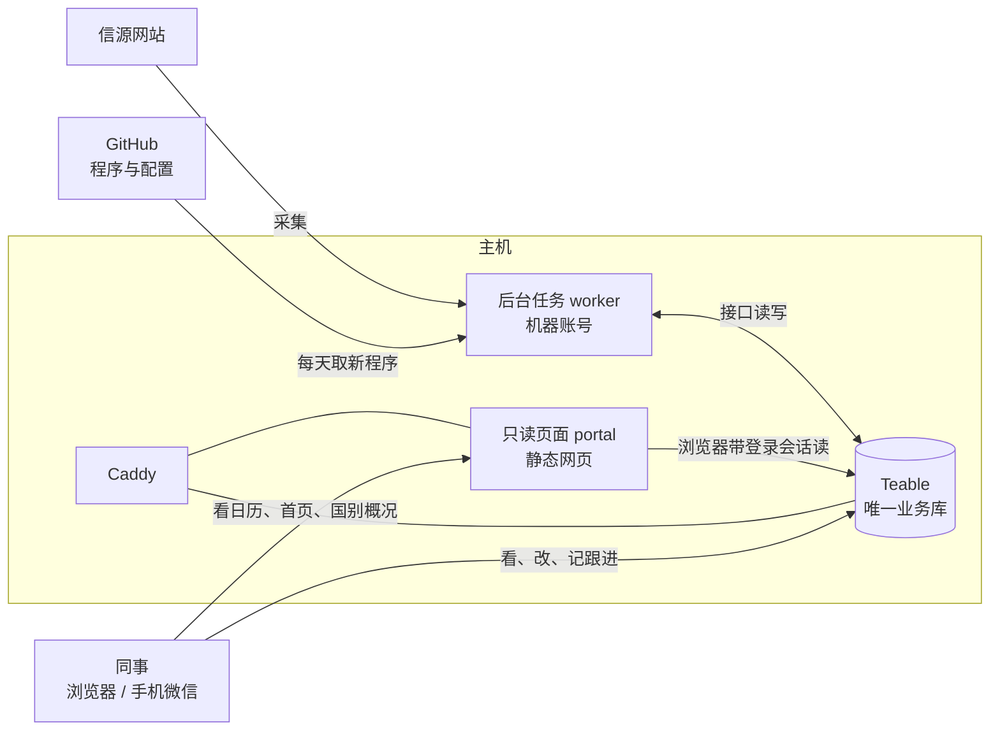

# 架构方案(2026-10-03):一个库、一个后台、一组只读页面

> 依据:[本体 v1.2](ontology/本体.md)(机器可读版 [ontology.yaml](ontology/ontology.yaml))与使用方 2026-10-03 的四个决定——
> 唯一业务库为 Teable;商机的公开事实搬进 Teable;线索上不设进展、负责人、下一步、到期、结果原因;跟进记录必须关于商机。
> 本文交给执行者分阶段实施,第 8 节有每阶段的改动、验收与审查门。
>
> **阶段 0 修订(2026-10-03)**:按 [架构方案审查](架构方案审查_2026-10-03.md) 改。第一节 9 处必须改已写进下文(各处标「审查一-N」);
> 第二节 7 条建议写进相应阶段(标「审查二-N」);第三节 4 件按默认值写进第 12 节,使用方另有决定再改。

## 0. 一句话

**数据只在 Teable 一处;机器在后台读写它;自建页面只读。** 没有第二份数据,就没有同步、没有"等 30 秒"、没有"哪边为准"。

| | 现在 | 改造后 |
|---|---|---|
| 部件 | GitHub 定时任务、data 分支、main 分支台账 YAML 与内部叠加、服务器上的系统(Streamlit)、每 30 秒同步、部署密钥推拉、Mac 本机界面、Teable | **Teable**、**后台任务**(同一台主机上一个容器)、**只读页面**(静态网页)、Caddy |
| 业务数据在哪 | 3 处(data 分支、main 分支、Teable),一个商机散在 6 个文件或表里 | 1 处(Teable),每种对象一张表 |
| 人在哪里改 | 系统页面、Teable、Mac 本机界面都能改 | 只在 Teable 改 |
| git 放什么 | 程序、配置、业务数据 | 程序与配置(采集规则、提示词、报告模板、本体) |

## 1. 部件与职责



| 部件 | 做什么 | 怎么读写 | 取代现在的 |
|---|---|---|---|
| **Teable** | 存全部业务数据(七张表);同事在这里看、筛、改、记跟进;表格视图(待处理、待确认、建议商机、看板、日历) | 人在界面里读写;机器经接口读写 | 现在的表格 + data 分支 + 台账 YAML + 内部叠加 |
| **后台任务** | 采集、判定、归属、建议商机、更新事实、国别信息、生成报告、阶段变更记跟进、补全上传的线索 | 用**机器账号**的令牌经接口读写 Teable(内网地址 `http://teable:3000`) | GitHub 定时监测、自动入账、30 秒同步、台账出处补线索 |
| **只读页面** | 合并日历、首页漏斗与地图、国别概况;每条记录都能"在表格里打开" | 浏览器里的脚本带着登录 Teable 的同一个会话直接读 Teable 接口,**不写** | 现在服务器上的系统(Streamlit) |
| **Caddy** | HTTPS;`/portal` 给只读页面,其余给 Teable;没登录的先去 Teable 登录页 | — | 已有,改路由 |
| **GitHub** | 存程序与配置;CI 跑测试;后台任务每天 08:00 从 main 取新程序 | 主机只读拉取 | 不再存业务数据,不再有机器人提交 |

去掉的:data 分支的写入(保留只读归档)、台账 YAML 与内部叠加的维护(迁入后归档)、30 秒同步与同步状态、服务器上的 Streamlit 系统、
Mac 本机界面、部署密钥的写权限、GitHub 定时监测(改成手动备用)、表格「每日摘要」表(由信源的最近采集与状态、待处理视图替代,不迁,见第 12 节 B)。

## 2. 设计原则(都来自本体)

1. **一份数据**(R1):写只发生在 Teable。后台任务不另存业务数据;页面不写。
2. **写入分人机**(R2):机器用单独的**机器账号**,修改历史里一眼分得清;机器**只填空值、只新建记录、列表只追加**——列表类字段(资金、标段、
   参与方、外部编号、别名、待核实)可追加新项(键 = 出处线索号 + 规范化文本),不改不删已有项;标量字段(名称、公开进度、资格、规模)只填空;
   发现与已有值不同的新信息,写进商机的「待核更新」,人确认后改。例外只有两类:机器自己的运行状态(信源最近采集与状态、报告生成状态),
   按期替换的国别指标(带年份与来源)。(审查一-4;列表只追加按第 12 节 D 的默认)
3. **人否定机器值有固定做法**(R2,审查一-2):线索只在「处理状态 = 待处理且判定方式为空」时判定一次,判过的永不回头,重判定只能在命令行显式执行——
   人改了、清空了的值不会被填回;商机上人要否定机器值时写明确的文字(「无」「不详」),不清空(清空即空值,机器会再填)。写进《表格使用说明》。
4. **派生不存**(R10):能在 Teable 里做成汇总、查找、公式字段的就做;做不了的(跨表合并的日历、漏斗)在只读页面里现算。
5. **页面只读**:自建页面没有任何写操作;要改,点"在表格里打开"。
6. **后台无状态**:去重、归属、"上次做到哪"都从 Teable 读(线索号、原文网址、判定方式、信源最近采集、报告生成状态);本机只缓存可再生的东西(网页原文)。
7. **两把令牌,各管各的**(审查一-1):
   - `TEABLE_TOKEN`:**机器账号**(编辑者)的令牌,只进主机 `worker.env` 与 GitHub secrets;后台任务、命令行(`core.cli run …`)只用它。
     切换之前 GitHub 里的 `TEABLE_TOKEN` 还是旧系统在用的管理员令牌,机器账号的先存成 `TEABLE_BOT_TOKEN`,阶段 F 再换名。
   - `TEABLE_ADMIN_TOKEN`:**管理员**的令牌(建库、建表、补字段、补视图要空间的创建者或所有者),只在执行会话或操作者本机跑
     阶段 A 的能力核验、阶段 B 的 schema、阶段 C 的迁移,**不进服务器**。
   - 两者都配 `TEABLE_URL`;同一套代码,在主机上定时跑,开发时在本机连同一个库手动跑。

## 3. Teable 表结构(由 ontology.yaml 生成)

**七张表**:线索、国别、商机、跟进记录、信源、时间节点、报告。**成员不建表**:就是 Teable 的空间成员;角色对应——管理员 = 所有者或创建者,
跟进人 = 编辑者,只读 = 查看者;负责人、记录人用 Teable 的"成员"字段。可见范围:全部门可见,不拆库(第 12 节 A)。

**生成方式**:`core/schema.py` 读 ontology.yaml(经 `core/ontology.py`),加一份 Teable 专用的映射 `docs/ontology/teable_map.yaml`(主字段、视图、
派生字段公式),在库里建表、补字段、补视图;只增不删,可重复运行。每个字段的描述写上写入方("机器写"或"人写")与本体里的说明。
建好后把库、表、字段、视图的编号写进 `portal/config.json`(只读页面与后台任务按编号取数,改字段名不坏)。

**类型映射**:

| 本体类型 | Teable 字段 |
|---|---|
| text / url | 单行文本(url 显示为网址) |
| longtext、list | 长文本(list 一行一项;公开事实句末标出处线索号,如 `[a1b2c3d4]`;机器只往末尾追加新行) |
| date / datetime | 日期(Asia/Shanghai;datetime 含时间) |
| pdate(可只到月、季、半年) | 日期(取区间起点,供日历)+「日期原文」单行文本(如 `2027-H2`)。截止类取起点偏保守(最晚启动更早),可接受;日历与表里同时显示日期原文(审查二-2) |
| number / bool | 数字 / 勾选 |
| enum / enums | 单选 / 多选 |
| file | 附件 |
| link:X / links:X | 关联(单条 / 多条);Teable 自动生成反向关联 |
| link:member | 成员字段(Teable 用户) |

**主字段**(每表第一列):线索 = 标题;国别 = 国名;商机 = 名称;跟进记录 = 公式"日期 · 记录人 · 内容前 40 字"(长文本未必能做主字段,阶段 A 核验;审查二-5);
信源 = 名称;时间节点 = 公式"类型 · 日期原文";报告 = 公式"类型 · 范围 · 日期 · 版本"。

**派生字段**(R10,Teable 里算,我们不写):

| 表 | 字段 | 做法 |
|---|---|---|
| 线索 | 最近截止 | 汇总:关联的截止类时间节点里未过的(状态不是「已发生」且日期不早于今天)最早一个(辅助公式「未过截止」) |
| 线索 | 写进的报告 | 报告「引用的线索」的反向关联 |
| 商机 | 所属线索数 | 计数:线索「所属商机」的反向关联 |
| 商机 | 下一时间节点 | 条件查找(`isConditionalLookup`):时间节点里「商机 = 本行」且未过的(状态不是「已发生」、日期 ≥ 今天),按日期取最早一个 |
| 时间节点 | 最晚启动(辅助) | 公式:未过的节点,日期 − 该类节点的内部流程周期(profile 的 lead_times 写进公式)(审查二-1) |
| 商机 | 最晚启动 | 汇总:时间节点的「最晚启动(辅助)」取最早(审查二-1;比在商机上用两个条件查找再 IF 简单) |
| 商机 | 最近跟进、当前判断、下一步、下一步到期 | 条件查找(`isConditionalLookup`,核自 Teable 源码):经关联的查找只收 filter、不收 sort 与 limit,"最近一条"要用条件查找——不经关联字段,filter 里写「跟进记录.商机 = 本行」(值写 `{type: field, fieldId: 本表主字段}`),按日期倒序取 1 条;建完查回显,旧版本静默丢掉 sort、limit 的删掉字段、记警告、改由后台算(第 9 节) |
| 商机 | 阶段修改人、阶段修改时间 | "最后修改人 / 最后修改时间"字段,**只跟踪「我方阶段」**(`trackedFieldIds`;A18 用) |
| 国别 | 线索数、商机数 | 计数 |

"未来" = 状态不是「已发生」**且日期不早于今天**(TODAY();实施审查三-A,使用方 2026-10-03 定的 (a)):线索里抽出的截止日没人会去改状态,只按状态算会一直当未过期。
TODAY() 是公式时区里的当天零点、IS_BEFORE 不给单位时按天比(核自 Teable 源码)。Teable 源码里没有按天重算公式的任务,隔天重不重算在阶段 A 第二天用
`scripts/teable_probe.py --recheck` 实测;不重算就做 (b):后台每天把日期已过、状态为官方计划 / 推断的节点改为「已发生」(机器改自己写的字段,本体 R2 加一条例外),
改状态会触发重算,公式照样对。

**表格里的视图**:

| 表 | 视图 |
|---|---|
| 线索 | 待处理(V1:相关且待处理,按最近截止)、待确认归属(V2)、按国别、全部 |
| 商机 | 建议商机(V3)、跟踪看板(V4:按我方阶段分列,拖动即改阶段)、按国别、待核更新(不为空的)、全部 |
| 跟进记录 | 全部(日期倒序)、按商机、日历 |
| 时间节点 | 日历、14 天内 |
| 国别 | 全部、重点国 |
| 信源 | 全部、异常(最近状态不是正常) |
| 报告 | 全部、待生成 |

合并日历(V5)、首页漏斗(V6)、国别概况(V7)在只读页面里。

## 4. 后台任务(worker)

**运行方式**:主机 compose 里一个容器 `worker`(取代现在的 `app` 容器);镜像带 Python 依赖与 pandoc;机器账号令牌(`TEABLE_TOKEN`)与模型密钥放
`/opt/teable/worker.env`(只 root 可读;管理员令牌不放这里);主机定时任务每天 08:00(采集之前)从 GitHub 只读拉取 main,有新程序就重启容器。
容器启动时把超过 30 分钟仍是「生成中」的报告改回「待生成」,重启不会丢活。

| 任务 | 本体行为 | 何时 | 读 | 写(只填空、只新建、列表只追加;运行状态与国别指标除外) |
|---|---|---|---|---|
| 采集与判定 | A01、A03 | 每天 08:30(北京) | 启用的信源;线索的线索号与原文网址(去重);商机的编号、别名、外部编号(挂接) | 新线索;**只判「待处理且判定方式为空」的线索**,判完写判定方式;判定字段;时间节点(按"所属 + 类型 + 日期原文"去重);所属商机(可靠且为空时);信源最近采集与状态 |
| 建议与更新商机 | A06、A07 | 判定之后,只对这一轮刚判定的线索 | 相关线索、可能新项目、所属商机 | 先挂接后新建的建议商机(过门槛的);空着的事实;列表的新项;新时间节点;出处线索;待核更新 |
| 补全上传的线索 | A03(R8) | 每 2 分钟 | 来源方式 = 用户上传且判定方式为空的线索 | 标题、摘要、国别、日期;判定方式 = 不判定 |
| 阶段变更记跟进 | A18 | 每 2 分钟 | 商机的我方阶段与阶段修改人、时间;它最近一条带阶段变更的跟进 | 新跟进记录(阶段变更、记录人、日期、"从 X 改为 Y")——条件见下 |
| 生成报告 | A14 | 每 2 分钟看待生成;周一 09:00 自建周报,每月 1 日 09:30 自建月报 | 报告表待生成的行;国别、商机、线索、跟进、时间节点 | 报告文件(附件)、引用的线索与商机、生成状态 |
| 国别信息 | A11 | 每月 1 日;新国别出现时 | 世行、IMF 接口;reference 里的基础与水务资料 | 国别的机器字段(指标按期替换;机构、国企、法规列表只追加) |
| 到期提醒(可选) | E5 | 每天 | 14 天内的时间节点与下一步到期 | 在商机记录下发一条评论并 @负责人(Teable 站内通知),不发邮件 |

"每 2 分钟"只是看看有没有要机器处理的新事,读的是同一个库,没有第二份数据要对齐。之后可以再省掉:在 Teable 自动化里配"新建记录 → 发请求给 worker",即时处理。

**只新建的去重键**(审查一-5):
- 时间节点:所属(商机 / 线索 / 国别)+ 类型 + 日期原文;已有的只补空着的出处线索与说明。
- 建议商机:先挂接——外部编号 → 别名 → 名称相近,挂上的写进线索的建议所属商机(外部编号吻合的算可靠,所属商机为空时代填);都挂不上才新建,
  商机编号 = 该国表里现有最大序号 + 1(从表里读,不另存计数);新建后把这条线索的所属商机填上。

**待核更新**(审查一-3):一行一条提议,格式「[线索号] 字段:新值(现值:…)」,键 = 出处线索号 + 字段;机器只追加表里没有同键的行
(含人驳回的);人驳回在行首加 `✗` 并保留,机器见 `✗` 不再提;人采纳后改事实、删该行。

**阶段变更记跟进的条件**(审查一-6):只在「阶段修改人」不是机器账号、且当前阶段与最近一条阶段变更不同时记;没有阶段变更跟进的视为「建议」
(初始阶段)——机器建的建议商机、迁移进来的商机都不会多记;人直接以「跟踪中」等新建的商机,第一条记"立项为 X";迁移时按旧系统操作记录写出
阶段变更跟进作为历史(第 6 节);两次检查之间(2 分钟)连改两次只记最后一次,可以接受。

**建议商机的门槛**(A06,防止一条新闻建一个商机):国别为重点或市场国,领域为核心领域(供水、污水、海水淡化、雨水排涝、水环境;
灌溉与防洪看 profile 的口径),类别为招标、意向书、资格预审、采购公告、融资或立项。没过门槛的可能新项目留在「待确认归属」,人决定建不建。

**写入层**:`core/tstore.py` 是唯一和 Teable 打交道的地方(审查一-7)。阶段 B 先做客户端:分页读(单次最多 1000 行)、按条件查(`filter`、
`projection`、`fieldKeyType=id`)、计数、批量建与批量改(每批 ≤ 200)、上传附件、失败重试——schema 与迁移都用它;阶段 D 再加
`fill_empty(记录, 值)`(只写空字段,不同的值返回给调用方写进待核更新)、列表追加(按键去重)、待核更新追加(按键去重、认 `✗`)。
写前读最新值、读完立即写,减少与人同时编辑的冲突(08:30 基本无人编辑)。所有机器写都经过它,单测覆盖"只填空、列表只追加、待核更新去重"。

**命令行**:`python -m core.cli run collect|suggest|enrich|stage-log|reports|countries` 与主机上的定时调用同一段代码;
GitHub 的 monitor 工作流改成只能手动触发,作为主机出问题时的备用(用 secrets 里的 `TEABLE_URL`、机器账号令牌)。

## 5. 只读页面(portal)

- **形态**:静态文件(HTML + JavaScript + ECharts,全部本地托管,不走公共 CDN),放在主机 `/opt/teable/portal/`,Caddy 在 `/portal/` 提供;
  没登录先到 Teable 登录页(沿用现在 `app.caddy` 的 forward_auth 做法)。根网址 `/` 转到 `/portal/`。
- **取数**(审查一-8):浏览器里的脚本带着登录 Teable 的同一个会话(同域 cookie)直接读 Teable 接口,看到的就是这个人在表格里有权看的;
  不需要令牌、不需要服务器程序、没有缓存副本。**不整表下载**(接口单次最多 1000 行,线索一年过万):
  - 漏斗按级计数:`/api/table/{表}/aggregation/row-count` 带 `filter`(每级一个条件),需要分组的用 `/aggregation`;
  - 日历只取窗口内日期(`filter` 按日期范围);国别页按国别 `filter`;
  - 一律 `fieldKeyType=id`,表、字段、视图的编号由 `core/schema.py` 写进 `portal/config.json`——同事改了字段名页面也不坏。
- **三页,按这个顺序做**(第 12 节 C):
  - **日历**(最核心,表格做不了):跟踪商机的时间节点 ∪ 跟进记录(日期、下一步到期)∪ 报告(日期),按商机、负责人、国别筛;
  - **首页**:漏斗(桑基图:信源 → 相关 → 属于商机 → 跟踪商机 → 写进报告,每级数线索)+ 世界地图(`world.geo.json`,中国口径,阶段 E 从
    `app/static/` 搬进 `portal/`,否则阶段 F 删 `app/` 时丢;审查一-7)+ 最新报告。"写进报告"沿用 2026-10-03 定的口径:线索的「写进的报告」不为空——
    A14 生成报告时,「引用的线索」写成正文直接引用的线索 ∪ 写进的商机**当时**的所属线索(快照,R9),所以所属商机写进了报告的线索也算,
    报告之后才入库的自然不算;
  - **国别概况**:国别信息 + 该国商机(按阶段)+ 线索统计;做好之前先用国别表的记录展开页代替。
- 每条记录旁有"在表格里打开";链接格式按 Teable 实际路径(`/base/{库}/{表}/{视图}?recordId={记录}`)在阶段 E 核验。页面没有任何写操作。

## 6. 数据迁移(一次性,进新库)

**新建一个库**(同名加"新版",即「水务项目机会 新版」),迁移、核对都在新库里做;旧库与旧系统照常运行到切换那天,切换后旧库改名"旧版·只读"。
迁移脚本 `scripts/migrate_to_teable.py` 用管理员令牌(`TEABLE_ADMIN_TOKEN`),经 `core/tstore.py` 读写;可重复运行(按线索号、商机编号增量),
先 `--dry-run` 出对账报告,再写。**对账的差异(含旧库比数据分支多出的 28 条)在审查门 1 之前要有结论,不能带着差异迁**(审查二-7)。

| 新表 | 从哪来 | 怎么转 |
|---|---|---|
| 线索 | data 分支 `watch/signals/`、`watch/submitted/`;旧库线索表 | 按线索号合并。**先对账**:数据分支 394 条、旧库 422 行,差的 28 条查清来历(多半是"台账出处补成的线索",在 `watch/submitted/`)。判定结果 → 机器字段,判定方式按旧的"模型 / 规则"写,台账出处与人工提交的写"不判定";处理状态、备注 ← `triage.yaml` 与旧库;旧库线索上的进展、负责人、下一步 → 所属商机或它的跟进记录,没有商机的写进处理备注 |
| 商机 | main 分支 `countries/*/ledger.yaml`(29 项)与 `sources.yaml`;`private/overlay/*.yaml`;旧库商机表(4 行) | 公开事实 → 机器字段(资金、标段、建设内容等列表转长文本,句末标出处线索号);ids → 外部编号;aliases → 别名;优先级、负责人、内部备注 ← 叠加与旧库;我方阶段:旧库与操作记录里设过进展的取当前进展,台账里标为不在业务范围的取"不跟进",其余"建议" |
| 线索(出处) | `sources.yaml` 里有网址的出处 | 原文网址还不是线索的,建成线索(信源"台账出处",已处理、相关、判定方式"不判定");关联到商机的出处线索。没有网址的出处(如内部成稿 R 编号)保留为长文本里的引用说明 |
| 时间节点 | 台账 milestones;标段的发布与截止;线索抽出的截止日;台账 events(投资论坛) | 部分日期 → 日期取起点 + 日期原文;状态照搬;出处 → 线索;论坛等关联国别;按"所属 + 类型 + 日期原文"去重 |
| 跟进记录 | 旧库跟进记录表(4 行);操作记录里带说明的进展;**操作记录里的进展变化** | 关联商机;记录人按显示名对上 Teable 账号,对不上的写进内容;进展变化写成带「阶段变更」的跟进(历史),每个不是"建议"的商机最后一条阶段变更等于它迁入时的阶段——A18 不会再补记(审查一-6) |
| 国别 | `reference/country_basics.yaml`、`country_water.yaml`、`countries.yaml`;最近一期世行、IMF 快照;`private/markets.yaml` | 用 `core/country_facts.py` 合成一国一行;范围 = 出现在线索、商机里的国别 ∪ 市场国别 |
| 信源 | `countries/*/watch.yaml`、`global/watch.yaml`、`watch/sources_user.yaml`、`watch/state.json` | 一个信源一行;**怎么抓**(选择器、翻页、附件)仍在 git 的 watch.yaml,按信源编号对应;**抓不抓、抓得怎样**在表里 |
| 报告 | data 分支 `reports/`;`private/reports/`;旧库报告表(13 行) | 「文件名」作标识(机器写,A14 生成时也写;附件上传失败也认得出这一行,重跑不重复建);Word 作附件;引用的线索号从同名 Markdown 里解析一次,写成关联;国别报告、项目报告按 10.22 的口径把写进的商机当时的所属线索也写进「引用的线索」 |
| (国别备注) | 叠加里的 country_notes、intel、actions | 按日期并进国别备注(国别级的事不是跟进记录,R7) |
| (不迁) | 旧库「每日摘要」表(5 行) | 旧同步的推送记录;新架构里由信源的「最近采集 / 最近状态」与待处理视图替代(第 12 节 B) |

**迁移时的取舍**(实现时定的,对账报告里逐条列出,审查门 1 请看):台账的「市场准入与竞争」(access)写进国别的同名属性(本体 v1.2,使用方 2026-10-03 定的);
线索简报归为「月报」(使用方同意);国别「市场分级」只填市场 / 其他,「重点」由人在表格里标;内部叠加的业务线、我方角色、判断、建议动作、情报并进商机的「内部备注」;不在业务范围与「不列入」的商机
我方阶段为「不跟进」并补一条阶段变更跟进;待确认归属(V2)里已处理的「可能是新项目」不再提(同旧系统);旧操作记录里对不上账号的操作人写进内容,
知道是谁的用 `--alias 旧名=表格显示名`;台账出处里 D 级、内部成稿、没有网址的不建线索,在长文本里写成〔编号〕。

**核对清单**:各表条数与对账报告一致;每个商机至少一条出处线索;抽查 10 个商机(含 AZE-003 苏姆盖特)的事实、节点、出处逐项对得上;
看板、日历视图打开正常;旧库 4 条跟进记录都在;每个不是"建议"的商机最后一条阶段变更等于它的我方阶段。

## 7. 删除与归档(切换后)

- **代码**:`app/`(整个 Streamlit 系统与 Mac 启动脚本)、`core/live_sync.py`、`core/ledger_edit.py`、`core/ledger_auto.py`、`core/ledger_leads.py`、
  `core/sync.py`(git 推拉)、`core/teable.py` 的同步部分(客户端已在 `core/tstore.py`)、`core/watch/store.py` 的文件存储部分、
  `deploy/teable/app_*`;`core/report.py`、`core/project_report.py`、`core/watch/reporting.py` 改为从 `tstore` 取数。删 `app/` 之前确认
  `world.geo.json` 已在 `portal/`。
- **数据**:data 分支停止写入,只读保留到对外公开前按 `docs/PUBLISHING.md` 删除;`countries/*/ledger.yaml`、`sources.yaml`、`private/overlay/`
  迁移后删除(git 历史里有);GitHub 部署密钥改为只读。
- **文档**:README 改写;`docs/本机界面使用说明.md` 换成「表格使用说明」(同事)与「运维说明」(管理员);旧的改造计划标注"已被本方案取代"。
  《表格使用说明》一页纸要写明:线索不删、只标已忽略(删了机器会重采;误删了在 Teable 回收站恢复;审查二-6);进展在商机上改;跟进必须选商机;
  否定机器写的值写「无」「不详」,不清空;待核更新驳回时行首加 `✗`,采纳后改事实、删该行。

## 8. 分阶段实施

每阶段小步提交,推送前跑 `ruff check core tests app scripts --line-length 140` 与 `.venv/bin/python -m pytest -q`;测试不联网(Teable 用
假接口);只在验收时连真实库,且只连**新库**。管理员令牌只用于阶段 A、B、C(执行会话或操作者本机),机器令牌只进 `worker.env` 与
GitHub secrets。审查门处停下,按第 10 节模板汇报。

**阶段 0 修订方案与本体(半天)**——已完成:按审查第一节改本文与 ontology.yaml、重生成本体.md(`docs/ontology/gen_md.py`)、`tests/test_ontology.py` 通过。

**阶段 A 能力核验、机器账号与固定版本(半天)**
- 在新库建试验表,逐项核验并记录结果(`scripts/teable_probe.py`,用管理员令牌;核验完删掉试验表):条件查找按日期倒序取第一条;
  最后修改人、最后修改时间只跟踪一个字段(`trackedFieldIds`);看板按单选分列且拖动生效(拖动在界面里人工确认);公式能不能做主字段(跟进记录用,审查二-5);
  按条件计数(`/aggregation/row-count` 带 `filter`)与单次读 1000 行;记录历史接口;附件上传接口;评论 @成员 的站内通知(人工确认收到);
  静态页面带会话读接口(阶段 E 部署时再在浏览器里确认)。
- **固定 Teable 版本**(审查一-9):记下当前运行的镜像版本,把 compose 里的 `ghcr.io/teableio/teable:latest` 换成按摘要固定
  (`deploy/teable/pin_teable.sh`,在主机上跑一次);升级改为手动动作,升级前重跑本阶段的能力核验。
- **建机器账号**(审查一-1):管理员在新库(或空间)生成**库级或空间级邀请链接**,用 `bot@<域名>`(不需要收信)按链接注册,设为编辑者,
  用它生成令牌(权限同 `install.sh` 的 scopes,不要建库、建表的权限)。
- 验收:能力核验表(行 = 能力,列 = 结果 / 后备做法);compose 已固定版本;机器令牌存进主机 `worker.env`(`deploy/teable/worker_token_from_mac.sh`)
  与 GitHub secrets(切换前名为 `TEABLE_BOT_TOKEN`)。操作步骤见 `deploy/teable/README.md`「新版(一个库)的准备」。

**阶段 B 表结构(1 天)**
- `docs/ontology/teable_map.yaml`(主字段、视图、派生字段公式);`core/ontology.py`(读本体与映射);`core/tstore.py` 的客户端(见第 4 节"写入层",
  审查一-7);`core/schema.py`(建表、补字段、补视图,只增不删;建好写 `portal/config.json`)。
- 测试:由本体生成的字段与类型映射一致;重复运行不重复建;派生字段不出现在任何写入里;tstore 分页、按条件查、批量建、附件上传。
- 验收:新库七张表、字段、视图齐全,截图;`portal/config.json` 有全部编号。

**阶段 C 迁移(1–2 天)—— 审查门 1**
- `scripts/migrate_to_teable.py`,按第 6 节,经 `tstore` 读写;`--dry-run` 出对账报告(含 28 条差异的结论;试运行的一份在
  `private/migration/`)。可重复运行:按键增量,已有的行只补空字段;`--sync` 才按迁移数据覆盖。行靠内容识别,同事改过的行再跑会重复建:重复运行(含 `--sync`)只在切换前、同事还没用新库时;
  阶段 F 的增量迁移在冻结旧系统之后、通知同事之前做一次(审查二-4)。
- 验收:第 6 节核对清单全过;对账报告与核对结果一起交审查;差异都有结论(审查二-7)。

**阶段 D 后台任务(2–3 天)**
- `core/tstore.py` 加 `fill_empty`、列表追加、待核更新追加;`core/jobs/`(collect、suggest、enrich、stage_log、reports、countries)、`core/worker.py`(定时循环);
  采集器、判定、挂接沿用 `core/watch/` 现有逻辑,只把读写从文件换成 `tstore`;报告生成改为从 `tstore` 取数。
- `deploy/teable/worker.Dockerfile`、compose 的 `worker` 服务、`worker_install.sh`、`worker_update.sh`。
- 测试:每个任务用假接口跑一遍;"只填空""列表只追加""待核更新去重与 ✗";A18 不重复记(机器建的、迁移进来的、2 分钟内连改);待生成报告只生成一次。
- **并行期**(审查二-4):实跑一整天之前,先把旧 GitHub 定时监测改成手动(或错开时间),不要两套程序同时抓同一批信源。
- **运行告警**(审查二-3):每次采集成功后 ping 一个 dead-man's switch(healthchecks.io 之类,免费档),一天没 ping 就发邮件给管理员;
  另规定有人每天看信源「异常」视图。
- 验收:在新库实跑一整天(采集、判定、建议、阶段变更、周报各至少一次),日志与新增记录截图;告警配好并演练一次。

**阶段 E 只读页面(1–2 天)—— 审查门 2**
- `portal/`(日历 → 首页 → 国别概况;`config.json` 由 schema 生成;`world.geo.json` 从 `app/static/` 搬来)、Caddy 路由(`/portal/`、根网址转向、forward_auth)。
- 验收:三页截图;未登录跳登录页;以只读成员登录只看得到它有权看的;页面里没有任何写请求、没有整表下载(浏览器网络面板核对);"在表格里打开"的链接能打开那条记录。

**阶段 F 切换与清理(1 天)—— 审查门 3(完成)**
- 冻结旧系统(停 `app` 容器的同步、GitHub 定时监测改为手动)→ 增量迁移一次 → 启用 worker → 旧库改名"旧版·只读" → 通知同事新网址与《表格使用说明》→
  按第 7 节删除与归档。
- **回退**(切换后一周内):旧库、旧容器、data 分支都还在;重新启动 `app` 容器、恢复 monitor 定时即可回到旧系统。回退后,切换期间新库里新增的数据
  **不回流**旧系统(要的话人工补录)(审查二-7)。
- 验收:新系统连续跑三天无异常;第 7 节清单完成;README 与使用说明更新。

## 9. 风险与后备

| 风险 | 后备 |
|---|---|
| Teable 某项能力在本实例上不支持(阶段 A 核验) | 含 TODAY 的公式与 today 筛选隔天不重算:后台每天把过期节点改为「已发生」(第 3 节);条件查找不行:最近跟进、当前判断、下一步由 worker 填(标注"后台算");只跟踪一个字段的最后修改人不行:A18 改读记录历史接口;看板不行:用按阶段分组的表格视图;公式不能做主字段:跟进记录主字段用单行文本"摘要",由人填 |
| Teable 自动升级改了接口或字段行为 | 镜像按摘要固定(阶段 A);升级改手动,升级前重跑能力核验 |
| 接口变慢或限流 | 批量读写、只取需要的字段、按条件计数、失败重试;七张表合计几千行,远在能力之内 |
| 后台任务挂了没人知道 | dead-man's switch 告警 + 每天看信源「异常」视图(阶段 D) |
| 编辑者能删记录 | 《表格使用说明》写"线索不删、只标已忽略";Teable 回收站可恢复 |
| 单台主机 | 每日数据库与附件备份(已有)与恢复演练脚本(已有);10 月 28 日到期前定是否换香港节点,迁移按 deploy 文档 |
| 同事习惯 | 《表格使用说明》一页纸:线索只标已处理或忽略;进展在商机上改;跟进必须选商机;否定机器值写「无」「不详」 |
| 公开事实质量下降 | 机器只填空、列表只追加;改已有值走待核更新;核实状态与出处线索在表里一眼可见 |

## 10. 汇报模板(每个审查门)

```
阶段:X   提交:<hash 列表>
做了什么:3–8 条,对应本方案的条目
证据:测试输出末两行;手工验收的命令与结果;截图
与方案不同的地方:哪项、为什么、替代做法
新发现的问题
需要使用方决定的
```

审查清单:数据只在 Teable(R1);机器写入全部经 `tstore` 且只填空、列表只追加(R2);派生字段没有被写(R10);页面没有写请求;密钥与令牌没进仓库
(管理员令牌也没进服务器);测试不联网;只动了新库;文档同步更新。

## 11. 不做

- 不给自建页面加写操作;不做任何双向同步;不在 git 里存业务数据;不保留 Streamlit;不引入 Teable 之外的第二个数据库;
  不改采集、判定、挂接的核心逻辑(只换读写的地方)。

## 12. 使用方拍板的事(审查第三节;先按默认,使用方另有决定再改)

| | 事项 | 现按 |
|---|---|---|
| A | 可见范围:空间成员看得到所有表,含内部备注与跟进记录。只读同事若不该看内部内容,要把跟进记录与内部字段放到第二个库,但会破坏"一个库" | **全部门可见,不拆** |
| B | 每日摘要表(旧库 5 行)的去向:它是旧同步的推送记录,新架构里由信源的「最近采集 / 最近状态」+ 待处理视图替代 | **废弃,不迁** |
| C | 只读页面的顺序:合并日历是表格做不了、也是最核心的诉求,先做;首页其次;国别概况可先用国别表的记录展开页代替 | **日历 → 首页 → 国别概况** |
| D | R2 改为"列表只追加":机器可往自己的列表字段追加新项,不改不删已有行 | **同意**(已写进本体 v1.2 与第 2 节) |

**实施审查(阶段 0–C)之后使用方定的(2026-10-03)**:

| | 事项 | 定了 |
|---|---|---|
| E | 过期的时间节点怎么算"未来"(实施审查三-A) | **(a) 公式用 TODAY()**(第 3 节);阶段 A 第二天实测不重算再做 (b) |
| F | 报告表加标识字段「文件名」(三-B) | 加(已做) |
| G | 台账的「市场准入与竞争」 | 国别加同名属性(本体 v1.2):机器写、列表、每条带出处 |
| H | 线索简报 | 归「月报」 |
| I | 国别的「市场分级」 | 迁移只填市场 / 其他;「重点」由人在表格里标(视图「重点国」按它筛),机器不写 |
| J | 旧操作记录里的「admin」 | 是管理员当时的表格显示名:迁移时 `--alias admin=<显示名>` |
| K | 怎么连真实新库 | 执行会话的环境变量 `TEABLE_URL`、`TEABLE_ADMIN_TOKEN`(新开的会话才读得到) |
| L | 线索的「处理备注」改长文本(三-C) | 改(已做) |
| | 三-D 条件查找不行时的后备 | 等阶段 A 实测 |
