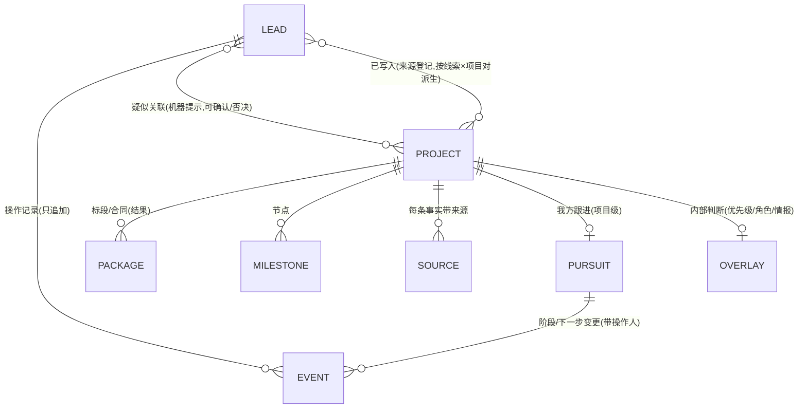

# 系统设计评审:线索管理、项目追踪器与我们的诉求(2026-09-27,评审稿)

依据 2026-09-27 的代码与数据快照(线索 288 条、判相关 200 条、处理标记 79 条、操作记录 19 条、自动写入 5 条;台账阿塞拜疆 24 项、摩洛哥 4 项),对照 GWI Project Tracker 公开页面、五家 CRM 官方文档、Shipley 与多边银行采购规则写成。36 条发现均经两名核实者核对,更正已并入正文;问题后括号里是发现编号(F01–F36),细节见附录 A,被否决或改向的子项见附录 B。

## 摘要

- **定位**:它不是"CRM 的一部分",是三层叠在一起——自动情报发现(GWI 和 CRM 都没有,已成形)、国别项目追踪器(数据接近 GWI 的项目记录,界面只是一张点不进去的表)、轻量 CRM 管线(几乎是空的:0 条进展事件,无负责人、下一步与结果)。
- **根因**:第二、三层之间没有接缝——线索上三枚各自独立的标记、两套"已写进台账"判据、进展挂在线索而不是项目上;第一层只看"在招",第二层没有"结果"入口,所以截标后不闭环;口径写在配置里,代码一处不用。
- **怎么融合**:借 GWI 的"项目为持续对象、状态=枚举+短句+更新时间+历史",借 CRM 的"主状态、负责人、下一步、到期、结果",不借 CRM 的概率、预测、必填与独立商机实体;目标模型见第四节。
- **先做什么**:第五节"立即(本周)"12 项全是半天到一天的小改,不改数据格式;第六节列了 11 件需要使用方拍板的事,最要紧的四件是自动评分、灌溉口径、金额口径、国别收口。

## 一、一句话定位

它不是"CRM 的一部分",也不是 GWI 的仿制品,而是三层叠在一起:

| 层 | 本系统里是什么 | 对应 GWI | 对应 CRM | 对应投标管理 | 现状 |
|---|---|---|---|---|---|
| 1 情报发现 | 每日采集 22 个信源→多语种初筛→模型判定与抽取→编号/名称挂接→可靠的才自动写入 | 没有,GWI 靠 40 位分析师人工筛(GWI 会员页) | "线索生成",CRM 的线索是人录的 | Shipley 第 0–2 阶段 | 已成形且免费:278 条候选全部判完,截止日抽取 237 条只 2 条不一致 |
| 2 项目追踪器 | 国别台账:项目本体(编号、别名、外部编号、阶段+短句、标段、节点、资金、参与方),每条事实带来源 | 就是 GWI 的项目记录(Progress 枚举+Status 短句+Project history) | "客户/项目档案" | 世行 P 号→公告→合同三层里的项目层 | 数据接近 GWI 最小字段集,界面只是一张 9 列的表,点不进去 |
| 3 轻量 CRM 管线 | 处理状态、跟踪进展(6 档,挂在线索上)、跟踪即入账、商机跟踪页 | 没有 | 线索状态→商机阶段→负责人→下一步→关闭原因 | Shipley 三道门、go/no-go、复盘 | 基本是空的:0 条进展事件,无负责人、下一步、到期与结果 |

一句话:第一层是别人给不了的;第二层数据对、界面缺;第三层还没开始。困惑(1)(2)(3)出在二、三层之间没有接缝,(4)(5)出在第一层只看"在招"、第二层没有"结果"。

## 二、对照矩阵

✓ 已具备;部分=有一半;✗ 没有。投标管理指 Shipley/Deltek/Unanet 一类做法。

| 维度 | 本系统 | GWI 项目追踪器 | CRM 线索管理 | 投标管理实践 | 一句说明 |
|---|---|---|---|---|---|
| 机会自动发现与初筛 | ✓ | ✗(分析师人工) | ✗(人录或表单) | ✗ | 独有 |
| 公告=事件、项目=持续对象、合同=结果 | ✓ | ✓ | 部分(线索/商机两层) | ✓(Deltek 自始以项目为记录) | 方向对 |
| 事实带来源、可剔除内部判断出公开版 | ✓ | 部分(history 无逐条来源) | ✗ | ✗ | 196/323 来源是成稿转引 |
| 项目状态:受控枚举+自由短句 | ✓ | ✓(Progress 7 档+Status) | ✓ | ✓ | "采购进行中"一档吞掉 GWI 三档 |
| 更新时间、进入阶段日期、项目历史 | ✗ | ✓(Updated 列、30 天新增徽章、Project history) | ✓(Date entered stage) | ✓ | 只有核实日期 |
| 项目详情页、"项目→它的线索"索引 | ✗ | ✓ | ✓(记录页+时间线) | ✓ | 月报有卡片,界面没复用 |
| 类型/规模/金额可筛 | 部分 | ✓(Category、B/O/F/I/D、m³/d、预估金额) | ✓ | ✓ | 体量已派生却不显示 |
| 纳入门槛与口径 | ✗ | ✓(公开门槛,如 WWTP≥10 万 m³/d) | 部分(评分) | ✓(先硬门槛后打分) | 口径写了,代码不用 |
| 线索单一生命周期状态 | ✗ | 不适用 | ✓(New→…→Qualified/Disqualified) | — | 三枚标记并列 |
| 我方跟进阶段(项目级) | 部分 | ✗ | ✓(商机阶段) | ✓(pursuit/won/lost/no-pursue) | 挂在线索上,0 人用过 |
| 负责人、下一步、到期 | ✗ | ✗ | ✓(owner、Next step、Next activity date) | ✓(capture manager) | 内部动作 owner 全"待定" |
| 投标资格与最晚启动(投标人视角) | ✓ | ✗ | ✗ | 部分(人填的 go/no-go 表) | 独有;依据只进报告 |
| 截标后结果:中标方、报价、原因、复盘 | 部分 | ✓(Bids submitted→Contract awarded) | ✓(Won/Lost 必填原因) | ✓(debriefing、赢率) | 阿塞拜疆已授标 12 个标段无一记合同金额;我方结果无处记 |
| 参与方/对手/伙伴结构化 | 部分 | 部分(只结构化 Client) | ✓ | ✓(对手、伙伴是一等实体) | 17 条参与方 17 种角色写法 |
| 去重:公告级 / 项目级 | ✓ / ✗ | ✓ | ✓(转化时查重) | ✓ | 同一项目多条公告各算一条 |
| 多人协作与操作留痕 | 部分 | 不适用 | ✓(owner、follower、时间线) | ✓ | 操作记录做对了;合并规则只在本机 |
| 报告输出 | ✓ | 部分(周刊) | 部分(仪表盘) | 部分 | 自动 Word 独有;答不出"在跟什么" |
| 自动评分 | ✗(明确不做) | ✗(门槛+标签) | ✓(规则式/预测式) | 部分(加权表) | 见第六节 |

## 三、主要问题与根因

按影响排序;每条:证据→根因→建议,括号里是对应的发现编号与使用方困惑。

**1. 线索没有"主状态",三枚标记并列,"涉及台账"被读成"已入账"(F06、F07、F13、F04;困惑 1、3)**
证据:卡片同时挂"涉及台账 ○AZE-007""✓ 已处理""进展"三枚独立标记,自动写进台账后卡片不变;○ 的提示叫人去台账页更新,但纯名称匹配的 ○ 不会出现在那里。79 条"已处理"里 60 条截止日还在未来——"已处理"只是"看过";5 条自动写入的线索在汇总里显示"●AZE-020"而非"已写入";○ 级 13 条全是地名子串命中,至少 9 条挂错。
根因:"看没看过"是唯一人工维度;"已写进台账"有两套判据(网址已登记 vs 人工核对记录),自动写入只满足其一;名称挂接是子串匹配,台账别名里大量是地名。
建议:①派生唯一主状态(待看 / 已看·去向 / 疑似关联 / 已入账·待过目 / 已入账·已确认 / 已转入项目跟踪 / 已忽略),只算不存、卡片只显示这一枚;"涉及台账"改"疑似关联";有 ● 不显示 ○、判不相关不显示 ○——两条规则即可清掉现存全部 ○。②"已写进台账"按(线索, 项目)对从现有记录派生。③别名拆"专名/地名",地名单独不挂接。处理状态保留三值,只加可选去向与原因。

**2. "我方跟进"没有宿主:进展挂在线索上,没有负责人、下一步与到期(F24、F08、F09、F02、F05;困惑 3、6)**
证据:0 条进展事件;台账项目没有任何"我方"字段(它的 owner 是业主);内部判断在 overlay,20 条行动 owner 全是"待定"或空,界面不读;阿塞拜疆 9 个有最晚启动的项目 7 个已过(最多 223 天),记不了"已决定以分包身份跟";AZE-021 挂 5 条线索,进展只能设其一;几台 Mac 共用一个身份。
根因:系统有两条状态轴——市场上项目的状态与我方的跟进——后者从未设计宿主。
建议:新增最小"跟进"记录,以台账项目编号为主键:{项目, 我方阶段(沿用 6 档), 负责人代号, 下一步, 到期, 决定(追/不追/观望), 原因, 备注, 时间, 操作人};线索的"设进展"改为"转入项目跟踪";商机跟踪页按项目一行;操作记录加操作人(本机一个岗位代号,一次设置、零手工)。CRM 通例:一条记录一个负责人,无下一步或已过期即高亮(HubSpot 商机属性页;Pipedrive 帮助"Rotting")。
争议:F05(反方)认为 0 条使用数据下改宿主是盲改;核实者否决其"备注前缀"替代,但同意概率、预测类别、邮件集成、丢单原因枚举、独立商机实体都不做。本报告取折中。

**3. 项目是不可点的一行:没有详情、更新时间与"项目→线索"索引(F15、F25、F14、F16;困惑 2、3)**
证据:台账表 9 列,业主、编号、资金、规模、参与方一律不显示;编号处处是纯文字;24 项核实日期全是 09-24,09-27 五次自动写入改了 4 个项目却没动它;"采购进行中"12 项里 5 项"已截标+待发布"并存,使用方只好把状态写进项目名。
根因:台账为报告而建,月报项目卡片已输出 GWI 详情页该有的一切,界面没复用;线索↔项目的三座桥全是线索→项目方向。
建议:台账页加"项目详情"(弹窗起步,复用报告卡片),下列涉及线索与操作记录;编号处处可点;派生"更新日"与"30 天内有更新"徽章,不加落盘字段(GWI 演示页的 Updated 列与 30 天新增徽章);阶段列按标段计数显示;stage_note 作为 Status 短句进表。争议:F25 要独立详情页,F15 只复用卡片;核实者收敛为"弹窗起步"。

**4. 口径写在配置里、代码一处不用:非市场国、灌溉、门槛以下与重点国等权(F18、F19、F21、F20;困惑 4)**
证据:台账页曾堆 68 条待核对,62 条是摩洛哥"可能的新项目"——其定义只是"模型说新且没挂上台账"(180 条),摩洛哥台账只有 4 项,必然几乎全部命中;288 条里 105 条(36%)来自 44 个非经营国别,79 次"已处理"有 34 次花在这些国家;profile 写灌溉不展开,模型提示词却把灌溉列为有用,5 次自动写入 4 次进灌溉项目;金额门槛与门户门槛不一致,155/200 条无金额。
根因:"不做自动评分"让规则门槛也没做;口径在漂移,直接接线会把正在跟的项目过滤掉。
建议:先定口径(第六节),再做"硬门槛标签+逐项解释"(国别、时间、合同性质先上),标签只筛选与折叠、不排序;监测默认方案只看市场国别,提醒页其他国别折叠成一行;"可能的新项目"改称"未对上台账",默认只列重点国+核心领域。GWI 正是公开门槛+标签+筛选、不评分(GWI 方法论页)。

**5. 截标之后不闭环:没有"记结果"入口,信源只到"在招"(F10、F11、F16、F17、F36;困惑 4、5)**
证据:门户采集器只查在招(塔拉 9 月 9 日截标即因此漏采),世行接口不取授标类型,EBRD/IsDB 的状态列没配变更跟踪;288 条里授标类 10 条、融资 0、立项 1;已截标 6 个标段全无中标方,阿塞拜疆已授标 12 个标段没有一个记合同金额(摩洛哥 2 个有签约价,但写成文字);模型抽取无业主、合同性质、招标编号、中标人;忽略的线索仍可设进展。
根因:采集器与台账都围绕"招标窗口"设计;标段截止后不推定;我方中标/未中标只是事件值,不回写台账。"过期信息有什么意义"的答案就是结果。
建议:①派生"已截标(推定)"与"待记结果"(截止后 45 天无中标方),只显示不落盘;②轻量"记结果"弹窗:中标方(机构)、中标价、我方结果、原因、来源→台账写事实,跟进记录写我方报价与原因;③忽略与进展互斥;④世行授标另建独立信源(占世行接口 74% 的公告),IsDB/EBRD 配状态变更跟踪,授标类线索进提醒页"结果"节;不写门户"结果回访"(结果栏目实测为空);⑤模型抽取加业主、合同性质、招标编号、中标方、投标人(只记机构)。世行授标公告本身含中标人与各家评标价(世行采购条例第 7 版 5.93)。

**6. 项目身份没有查重规则,挂接靠名称弱匹配(F12、F13、F03;困惑 1)**
证据:阿塞拜疆 24 项 15 项无外部编号,3 项连英文名和别名都没有;30 个世行项目号各有 ≥2 条线索共 76 条;线索里的项目号只当正则文本碰台账编号;跟踪即入账只查线索自己的挂接,两条未挂接线索先后设进展会建出两个项目。
根因:线索去重有效(跨信源重复 0),项目层只查编号唯一;GWI 是 1,556 条而不是几万条,因为按项目计数。
建议:采集时把世行 P 号、门户编号、EBRD 项目号归一成线索外部编号,挂接先精确匹配;无编号项目校验告警;跟踪即入账前查同编号或同业主+相近名称,命中即挂接,模糊命中只提示;按项目折叠放后一期。

**7. 多人同步的脆弱点:机器人当天的运行可能整个丢失(F23、F26、F04)**
证据:追加文件的合并规则只写在各 Mac 本机,data 分支没有 .gitattributes;机器人与本机都整文件重写台账核对文件。当天有自动写入、且运行期间有人推送了事件时,机器人提交 data 分支会失败退出(09-27 有 5 条自动写入和 1 条系统标记,运行期间恰好无人推送,所以没有触发):线索、状态、提醒页全不提交,而台账已推到 main,自动写入记录永远补不上。
建议(都是 S):data 分支提交 .gitattributes 给两个追加文件配 union;提交 data 拆成监测后、自动写入后两次;运行开始时对账,缺记录的补成"待过目·记录缺失"。全量"三文件合一"推迟。

**8. 报告答不出管理层的问题,摩洛哥连周报都没有(F22、F30、F09)**
证据:周报只对配了国别信源的国别生成,摩洛哥无国别配置,于是没有周报;周报无我方动作;月报动作清单 owner 全"待定";最晚启动不进预警与周报。
建议:周报条件改为"有台账或有信源",空周不出;周报与月报各加"管线与决定"一节;预警页加"内部动作"与"最晚启动(估)"。争议:F30 主张关周报,核实者否决(不调模型、不用人动手,关掉省不下成本)。

**9. 其他两组(F04、F32;F29、F34、F35)**
蔓延与弹窗:两天 29 次提交,页面 7→12;详情弹窗十余段,"设进展"在最底。建议一个月内不加页面、卡片标记与词表(不冻结项目级视图),弹窗做四步小改。信源健康与模型自检:信源只记"本次条目数与出错",选择器半失效、连续无新增都不报警;补判窗口绑在 14 天上,超上限会留白(目前是风险不是事实)。建议加新鲜度与骤减报警,补判窗口独立为 60 天。

## 四、建议的目标模型

**1. 实体与关系**

| 对象 | 性质 | 存哪 | 不变量 |
|---|---|---|---|
| 线索 | 事件,不可变 | data 分支 | 只能被判定、挂接、处理;主状态派生不落盘 |
| 项目(台账) | 市场上的持续对象 | main 国别目录 | 只写带来源的公开事实;不放责任人、概率、我方阶段、丢单原因 |
| 标段/合同 | 结果 | 台账内 | 中标方、金额、授标日、投标人只记机构 |
| 跟进 | 我方对某项目的动作与阶段 | data 分支追加文件(建议,需决定) | 一项目一条现值;负责人只存岗位代号 |
| 内部叠加(overlay) | 优先级、角色、判断、情报 | main 私有目录 | 界面只读(需决定),公开版剔除 |
| 操作记录 | 追加日志 | data 分支 | 只追加,带操作人与项目编号 |
| 派生 | 资格、最晚启动、主状态、更新日、类型标签、推定已截标 | 不存 | 只算不写回 |

四条规则写进 README/SYSTEM_PLAN:派生不写回;判断进内部叠加或 data 分支;事实进台账并带来源(校验器加告警);动作进追加日志。新功能先答"改哪个对象"。数据质量轴(核实状态、来源等级)独立显示。

**2. 两条状态轴与词汇表**

| 轴 | 挂在 | 取值 | 谁推动 |
|---|---|---|---|
| 项目状态(市场轴) | 台账项目、标段 | 项目九档不改;"采购进行中"按标段计数显示 意向书征集中 / 资格预审中 / 招标中 / 已截标(推定)/ 已授标;标段:待发布 / 在招 / 已截标 / 已授标 / 取消;节点加"融资关闭" | 公告与人;截止日到期自动推定、人确认(GWI 方法论页) |
| 跟进阶段(我方轴) | 跟进记录(项目级) | 关注→跟踪中→准备投标→已投标→中标 / 未中标 / 放弃;决定:追 / 不追 / 观望;原因:价格 / 资格 / 伙伴 / 不投+自由文本 | 人;中标/未中标时同一动作把中标方(公开事实)写进台账 |
| 线索主状态(派生) | 卡片一枚 | 待看 / 已看·去向 / 疑似关联 / 已入账·待过目 / 已入账·已确认 / 已转入项目跟踪 / 已忽略 | 派生,不存 |

**3. 页面地图**

| 页 | 改什么 |
|---|---|
| 监测 | 默认"待办"方案(新增+7 天内截止,只看市场国别);卡片一枚主状态;弹窗四步小改 |
| 商机跟踪 | 按项目一行(市场阶段、我方阶段、负责人、下一步·到期),点开列全部线索 |
| 台账 | 项目详情弹窗(报告卡片+涉及线索+操作记录);加列:更新日、阶段计数、类型、规模、我方进展/负责人、优先级(只读);"记结果"弹窗 |
| 预警 | 加"内部动作""最晚启动(估)""待记结果" |
| 报告 | 周报覆盖有台账国别;周报/月报加"管线与决定" |
| 热榜 / 导览 / 分析 / 搜索 | 一个月内不动 |

**4. 自动与人工的分工**

| 机器做 | 人做 |
|---|---|
| 采集、初筛、判定与抽取、外部编号精确挂接、可靠的自动写入、更新日、推定已截标、待记结果提醒、硬门槛标签、信源健康告警、报告与引用核对 | 核对疑似关联、决定追不追与负责人、下一步与到期、记结果与原因、口径与别名维护、内部周期校正 |

## 五、优化路线

工作量 S=半天到一天、M=两到三天、L=一周以上;价值 H/M。

**立即(本周):全部 S,不改数据格式**

| # | 改什么 | 工作量 | 价值 | 前提 / 依赖 |
|---|---|---|---|---|
| 1 | 卡片一枚派生主状态;"涉及台账"改"疑似关联";有 ● 不显示 ○,判不相关不显示 ○(F06①、F13②) | S | H | 无 |
| 2 | data 分支 .gitattributes 配 union;提交 data 拆两次;运行开始对账缺失记录(F23、F26) | S | H | 无 |
| 3 | 本机 .env 加岗位代号,操作记录与提交身份带代号;机器人写"系统"(F08 最小版、F02) | S | H | 团队约定代号表 |
| 4 | 周报条件改为"有台账或有信源";空周不出(F22①、F30) | S | M | 无 |
| 5 | 监测默认方案只看市场国别;提醒页其他国别折叠(F21 展示层) | S | H | 六·4 |
| 6 | 台账页项目详情弹窗(报告卡片+涉及线索+操作记录);编号可点(F15/F25) | S–M | H | 无 |
| 7 | 派生"更新日"列+"30 天内有更新"徽章;阶段列按标段计数;stage_note 进表;项目名里的状态括注迁走;节点加"融资关闭"(F14、F16) | S | H | 无 |
| 8 | 派生类型(B/O/F/D)、规模、体量三列;默认隐藏参考项;加排序与资格筛选(F27、F31、F33、F28) | S | M | 无 |
| 9 | 文档:对象定义与不变量;"暂不做"清单;校验器加"事实缺来源"告警(F01、F05) | S | H | 无 |
| 10 | 内部周期校正——填数不是功能;校正前最晚启动标"估"(F03) | S | H | 使用方内部确认 |
| 11 | 世行授标独立信源、IsDB/EBRD 状态变更跟踪、门户截止日变更跟踪;授标类进"结果"节(F11) | S | H | 无 |
| 12 | 信源新鲜度与骤减报警;补判窗口独立为 60 天、重点国优先(F29、F34④) | S | M | 无 |

**近期(一个月内)**

| # | 改什么 | 工作量 | 价值 | 前提 / 依赖 |
|---|---|---|---|---|
| 13 | "已写进台账"按(线索, 项目)对派生,四处统一(F07) | S–M | H | 1 |
| 14 | 最小跟进记录+"转入项目跟踪"+商机跟踪按项目一行+台账"我方进展/负责人"列(F24、F09①) | M | H | 六·6;3 |
| 15 | "记结果"弹窗;派生已截标(推定)与待记结果;忽略与进展互斥(F10) | S–M | H | 无 |
| 16 | 处理状态加可选去向/原因;待办默认方案(F06②④) | M | M | 1 |
| 17 | 外部编号归一为一等键、挂接优先精确匹配、无编号告警、跟踪即入账前查重(F12) | M | H | 无 |
| 18 | 别名拆"专名/地名";挂接反馈事件(对/不对),否决的不再挂回(F13①③) | S+M | H | 与 13、15 一并定 |
| 19 | 模型抽取加业主、合同性质、招标编号、中标方、投标人(机构)(F17 第一步) | M | H | 三处提示词同改 |
| 20 | 硬门槛标签第一批:国别、时间、合同性质;"未对上台账"默认只列重点国+核心领域(F18) | M | H | 六·1–3 |
| 21 | 预警页加内部动作与最晚启动;周报/月报加"管线与决定"(F09②③、F22②③) | M | H | 14;六·5 |
| 22 | 参与方角色枚举化;弹窗四步小改(F36①、F32) | S | M | 无 |
| 23 | overlay 优先级/业务线只读进台账表(F20②) | S | M | 六·5 |

**以后(等数据或决定)**

| # | 改什么 | 工作量 | 前提 |
|---|---|---|---|
| 24 | 按项目折叠(一簇一行)与提醒页按簇分组(F12④) | L | 17 |
| 25 | 三文件合一、事件折叠现值(F23 全量) | L | 观察到真实丢标记后 |
| 26 | 规则排序,每条列依据(F19③ 方案 B) | M | 门槛跑一个月;国别三档 |
| 27 | 标段增投标人/授标日/合同期;容量字段;机构聚合视图(F36②④、F33 第二步) | M | 六·9;投标人记录>30 条 |
| 28 | 独立项目详情页;监测页左表右栏(F25、F32①) | M | 6、22 用几周后 |
| 29 | 扩国别:拆提示词、正文入缓存、按范围配额(F35) | M | 第三个专属门户国别立项 |
| 30 | 候选项目自动建(F19②) | M | 六·11 |

## 六、明确不做、需要使用方决定的事

**维持"明确不做",并新增几条(附理由)**
- 维持:门户全量抓取、绕过反爬/付费墙、付费聚合站、GIS(暂)。
- 新增:成交概率与加权金额、预测类别、阶段必填属性、邮件/日历集成、丢单原因枚举、独立"商机"实体——0 条进展、0 次投标,无赢率可校准;邮件日历与硬约束冲突;丢单原因先用自由文本+固定码(F05;负责人不在此列)。
- 新增:门户"结果回访"采集器(结果栏目为空);判断字段写进台账;为"像 GWI"加必填台账字段;跨信源线索合并(重复为 0);依据逐段校验与周报精确率(误报多)。

**需使用方决定(每项两种选择与后果)**

1. **自动评分——建议改为"不做不可解释的分数"(F19、F18、F20;原列入明确不做)。** 理由:口径从未生效,180 条"可能的新项目"只能人工排;GWI 不评分,靠公开门槛+标签+筛选(GWI 方法论页);承包商先硬门槛后打分(Shipley 博客 Bid Decisions)。三选一:A 只做标签与筛选——最保守,清单仍长;B 规则排序(重点国>市场国>其他 × 门槛通过数 × 截止临近),每条列出依据、不出现数字分——建议,先定口径与国别三档,跑一个月再定;C 加权分数——不建议,155/200 无金额,分数会被"未知"主导。
2. **灌溉/水利要不要展开(F19①)。** 改为"延伸线"(纳入但降权):与现实一致(摩洛哥 2/4、自动入账 4 条灌溉),代价是每天多看约四分之一线索;维持不展开:AZE-020/022/024、MAR-001/002 标为"参考",塔拉这类项目沉底。改口径要同步改提示词并触发重判。
3. **金额口径(F19①)。** 门户 2000 万迪拉姆是"入库门槛",profile 500 万美元是"优先门槛",分别命名;"无金额"按未知保留;世行意向书抽到的是项目总额,不与标段门槛比。
4. **国别收口(F21)。** 非经营区域国别不进提醒页主表与默认视图(仍入库、可检索、可逐国放行):省 43% 的人工点击和 38% 的模型调用;代价是可能晚看到新市场。
5. **overlay 进界面(F20、F15、F09)。** 进(只读,情报节除外):台账页能看到自己写的优先级与行动;不进:决策信息只在 Word 里。本机运行,不扩大泄露面。
6. **跟进记录存哪(F24、F08 vs F05)。** a) data 分支追加式文件——可合并、不污染 main,建议;b) 并入 overlay——与优先级同处,但每改一次提交 main、多机同改会冲突;都不写进台账。负责人只加零成本的岗位代号。
7. **冻结范围与默认落地页(F04 vs F06/F24、F32)。** 一个月内不加页面、卡片标记与词表——采纳;项目级视图与事件日志扩展是真缺的,不冻结。落地页保持热榜还是改监测(待办队列),请定。
8. **周报(F30 vs F22)。** 只出阿塞拜疆并跳过空周,还是扩到所有有台账的国别(摩洛哥每周 30+ 条,需与收口配合)。
9. **新增台账字段(F31 vs F33/F36/F27)。** 容量、投标人/授标日/合同期、交付结构:反方认为给手工台账加字段就是使用方抱怨的人工负担;正方认为投标人名单可领先 GWI。建议:枚举扩展现在做;新字段等口径定了、出现 BOT 项目、投标人记录超过 30 条再议。
10. **内部周期校正(F03)。** 阻塞项:7 个"最晚启动已过"建立在"尚未经内部确认"的周期上,校正前只能标"估"。
11. **候选项目自动建 vs 跟踪即入账(F19②)。** 若采纳自动建,入口必须叠加门槛(重点国、核心领域、采购/立项类),否则摩洛哥 62 条会变成 62 个项目。

## 附录 A:经核实的发现清单

说明:36 条发现全部保留;"建议"已按核实者更正改写(更正优先于原文);"核实意见"摘录两名核实者的结论与更正;"争议"标出立场对立的发现及本报告的取舍。工作量 S=半天到一天、M=两到三天、L=一周以上;价值 H/M。证据里的文件与行号供开发者复核,读者可跳过。

### F01 应保留:台账已是"公告→项目→合同"里的项目+结果层,事实带来源、派生只算不存
- 类型:保留(strength)
- 证据:词表与各层字段均含来源编号(core/ledger.py:28-105);引用未登记来源即报错(343-345、255-264);投标资格返回依据(407-438)、最晚启动返回依据(457-468)、派生只算不存(489-507);写入时对同日同类节点只加引用不重建(core/ledger_edit.py:240-265),来源按网址去重;自动写入标"未经人工核对";公开版一键剔除内部判断(core/report.py:101);阿塞拜疆来源 323 条(A 120/B 45/C 157,成稿转引 196);测试 112 个函数、170 个用例。
- 建议:不为"像 CRM"往台账加责任人、成交概率、我方阶段、丢单原因(台账的 owner 已是"业主"字段,勿混淆);补齐 README/SYSTEM_PLAN 的四个对象定义(线索=事件、项目=持续对象、标段=结果、跟进=动作)与"新功能先答改哪个对象"的门禁(README 已有"事实与判断分开""派生不写回"两句,是补齐不是从零写);校验器加告警级"事实缺来源"计数(现台账已有无来源推断,如 AZE-012 分包标段备注);新对象各配校验器与测试;数据面指标改为可算的"被引用来源中 A 级占比"(现 49/109),一个月后复看。
- 工作量 / 价值:S / H
- 核实意见:保留。两名核实者逐条核对成立。更正:两处原则已部分写在 README:28、147;行号小误;"只写带来源的事实"目前不是校验器保证的;"A 级占比"改为可算指标。

### F02 应保留:只追加的操作记录、按线索合成的时间线、可撤销的自动写入
- 类型:保留
- 证据:操作记录只追加(core/watch/store.py:179-185);时间线把采集、判定、挂接、变化、处理、进展、核对、截止日 8 类并成一条(events.py:91-138);自动写入每条一个提交、可按内容撤销并留痕(ledger_auto.py:146-176);快照 19 条事件含系统 5 条。
- 建议:保留并扩展:事件加操作人 by(事件已支持 item/source,缺的只是 by;需先在本机设置里加代号);进展/备注事件可挂台账编号(取决于 F24);项目时间线复用 events.timeline 的排序(add() 是函数内闭包,需抽成模块函数,S–M);union 合并改为在 data 分支提交 .gitattributes(同时覆盖 Actions 与所有 Mac),events.jsonl 与 ledger_auto.jsonl 都配;说明 union 不覆盖整文件重写的 triage.yaml/ledger_reviewed.yaml;历史 62 条无记录的"已处理"仍显示"时间未记录"。
- 工作量 / 价值:S / H
- 核实意见:保留。更正:item 字段已存在;add() 是闭包;union 不能消除 YAML 现值文件的冲突;与 F04(3) 合并为一条。

### F03 应保留:多语种召回→逐字依据抽取→编号优先挂接→可靠才自动写→投标人视角派生这条主线
- 类型:保留
- 证据:规则初筛折叠大小写/重音/弯引号、召回优先(rules.py:57-64、109-130);词表 7 领域×9 语种 236 词+8 类阶段词 92 个;278 条候选全有模型结果,截止日与信源字段并存 237 条只 2 条不一致;每个截止日必附原文(llm.py:60-65);编号挂接不看国别、名称限同国;自动写入只写 high 且网址未登记;● 级 21 条(编号吻合 7、模型确认 14)无错挂;资格=项目明示条款>19 套采购制度×出资方成员国×投标人国籍(9 套带来源、10 套 C 级);最晚启动按内部周期倒推。反面:准入门槛/活动只进报告;资格在界面只有 chip 无依据;lead_times"尚未经内部确认"。
- 建议:保护规则初筛不被"全交模型"替代、派生只算不存、扩国别先补词表与制度成员国;界面前置:chip 加依据提示(ui.py 已支持 title)、每项展开显示最晚启动分项、台账页顶部按国折叠显示准入门槛与活动(渲染可从 report.py 搬);profile 加 lead_times_confirmed 标志,未确认时最晚启动标"估";"可靠"定义只对发行方专有格式编号(IsDB "AZE-1024"、门户 refConsultation、EBRD 号)且同国才扩展,通用"12/2026"类不扩,与 F17 一并决定;把校正 lead_times 列为阻塞项(填数不是功能)。
- 工作量 / 价值:S / H
- 核实意见:保留。更正:采购制度 19 套非 24;语种 9 种;● 21 条=编号 7+模型确认 14;"首轮回溯抓到苏姆盖特意向书"缺依据(该线索只给已有节点加引用),删;AZE-021 的 5 条挂接是咨询授标,措辞改"无错挂"。

### F04 需使用方决定(反方):两天 7 页加到 12 页,先减不先加,冻结一个月
- 类型:决定
- 证据:29 次提交(09-26 15、09-27 14),界面首次提交 7 个页面,现 12 个;状态词表约 10 个枚举分布在 query.py、events.py、ledger.py;卡片三枚 chip(ui.py:296-303);术语 12 条、FAQ 10 条;triage/ledger_reviewed/ledger_auto 各自与 events 双写;union 只在本机;热榜 default=True 且版式由使用方指定(SYSTEM_PLAN.md:32)。
- 建议:冻结到 2026-10-27:不加页面、不在卡片加新标记、不加新词表——但不冻结事件日志扩展与项目级视图(困惑 3 真缺);立即做减法:线索卡片一枚"与台账的关系"派生 chip(需在 query.row/load_rows 加读 ledger_reviewed、ledger_auto、台账已登记网址,改 query.py+common.py+ui.py,不改数据文件);默认落地页改监测标为使用方决定;不做"三文件合一";union 用 data 分支 .gitattributes;与 F06 的分歧按"派生不落盘"调和——这枚 chip 本质就是派生的主状态。
- 工作量 / 价值:S / H
- 争议:与 F06(主状态)、F24/F25/F23(新对象与重构)对立;核实者裁定冻结范围收窄、主状态派生不存。
- 核实意见:保留。更正:改 chip 需改 query.row 不只 ui.py;只补 events 的 union 效果局部,YAML 冲突另议;"7 套状态词"应收窄为三处真冗余(三枚标记、skipped 一词三义、线索上 status 与 stage 并存);困惑(3)是真缺的视图。

### F05 需使用方决定(反方):CRM 的负责人、概率、预测类别、必填、邮件集成、丢单原因、独立商机实体对几个人的团队是浪费
- 类型:决定
- 证据:操作记录无操作人;各 Mac 共用 user.name=osint-water-app;19 条事件全在 09-27,进展 0、备注 0;triage 79 done/0 ignore/2 note;overlay 20 条动作 8 条 owner"待定"、12 条无字段;使用说明写"多人共用请部署到服务器并配登录";首次设进展即入账已是 CRM 的"线索→商机转化"。
- 建议:写进 docs/SYSTEM_PLAN 已定事项(附重议触发条件,如"活跃进展超过 10 条再议丢单原因",README 加一句概括):不做成交概率与加权金额、预测类别、阶段必填、邮件/日历集成、丢单原因枚举、独立商机实体;概率若日后重议只进 overlay 判断层不进台账;"负责人"不进不做清单(见 F08 最小版);台账表加派生"我方进展"列(该项目所挂线索的最高进展,约 15 行)。
- 工作量 / 价值:S / H
- 争议:与 F08/F24/F10 对立;核实者否决其"备注前缀"替代(每次多一步手工且不可筛)。
- 核实意见:保留。更正:overlay owner 待定 8 条、另 12 条无字段;"概率混进公开层"只在写进 ledger.yaml 时成立,硬论据是 0 条进展、0 次投标无法校准。

### F06 线索没有单一生命周期主状态——困惑(1)(3)的根因
- 类型:缺口
- 证据:LINK_TIP 自认"不是已入台账"却让人去台账页更新(ui.py:225-227),而台账页建议列表只收 high 或模型确认(outputs.py:197),纯名称 ○ 不出现(实测 AZE 5 条只有 ○ 的线索一条都不在);三 chip 并列(ui.py:299-303);自动写入不改处理状态、不写核对记录;更新台账后默认标 done(ledger_update.py:294→154);79 done 中截止在未来 60、68 条无事件;5 条自动写入线索全 done;相关待处理 121 条(MAR 61,7 天内截止 29);88 条不相关停在 new;三处 FAQ 解释同一区分。
- 建议:①派生唯一主状态(不落盘,由 triage+ledger_reviewed+ledger_auto+台账网址+进展计算),卡片只显示这一枚,机器提示改名"疑似关联"、入账后隐藏;"涉及台账"在 outputs.py:122、monitor.py:91、ui.py:225-227/299、guide.py:159、使用说明:168-169、README:65 一次改齐;②保留 new/done/ignore 不改名,只给 triage 条目加可选 to(去向)与 reason(原因)一键 pills,不必填;③保留"保存后标已处理"复选框,主状态由核对记录派生显示"已入账 X";④待办默认方案:新增(用 max(first_seen),state.json 没有 last_run)+7 天内截止+重点国置顶+非市场国折叠,存为 views.yaml 默认方案。
- 工作量 / 价值:①③ M、② M、④ M;整包 L,拆开做 / H
- 争议:F04 反方认为主状态是第八套词表;调和为"派生不存、唯一显示"。
- 核实意见:保留。更正:工作量 M 低估应拆分;done 改名 seen 否决(牵动约 16 个文件无可见收益);必填去向/原因会被否决;state.json 无 last_run。

### F07 "已写进台账"有两套判据,自动写入不落核对记录,一线索多项目时按网址整条跳过
- 类型:缺口
- 证据:判据 A=网址已登记(ledger_auto.py:40/44、outputs.py:189-193 按网址整条跳过)vs 判据 B=核对记录 action==updated(pipeline.py:58-62、leadlog.py:36-38);自动写入只满足 A;粘贴/上传线索无网址永不满足 A;快照核对记录 3 条,5 条自动写入不在其中;dae0ea51 挂 AZE-006 ● 与 AZE-007 ○,写进 AZE-006 后 AZE-007 的建议被网址跳过永久消失(9 条多挂接线索全是 high+medium 组合,会持续发生)。
- 建议:不新建关系表:在 outputs.py 加派生函数 ledger_state(线索, 台账)→{编号: auto|confirmed|reverted|updated|skipped},数据来自 ledger_reviewed、ledger_auto 记录、events 的 confirmed/reverted、项目引用来源的网址;pipeline.ledger_col、leadlog.enter_ledger、suggestion_pairs、candidates 四处统一调用;网址跳过改为按(线索, 项目)对——只有网址对应的来源出现在该项目自己的引用里才跳过;skip 记录带 item;_save 保持现状,"已入账"由 F06 主状态显示。
- 工作量 / 价值:S–M / H
- 争议:与 F26(从 sources.yaml 派生待过目并删 ledger_auto.jsonl)对立——两者都按"派生"方向调和,不删文件。
- 核实意见:保留。更正:关系表已存在一半(events 的 ledger 事件带 item),改派生不迁移;工作量 M→S–M。

### F08 整个系统没有"谁负责"
- 类型:缺口
- 证据:log_event 无操作人字段,19 条事件无人名;台账 owner 是业主;app/ 不读 overlay;overlay 20 条动作 owner 只有"待定"与缺省,唯一读者是月报;sync.py APP_ID 统一提交身份。
- 建议:最小版:本机 .env 加 OW_USER=岗位代号(不用姓名/工号),store.log_event 自动写 by,提交身份用代号,机器人写"系统";"负责人"派生=该线索最近一条进展事件的操作人,商机跟踪表加一列显示;不做"转给…"动作与 kind=owner 事件;overlay owner 改代号是使用方填文件的事(需决定,且与 owner 事件二选一不并存);周报按负责人分组等出现两个以上 by 再做。
- 工作量 / 价值:S / H
- 争议:F05 反方主张 10 月底再定;核实者取最小版(零额外手工)。
- 核实意见:保留。更正:需求侧证据有限(使用方未问"谁负责"),站得住的是共用身份使"谁批量标了 62 条、谁改了台账"不可追溯;M→S。

### F09 "下一步做什么、什么时候到期"在界面上不存在
- 类型:缺口
- 证据:商机跟踪表列只有进展/国别/标题/截止/台账/最近操作;预警页只用 deadline_rows,不用最晚启动;最晚启动在界面只在台账页(月报已有"时间窗口"节与"最晚启动已过"提示);overlay 20 条动作 7 条 30 天内到期,界面 0 处显示,周报不读;国别动态报告的"行动建议"由模型写,月报的"建议动作清单"来自 overlay(owner 全待定)。
- 建议:①不绑死 pursuit:给进展/备注事件加可选 next、due,current_stages 取最近值,商机跟踪表加"下一步·到期"列,空或已过高亮;②预警页来源加"内部动作"(overlay 动作放 profile 开关后,默认关,需决定)与最晚启动(Timing 已算出分项,可倒排"立项评审/联合体/保函"子节点,标"估");③周报加"本周内部到期动作"节,先按到期日排;④提醒页第二节加"最晚启动"列。
- 工作量 / 价值:M / H
- 核实意见:保留。更正:月报已有最晚启动排序与建议动作表,限定为"界面与周报没有";Timing 需暴露分项字典。

### F10 截标之后的状态转换不闭环
- 类型:缺口
- 证据:标段截止后状态不推定(ledger_edit.py:255-262 只在新建时按截止日给 closed/open);过期提醒只看节点不看标段;已截标 6 个标段全无中标方(含塔拉 MAR-001,手写 closed);AZE 已授标 12 条有中标方 10、合同金额全未记(MAR-002 两条签约价写成文字);线索设中标/未中标只记事件不写台账,授标类自动写入只加节点不填中标方;忽略的线索仍可设进展;skipped 三义(人核对不用更新/系统已有内容/撤销)且是自动写入黑名单;更新弹窗约 320 行、4–5 分区。
- 建议:先做(1)(2)(4):派生 closed_presumed 与 pending_outcomes(截止后 45 天无中标方),放台账行"下一节点"列与预警页右栏,不落盘;短弹窗"记结果"(中标方机构、中标价可空、我方结果、原因自由文本+可选码、来源)→ ledger_edit.apply 改标段 status/awardee/value,我方报价与原因写跟进记录;ignore 时清进展或拒绝;(3)授标类预填中标方等 F17;(5)skipped 拆义降为低优先级(成批不用更新只碰无 high 挂接的线索,黑名单效应窄);(6)月报复盘表等第一条 won/lost。今天 pending_outcomes 会列 6 条(3 条为咨询标段),是提醒不是必做。
- 工作量 / 价值:全做 L;(1)(2)(4) S–M / H
- 争议:与 F05(丢单原因枚举)对立——先自由文本,不必填。
- 核实意见:保留。更正:MAR 有签约价文字;"12 步"改为弹窗规模描述;黑名单效应比表述窄;没有"项目详情页"可放。

### F11 覆盖面只到"在招":授标/截标结果、融资与规划前段、PPP 几乎没有信源
- 类型:缺口
- 证据:世行接口四类公告无 Contract Award;美洲行只筛三类;门户网址带 EnCours;EBRD/IsDB 列表有状态列无 track_changes(指纹为空则状态变化不出线索);世行项目库只挂阿塞拜疆;快照授标 10(判相关 4 全 EBRD)、融资 0、立项 1、PPP 关键词 0;22 信源本次 new=0。
- 建议:①世行授标另建独立信源(Contract Award 占接口 74%,加进同一条会挤出 IFB/REOI),按市场国或有台账国别过滤;美洲行加授标类型;②isdb_tenders 配 track_changes [status](关键),ebrd_notices 配 [state](增益有限,授标本就是独立类型);状态变化映射到标段 status;③删除门户"回访"模式(结果栏目为空,回访只得"已截标"),改为 ma_pmmp 加 track_changes [closing] 发现延期;授标结果走世行接口与人工;④线索派生 progress(open/closed_presumed/awarded),授标类进提醒页"结果"节不占每日待办;⑤世行项目库移到全球按国过滤,EIB/IATI 第三阶段。
- 工作量 / 价值:M / H
- 争议:与 F31(不为塔拉写结果采集器)——已按 F31 方向调和。
- 核实意见:保留。更正:PPP 0 条;EBRD 授标本就是独立类型;世行授标需独立信源;门户回访否决。

### F12 项目身份没有查重规则、一公告一线索不按项目聚类
- 类型:缺口
- 证据:线索 id=sha1(信源|键)对同一公告有效(跨信源重复 0),对同一项目多公告无效:30 个世行 P 号各 ≥2 条共 76 条;fields.project_id 140 条只当正则文本;摩洛哥相关 64 条来自 26 个业主,标题含 lot/tranche 23–29 条;台账校验只查 id 唯一;AZE 15/24 无 ids(009/010/011 连英文名别名都无);create_from_lead 不查重;enter_ledger 只查线索自己的挂接。
- 建议:(1) 采集时归一 ext_ids(世行 project_id/bid_reference_no、门户 refConsultation、EBRD 项目列、IDB projectnumber),挂接先做 ext_ids∩item.ids 精确匹配;(2) 校验两级告警:无 ids 且无英文名/别名→CI 警告(今日命中 AZE-009/010/011),只有地名别名→提示;人确认 ○ 时若线索有 ext_ids 而项目没有,提议写进 ids;(3) create_from_lead 前:ext_ids 命中→直接挂接不新建;同国+同业主+标题相似≥0.6→不自动建,保存提示里写"疑似已有 X"(回调里不能弹窗);(4) 按项目折叠(簇键:high 挂接编号>外部项目号>业主+归一标题>信源+键)放第二期,先只在监测页与"可能的新项目"折叠,业主+标题归一作可关的第二档。
- 工作量 / 价值:(1)(2)(3) M;(4) 另计 M–L / H
- 争议:F31 认为项目级去重"没有对象"——收窄为"不做跨信源合并";线索层同项目多公告的膨胀是真的。
- 核实意见:保留。更正:MAR 64 条/26 业主;弹窗不能放在回调;簇键要在采集与重挂两处算。

### F13 挂接误差:○ 级全是地名/通用别名子串命中;模型从未独立挂上;误挂不统计、撤销不回流
- 类型:缺口
- 证据:名称/别名匹配是 ≥4 字符不分大小写子串(link.py:74-78);13 条规则 medium 的理由全是地名或 non-revenue water,≥9 条明显挂错(ADSEA 会见→AZE-002、垃圾设备→AZE-002、数字指南/AI 新闻→AZE-001 等);14 条 ○ 里 9 条与同线索 ● 并存,5 条只有 ○ 的线索 3 条判不相关、2 条无结果;模型 ledger_links 15/15 与规则重合;撤销自动写入整条标 skipped,重挂时 ○ 原样回来。
- 建议:最便宜的先手:有 ● 不显示 ○、模型判不相关不显示 ○(query.py:44、outputs.py:106、ui.py:298),即清掉当前全部 ○;①aliases 拆 aliases(专名)与 places(地名),places 要"地名+该项目领域词+同国"才给 medium,并进 ledger_key 指纹;核对 AZE 21 项别名(半天);③挂接反馈事件 kind=link value=confirmed|rejected,重挂排除 rejected、confirmed 升 high 并进自动写入,撤销改记 rejected(与 F07/F10 语义一并定);⑤招标编号含 ≥2 个字母机构码(DGRID、DCL、SRMFM)时才写进 ids;④周报精确率删去(○ 共 13 条,价值低)。
- 工作量 / 价值:①② S;③ M / H
- 核实意见:保留。更正:模型未独立挂上是经验结果不是机制缺口(全表已交给模型);误挂 ≥9/13;⑤大半已存在。

### F14 台账项目没有"更新时间""进入阶段日期""项目历史",没有"项目→线索"正向索引
- 类型:缺口
- 证据:台账项目无 updated/stage_since/history;apply() 只在新建时写 checked_at,AZE 24 项全 09-24,09-27 五次自动写入(改 AZE-006/020/022/024)未动它;阶段变更只在提交信息;台账表无更新日、不显示 stage_note;时间线只按线索;无 item→leads 函数(suggestion_pairs 可作起点)。
- 建议:取派生方案:updated=max(项目引用来源日期, 实际节点日期),再并入 ledger_auto 记录、带 item 的事件、核对记录以区分"证据日期"与"我方动作日期"(试算 AZE-006/020/021/024→09-24、AZE-022→09-12、MAR-001/002→09-27、AZE-007→2024-08,排序合理);不加 history 列表(人改 YAML 会漏、与 F31 冲突);"项目历史"用提交信息+ledger_auto+带 item 事件合成;stage_since 只在 apply 改 stage 时自动写,存量不回填;台账表默认按更新倒序+"30 天内有更新"徽章,不做"超过 N 天无更新"待办;item_leads(编号) 放 outputs.py(links_of ∪ reviewed.item ∪ ledger_auto.item ∪ 网址匹配);stage_note 进表。
- 工作量 / 价值:S(派生) / H
- 争议:F31 主张 Updated=checked_at——核实者取派生,但 checked_at 是核实日期,不能单独充当。
- 核实意见:保留。更正:两方案改为只取派生;history 落盘否决。

### F15 "已处理的去哪里汇总"的真正答案是按项目看,项目卡片已在报告里——复用它
- 类型:缺口
- 证据:core/report.py:379-463 项目卡片已输出阶段+短句、业主、编号、体量、下一节点、资格、最晚启动、资金表、工程内容、标段表、时间线、参与方、待核实、内部叠加;台账表 9 列 HTML 无展开;app/ 无 overlay 引用;各页编号纯文字。
- 建议:台账表是整段 st.html,不能逐行 expander:改 st.dataframe 单行选择或表下"查看项目"选择框,选中后 st.markdown 渲染卡片(public=False),来源编号用 item_sources 补链接;"涉及此项目的线索"用 F14 的 item_leads(否则漏掉自动写入与核对记录的线索);编号跳转用 ?item= 参数;不建新实体、不建正向索引文件、不建新页面;overlay 进界面标"需使用方决定"(本机运行、公开前已整体剔除 private/)。
- 工作量 / 价值:S–M(约 40–120 行) / H
- 争议:与 F25(独立详情页+URL+时间线)对立——收敛为弹窗起步、复用卡片。
- 核实意见:保留。更正:子段行号略偏;实现细节改选择器;工作量偏 S。

### F16 阶段词汇表太粗:"采购进行中"一档吞掉 GWI 三档,细状态被写进项目名
- 类型:缺口
- 证据:STAGES 9 值,采购进行中 AZE 9/24、MAR 3/4;项目名含状态括注 6 项;stage_note AZE 11/24、MAR 0/4 且台账表不显示(更新弹窗有输入框);PKG_STATUS 已有 closed/awarded 但不派生到项目级;open 标段截止后不自动 closed;节点类型无 financial_close(AZE-012 已授标但融资未关闭);8 个在招标段都有同日 planned 节点,过期会在预警右栏与提醒页 §四报"过期未更新"。
- 建议:不改 STAGES;派生按标段状态计数显示("在招 1·已截标 1·待发布 2·已授标 0",截止已过的 open 计入"已截标(推定)",open 无截止按在招)——12 个采购中项目全部有标段;不新增 stale_packages 待办、不让 autoledger 每日写 open→closed(每次写入=一次提交+一条"待过目");截止类节点已过即显示"已截标(推定)"不计入 stale,只对授标/签约/开工/完工的 planned 过期才提醒;"记结果"提示延后(45 天)只作徽章;MILESTONES 加 financial_close;6 项名称括注一次性迁到 stage_note,CI 加兜底提示;延期公告会被 propose 建成新标段而非改旧标段,属 F10 范围先解决。
- 工作量 / 价值:S–M / H
- 核实意见:保留。更正:原四条派生规则一条都不命中(5 项 closed+planned 并存),改计数;"悄悄消失"只对一半;自动写库与新待办否决。

### F17 模型抽取字段缺业主、合同性质、标段/招标编号、规模、中标人与投标人
- 类型:缺口
- 证据:SCHEMA 只有 project/funder/amount/deadlines/eligibility/ledger_links;4 条判相关授标公告摘要含中标方(OJSC Bunyod、Celab)但无结构化字段,写标段时 awardee 固定为空;台账 scope 单位自由(68 行 18 种写法);台账表无规模/类型列;门户 category 工程 46/服务 11/货物 6、世行 procurement_method RFB 47/QCBS 19/CQS 11 无人用;buyer 63、project_name 85。
- 建议:分两步:第一步 SCHEMA 增 owner(机构)、contract_nature∈{works,goods,consultancy,design_build,ppp_concession,o_and_m}、lot、reference、awardee、bidders;DeepSeek 路径三处同改(SYSTEM 第 4 条+JSON_GUIDE+normalize);门户类别/世行采购方式做 contract_nature 兜底映射(零模型成本);query.row 增列可筛;propose 对 award 写 awardee 与 parties[contractor],对 tender 把 reference 写进标段备注并作挂接键;create_from_lead 用模型 owner;_needs_llm 改为检查新字段(旧线索约 200 条、两次运行补完);第二步 capacity 等 F33 定单位枚举;scope 单位硬校验拆出或改软校验(现有 68 行会全挂)。
- 工作量 / 价值:M(含 scope 硬校验则 L) / H
- 核实意见:保留。更正:补判按字段存在判断且只扫 14 天;世行 5 条 Contract Award 无模型结果且接口无中标人字段;授标线索只占 4/200,价值待信源兑现。

### F18 profile 里的领域范围、金额门槛、业务线、国别分级是死配置
- 类型:缺口
- 证据:排序只有截止/发布/发现;筛选无金额、国别分级、业务线;profile 的 sector_scope/thresholds 只读入、business_lines 不读、全仓库无引用;模型提示词把灌溉列为有用;自动建项目认不出细分默认灌溉;candidates 不看 in_scope,09-27 五次自动写入四次进 in_scope=false 项目;台账页无 in_scope 列;相关 200 条 new_opportunity 182(MAR 64)、纯水利 53、有金额 45(<500 万 24、500–2000 万 7、≥2000 万 14)、无金额 155;门户门槛 2000 万 MAD≈200 万美元 < profile 500 万;MAR 相关 64 条只处理 3 条。已有可复用:Derived.size_usd、query.row 的 market 字段、report.py 按 in_scope 分核心/参考。
- 建议:排在 F19① 之后;第一批只做无需拍板的标签:国别(tier+markets.yaml 派生 focus/market/other)、时间(days_left)、合同性质(F17 兜底);领域、规模等口径定了再上;标签显示 chip(悬停给依据)+"只看全部通过/有未知"筛选+折叠,不改默认排序(那是 F19③ 方案 B);提醒页按国别分级分块;"可能的新项目"改称"未对上台账"默认只列核心+重点国;in_scope=false 项目照常自动写、卡片标"参考项",不移出截止预警(AZE-024 有行动);线索层"资格"标签需先加信源/出资方→采购制度映射;business_lines 需 profile 英文与 overlay 中文的映射表;Filter 新字段默认"不限"保证旧方案不失效。
- 工作量 / 价值:第一刀 M,全做 L / H
- 核实意见:保留。更正:已有可复用部件;顺序在 F19 后;删默认排序改动;资格标签线索层现做不出;M→M–L。

### F19 需使用方决定:用"纳入门槛+标签+逐项解释"替代"自动评分",先定灌溉、金额、业务线口径;门槛落地后是否做透明的规则排序(A/B/C)
- 类型:决定
- 证据:新项目入口只有"模型说新且无挂接"(180 条:MAR 62、MDG 8、TUR 7);profile 两国均 focus,markets.yaml 39 国无 tier;README:200 与 ledger.py 头注"不做自动评分";提示词与词表含灌溉;AZE 灌溉 3/24、in_scope=false 4 项;MAR 灌溉 2/4;自动写入 4/5 灌溉;相关线索有模型金额 45/200(<500 万 24);门户门槛≈210 万美元;人工路径:台账页"新建项目""手工更新"是第三条入口。
- 建议:三件事按顺序决定:①口径——灌溉改"延伸线"或维持 false 并接受 5 项标参考;门户门槛(入库)与 profile 门槛(优先)分别命名不统一,thresholds 只对结构化金额生效、GPN/EOI 按项目总额;口径改动要同步改提示词、ledger_auto 默认领域、词表定位,并把 sector_scope 加进 terms_version 指纹触发重判;②是否把口径做成"纳入门槛规则"(非分数):从 segments×sector_scope 派生核心/延伸/参考,in_scope 保留为人工覆盖不替换;"候选项目自动建"与跟踪即入账写成替换/并存的选择题,入口叠加门槛;③排序三选一 A/B/C,建议 B,markets.yaml 的 local_entity/projects/staff 已能派生三级不必等 tier 补齐;README 改写为"不做不可解释的分数;规则排序须逐条给依据";先跑一个月门槛与标签再定是否折成分值。
- 工作量 / 价值:M(与 F18 同批) / H
- 核实意见:保留。更正:入口有三条(含人工);金额分母混用;国别分级可由 markets.yaml 派生;in_scope 不替换。

### F20 需使用方决定:把内部判断(overlay)与国别分级读进界面,用作"规则排序+逐项解释"
- 类型:决定
- 证据:README:200;app/ 零处读 overlay,只 cli.py/report.py 读;AZE overlay 12 项有 priority/business_line/judgement、9 项 role、8 项 next_actions,顶层含 intel;监测页三种排序全是日期;台账表按文件顺序;近 30 天相关待处理 121。
- 建议:硬门槛标签=F18,不重复计;②app/common 加 overlays() 缓存,台账页加"优先级""业务线"两列,默认按 priority 排、可切回;role/judgement/next_actions 放行展开区(需新建面板);国别级 notes/actions 放国别概况页;intel 不读;表头显示 overlay 的 as_of 提醒过期;items 键在台账不存在时提示;界面写明"编辑仍走文件";③商机跟踪按 priority 排等 F24 有项目级记录再做;④口径先定(F19)。
- 工作量 / 价值:② S,含详情面板 M / H
- 核实意见:保留。更正:无项目详情视图;仅 ② 是 S。

### F21 需使用方决定:36% 的线索来自 44 个非经营国别,却与重点国等权——先按经营区域收口
- 类型:决定
- 证据:288 条按国别 focus 126/market 57/nonmarket 105(44 国);相关 82/41/77;done 21/24/34;相关且 new_opportunity 64/41/77;GLOBAL.md 195 行(66 条)vs AZE.md 48 行(AZE 待处理相关为 0);max_calls 150,105 条非市场国线索占本期 278 次判定的 38%;国别在入库前已由信源配置/结构化字段定下;tier 三档已定义,私有 profile 只有两国 focus;默认方案"全部待处理"无市场条件;线索简报(全部国别)含非市场国。
- 建议:展示层版本(S):默认方案 markets=["*"](query.py 已支持);提醒页非市场国折叠一行;若不送模型,须给线索写明确标记(llm.skipped=out_of_market)并让 relevant()/统计视为未判定,且 reclassify 同样加门槛;tier: watch 放行名单放 markets.yaml 标记或单独列表(profile.countries 加无台账国别会掉出所有提醒页);写进 README"非经营区域国别不进提醒与默认视图";注意 MAR 自身 92 条是第二大噪声组,本条不解决重点国内部堆积。
- 工作量 / 价值:S(展示层) / H
- 核实意见:保留。更正:线索简报含非市场国;AZE 48 行是处理状态差异;relevant() 回退陷阱;放行机制。

### F22 周报是线索流水、月报是台账快照:三份报告答不出"在跟什么";摩洛哥连周报都没有
- 类型:缺口
- 证据:cli digest 只取 c.watch 国别;MAR 无 watch;快照周报只有 AZE W39;周报五节无我方动作;月报动作清单 owner 全待定;report.py 与 write_digest 不读 events.jsonl(reporting.py 经 load_rows 读了但不输出);提醒页条件 c.watch or c.ledger 与周报不一致;--public 只存在于 report 命令。
- 建议:(1) 现在改 cli.py:202 为 c.watch or c.ledger(一行;MAR 周报"信源运行"节列产出其线索的全球信源或省略);(2)(3)(4) 依赖 F24 与团队开始设进展,先实现并明写"本期无跟进记录";owner 空标红便宜(report.py:233),谁来填取决于 F24;(5) 管线节放进 report.py 已有 if not public 块,周报/简报本是内部件;与 F30 收口:周报按台账国别生成、篇幅由 F21 与折叠控制;管线节先进月报(管理层节奏是 monthly)。
- 工作量 / 价值:(1) S,其余 M / H
- 争议:与 F30(周报默认关闭)对立——核实者裁定不关。
- 核实意见:保留。更正:"三份报告都不读 events"字面不成立、实质成立;(1) 是 S;--public 是新增非扩展。

### F23 五个旁路文件三种合并语义:整文件重写的 YAML 多人同步会静默丢标记;Actions 端没有 union
- 类型:缺口
- 证据:triage.yaml、ledger_reviewed.yaml 整文件重写 sort_keys;views.yaml 不排序;sync pull --rebase -X theirs 以本机为准;union 只写本机 .git/info/attributes、只含 events.jsonl;data 分支无 .gitattributes;monitor.yml 检出无 union,变基失败 exit 1;bot 只在 autoledger 有写入或系统 skipped 时碰 events/ledger_reviewed(条件比原述窄);ledger_auto.jsonl 任何地方无 union;使用说明承诺"两边记录都保留";rows() 缓存签名含 events mtime,每次追加全量重读。
- 建议:最小运维版(S):a) data 分支提交 .gitattributes:events.jsonl、ledger_auto.jsonl merge=union(覆盖 Actions 与所有 Mac,sync._union_merge 留作双保险);b) bot 的"系统核对 skipped"写到 bot 独占文件或只记事件;c) monitor.yml 变基失败 rebase --abort 后重试一次;d) 事件加 by/writer(与 F08 共用)。(1) 事件折叠现值、(3) views 分文件、(4) 去掉 -X theirs 推迟到真的观察到丢标记;若做 (1),README:74 网页改 triage.yaml 的入口要取消或运行时导入。
- 工作量 / 价值:最小版 S;全量 L / H
- 争议:F04 反方只做 union 一处——一致。
- 核实意见:保留。更正:bot 冲突条件窄;views.yaml 不排序;OSINT_WATER_USER 不存在是新约定;"跑几十分钟"无法核实;triage 相邻插入概率偏高,确定会冲突的是 jsonl 末尾追加与 bot 重写 ledger_reviewed。

### F24 "我方跟进"与 go/no-go 决定没有宿主实体
- 类型:缺口
- 证据:current_stages 按线索号;台账 item 白名单无我方字段,资格/最晚启动只算不存;pipeline.py:40 不看 status;enter_ledger 只查线索自己的 links;overlay 只被 report.py/cli.py 读,AZE 7+MAR 1 条动作 owner 待定、items 无 decision;amount 是格式化字符串;size_usd 只在台账侧;store 无操作人;AZE 最晚启动 9 项、已过 7 项(017 −223、022 −217、024 −61、001 −59、005 −52、006/020 −6),资格 eligible 4/presumed 1/conditional 13/restricted 2/unknown 4;MAR-003 −82、004 −73;AZE-020 挂 3 条、021 挂 5 条、9 条多挂;stage 事件 0;AZE 已授标 12 条有中标方 10、合同金额全未记。
- 建议:最小记录 {item, stage(六值), owner(岗位/代号), next_action, due, decision(pursue|no_go|watch), reason(自由文本+price/eligibility/partner/no_bid), note, at, by};gate/conditions_met/四档 confidence/报价/对手/赢率等到第一次 won/lost 再加;存放默认 a) data 分支 watch/pursuit.jsonl 追加式,b) 并入 overlay 只在决定 overlay 进界面时考虑;慢变量 overlay/快变量 pursuit 的分工写进使用说明;第一步(M):①leadlog._save 首次设活跃进展时解析到所挂台账项目(多个 selectbox、没有则走 enter_ledger),按项目写 pursuit 并在事件记 item;②商机跟踪"在跟踪的商机"按项目一行(市场阶段、我方阶段、负责人、下一步·到期、挂接线索数),点开列全部线索;③台账页只读列:我方进展/负责人(pursuit)与优先级/角色(overlay);"最晚启动已过、decision=pursue 时显示按 X 角色跟"与 lead_times"估"标签同时上线。
- 工作量 / 价值:全量 L;第一步 M;只读展示 overlay S / H
- 争议:F05 反方认为 0 条使用数据下改宿主是盲改——核实者以"同一项目多线索会多行/漏行、0 条记录正是改宿主最便宜的时点"回应,并大幅收窄字段。
- 核实意见:保留。更正:原 15 字段是企业 CRM 规模,收窄到 10 个;台账 _KEYS 白名单反过来支持"不写进 ledger.yaml"。

### F25 台账项目没有详情页与项目 URL
- 类型:缺口
- 证据:台账表静态 HTML 无链接(ledger.py:165-197),已有 ?upd=&item= 参数;节点/标段只在编辑弹窗;alerts/monitor/pipeline 编号纯文字;query.row 无 items、关键词不含 links;时间线只按线索;report._card 只在报告调用;AZE 24 项 owner 23、scope 19、notes 16、financing 15、parties 6;节点 71、标段 35、来源 323 不可按项目浏览;SYSTEM_PLAN 第三阶段列"项目时间线";item_sources 默认只列 3 条。
- 建议:按序:④先做(10 行):query.row 增 items 列表并纳入关键词;②详情用 st.dialog 起步,在 ?upd= 解析处并列 ?item=,st.markdown 渲染 _card,下加反查线索(common.rows() 顺手建 {编号:[线索]} 缓存)与 item==编号 的事件;③头部"我方阶段/负责人"等 F24;"更新时间"用 checked_at 或来源最大日期并写明口径;④编号可点:alerts.py:84、monitor.py:92、pipeline.py:107/114、ledger.py:185、自动更新卡统一 page_link(query_params={'item':…});来源全列。
- 工作量 / 价值:M(详情 S,时间线 M) / H
- 争议:与 F15 对立——两者都复用 _card,区别只在容器,取最小版。
- 核实意见:保留。更正:L→M;先做 ④;不建独立页、不建新实体。

### F26 台账在 main、记录在 data:自动写入先推 main 再记 data,data 提交失败即产生"孤儿"写入
- 类型:缺口
- 证据:autoledger 每条线索先提交推 main,成功后才在 data 记 ledger_auto.jsonl 与事件;data 统一提交在工作流最后一步,失败则记录丢失而 main 已改,次日 candidates 因网址已登记跳过,永不进"待过目";撤销先记 reverted 再看推送;sources.yaml 备注、ledger_auto.jsonl、events 三处记同一事;opportunity.parquet 无读者。
- 建议:只做 (2)+(3):monitor.yml 在监测步后先提交推送一次 data,autoledger 后再一次;pending() 或运行开头对账——遍历各国 sources.yaml 里 via=auto_extract 的来源,解析备注中的线索号,若 events 无对应 auto/confirmed/reverted 事件则合成 added=None 的待过目记录(撤销退化为只删来源),界面标"记录缺失,请核对";(1) 不把 auto 结构化字段写进 sources.yaml(混进事实层、与 F07 冲突、需扩字段表与迁移);(4) 保持 undo 先记再推(否则本机稍后推上后定时任务会再写一遍);(5) parquet 不动。
- 工作量 / 价值:S / M
- 争议:与 F07(显式关系表)对立——按派生方向调和。
- 核实意见:保留。更正:push_retry 三次被拒不产生孤儿(定时任务 keep_unpushed=False 直接返回不记录,检出用完即弃);孤儿只来自 data 提交步失败;界面无 via 选项。

### F27 类型标签 B/O/F/D 与交付结构缺失:"建设并运营"标段记成 works,投资运营线在台账里看不出来
- 类型:缺口
- 证据:PKG_TYPES 只有 works/goods/consultancy/ppp/design_build;INSTRUMENTS 已有 ppp_equity/ppp_debt/nonsovereign_loan/corporate;item 无 structure;MAR-003/004 "… et son exploitation"记 works;AZE-012 运营维护记 ppp;profile.business_lines 零引用;overlay business_line AZE 12/24、MAR 1/4;规则表 funders 15 家含 GOV/PRIVATE;台账 financing.funder 是自由文本("ADB/IFC""E5P""ACWA Power""私营伙伴")。
- 建议:derive 派生四个布尔标签进 Derived.tags:B=有 works/design_build/dbo 标段;O=type∈{ppp,dbo,om}(不按名称关键词);F=instrument∈{ppp_equity,ppp_debt,corporate,nonsovereign_loan};D=instrument∈{sovereign_loan,nonsovereign_loan,grant,ta_grant}(不按自由文本 funder);PKG_TYPES 加 dbo、om(同步更新弹窗下拉);不加 item.structure;validate() 加警告"标段名含 exploitation/运营/O&M 但 type=works,建议改 dbo",顺手回填 MAR-003/004、AZE-012;标签→业务线映射(B→工程总承包、O/F→投资运营、goods→设备供应)放 app 或 profile,不放 core;报告总表加一列。
- 工作量 / 价值:S(–M 含列与筛选) / M
- 争议:F31 同意派生、反对新字段——一致。
- 核实意见:保留。更正:funder 非规范代码,D 按融资工具判;O 不按关键词;不加 structure 字段。

### F28 台账列表筛选只有国别/领域/阶段:派生字段不能作条件,没有参考项与归档开关
- 类型:缺口
- 证据:台账页只有国别/领域/阶段筛选;derive 已输出 elig/size_usd/timing 不可作条件;in_scope 只在 report.py 用,AZE 4 项 in_scope=false 与核心同列无标记;scheme_rail 只在监测页,views.yaml 为 {};on_hold/cancelled 两国 0 项;item 无 updated 字段。
- 建议:收窄:①默认隐藏 in_scope=false 与 completed/cancelled/on_hold,标题栏两个开关"含参考项""含已结束/暂停",显示时名称后标"(参考)",与报告口径一致;②表头排序:最晚启动(默认)/下一节点/编号;③筛选只加投标资格与 F27 类型标签;出资方/制度/体量区间/更新时间等台账过两位数项目再加;④不建台账筛选方案(不复用 scheme_rail,免另建 dataclass);⑤"不再跟踪"用现有 on_hold/cancelled+stage_note,不新增机制;⑥更新时间若要列,口径只能是 checked_at(写明核实日期)或来源最大日期。
- 工作量 / 价值:S / M
- 核实意见:保留。更正:"更新时间"无数据基础;含方案机制则 M;台账方案无需求证据(线索方案上线至今 0 个)。

### F29 信源健康只看"本次条目数与出错":半失效发现不了,首次运行静默吞掉历史
- 类型:缺口
- 证据:每信源只记 status/error/last_run/last_ok/items/new/terms;html_list 只在 0 条才 raise(may_be_empty 除外);首次运行 baseline 只打到标准输出,summary.md 不写;22 信源本次 new 全 0、GDELT blocked;四个退役信源 last_ok 停在 09-26;通用新闻 RSS 与低频列表按 new 计会天天误报。
- 建议:state 每信源加 last_new(以 unseen=原始新条目数为准,不用初筛后的 new)与 items_hist(最近 7 次);主规则:本次条目数低于 7 次中位数 50%→"条目骤减,检查选择器";"N 天无新条目"只对中位数≥50 的大信源(wb_notices、ma_pmmp、undp、ebrd、idb、aiib、isdb_tenders)生效,其余靠 watch.yaml 可选 expect_new_days;page 类不参与;跳过停用/被 seed_from 接替的信源;items_hist 顺带记 published 为空比例与自身历史比;首次运行在 publish.py 加一行"{信源}:首次运行,{items} 条记为已见"进 summary 与信源页说明列。
- 工作量 / 价值:S(约 60–80 行) / M
- 核实意见:保留。更正:baseline 已在 CLI 输出;退役信源要跳过;规则口径按 unseen 与中位数。

### F30 应保留:自动出 Word 报告并核对引用是管理层接口——保留月报,周报不关、只跳空周
- 类型:保留
- 证据:monitor.yml:66-72 周一周报、75-88 每月 1 日 report+brief;cadence monthly;快照 monthly 8、weekly 2(含搭建期手动重复产物;稳态每月 5 md+5 docx、每周 AZE 1+1);report.py 615+reporting.py 493 行,引用核对 170-183;stage 事件 0;无复盘模板。
- 建议:保留月报与引用核对;不删 monitor.yml 定时分支(周报是使用方每周工作、零成本、不调模型);只采纳"空周不出":write_digest 筛出本周线索后若相关且未忽略为 0 则不出文件,总览"最新周报"沿用上一份并注"本周无相关线索";不新增模板,第一次投标前不做复盘模板;与 F22 的矛盾交使用方:周报"只出阿塞拜疆并跳空周"还是"扩到所有有台账国别",并说明 MAR 无周报是配置缺口不是报告过多。
- 工作量 / 价值:S / M
- 争议:与 F22 对立。
- 核实意见:保留。更正:产量证据打折(搭建期手动运行);关周报省不下成本。

### F31 需使用方决定(反方):不为"像 GWI"新增台账字段、不做项目级去重、不为塔拉写门户"结果"采集器;要一览就派生三列
- 类型:决定
- 证据:STAGES 9 档、PKG_TYPES、INSTRUMENTS(ppp_* 2 条)、scope 已能存容量(AZE 19/24 有 scope,m³/d 6 条/5 项、km 16–17 条);checked_at 24/24、4/4;views.yaml 落 data 分支(优于 GWI 的本机 cookie);跨信源 url 重复 0、标题归一化重复 1 组;门户开标记录与结果栏目"Aucun résultat";profile 工程门槛 500 万美元;派生三列覆盖:B 10/24、O/F 2/24、D 9/24、规模 5/24;"已截标(推定)"今日命中 0。
- 建议:不新增台账字段、不做跨信源线索合并(收窄自"不做项目级去重"——同项目多公告膨胀是真的,归 F12)、不为塔拉写门户结果采集器(授标走世行接口已有的公告,挂到标段归 F11);台账行构造里派生三列:类型标签(B=有 works/design_build 标段;O/F=instrument 以 ppp_ 开头或 type=ppp;D=funder 按"/"拆分并别名映射后在规则表内且非 GOV/PRIVATE,匹配不上显示"—")、规模(scope 里 unit=m³/d 的 qty)、更新日(checked_at,写明核实日期);派生"已截标(推定)";对使用方不许诺"GWI 式一览",只叫"类型/规模/更新日三列(派生)";要按容量筛先在 scope 补 m³/d。
- 工作量 / 价值:S / M
- 争议:与 F14/F33/F36/F12/F11 对立;与 F27/F16 一致。
- 核实意见:保留。更正:funder 自由文本需拆分映射;推定命中 0;"联系人栏硬约束禁止"表述过重(禁的是自然人,机构记在 parties);GWI"7+2 档"无法从截图核实。

### F32 写操作集中在弹窗:线索详情弹窗十余段、进展设置在最底,台账写入四到五节表单
- 类型:缺口
- 证据:monitor.py:67-126 详情为 @st.dialog、on_dismiss rerun,lead_record 在最末;leadlog.py:55/81 与 common.py:214-231 为弹窗片段副作用绕行;ledger_update.py:176-320 四到五节+两组 data_editor;pipeline.py:111-140 已有左表右栏;无 ?lead= 参数。但每天最频繁的"定去向"在卡片上就是内联按钮且有批量勾选,不进弹窗;进展 0 条是功能当天上线,不能归因弹窗;报告回链在各自 localhost 端口下价值有限。
- 建议:先做 S 四步:(a) detail() 把 lead_record 上移到标题与按钮之后;(b) 弹窗加"上一条/下一条"(写 ss['_open_lead'] 后 rerun,页面顶层再开)——原生 Streamlit 无键盘事件;(c) update_dialog 按线索类别决定哪节展开(eoi/gpn 只节点,tender/spn 节点+标段,award 只标段);(d) ?lead= 参数按 apply_query_params 模式只供站内跳转。①信息列表改左表右栏与④项目详情走页面推迟,由使用方用几周后决定。
- 工作量 / 价值:S(四步);① M / M
- 核实意见:保留。更正:并非"全部写操作都在弹窗";已有项目是四节四编辑器;键盘式下一条做不到。

### F33 规模/容量与金额:没有容量字段,体量已派生却在台账页不显示、不能筛,金额门槛无代码使用
- 类型:缺口
- 证据:scope 只有 item/qty/unit/note/src,AZE 68 行 unit 空 23、km 16、m³/d 6、m³ 4 及"座(另有 30 座之说)";MAR-003/004 处理规模在待核实;size_usd 已派生并入快照,月报有"体量"列(report.py:183/393)但台账页不显示不能筛;total_cost AZE 5/24、MAR 3/4;thresholds 无引用;SCHEMA 无容量;run.py 已有按信源 min_amount 过滤通路;MAR 标段 value 五条全是文字。
- 建议:第一步(S,不加字段):core 加 capacity_text(it) 取 scope 中 unit∈{m³/d,人口当量,ha,km} 的最大 qty 连单位;台账页加"体量(美元)""规模"两列并可按体量排序;"≥门槛"开关默认关、注明口径未定、无金额项目保持可见;金额显示标口径(项目总额/标段预估/签约价);第二步(item 增 capacity 字段、SCHEMA 抽容量、propose 预填)标"需使用方决定",等口径定了且有容量数据的项目多于十几项;SCHEMA 抽容量建议不做(公告里比金额更稀);package.value 数值化(amount+currency+口径)才能比门槛。
- 工作量 / 价值:第一步 S,第二步 M / M
- 争议:与 F31 对立——第一步不加字段,不冲突。
- 核实意见:保留。更正:size_usd 月报已显示;可复用 min_amount 通路;金额目前是自由文本。

### F34 模型判定没有自检:依据不核对原文、无抽样评估、人工标记不回流;补判只回看 14 天且每次 150 次上限
- 类型:缺口
- 证据:normalize 只校格式不核对 evidence;relevant/category 无置信度;人标 ignore/done 不回流不统计;补判 since=today−inbox_days(14)、超 max_calls 150 返回 None;34 个测试全固定样例;983 段 evidence 中约 856 段能在摘录/正文缓存找到(86%),截止日 evidence 247 段中 195 段;模型截止日与信源字段并存 237 条只 2 条不一致;快照 10 条无模型结果的都是未过初筛的 AZE 条目,"留白"是风险不是事实;补判顺序已隐含"国别范围先跑、首见升序"。
- 建议:只做 ④:reclassify 的 since 改为独立配置 watch.reclassify_days(默认取 lookback_days=60);pending 按(重点国优先,first_seen 升序)排序;接新门户时直接调 max_calls 并记费用;①evidence 子串校验不做(误报率高、卡片再多一个标签);②"模型与人不一致"节推迟,可先在 summary.md 加一行计数"人标 ignore 且模型判相关:N";③relevance_confidence 不加,排序问题走 F19。
- 工作量 / 价值:S / M
- 核实意见:保留。更正:留白未发生;排队已部分是现状;①②③否决。

### F35 扩到 10 个国别的可维护性
- 类型:缺口
- 证据:全球范围系统提示带全部台账清单(28 项 4,792 字,约 171 字/项);load_signals 全量读、update_signals 整月重写;界面 rows() 读全部线索;signals 1,465,206 字节/288 条,excerpt>3000 字 108 条;state.json 930 KB、ebrd 已见 4,074 键(上限 2 万);MAR 无 watch.yaml 无周报;known_members 每家 9–17 国——但它只与投标人国籍比对,新国别 unknown 的真正原因是其国内采购制度不在 regimes;有详情页的线索 excerpt 已 ≤1500 字,116 条>1500 的都没有正文缓存,excerpt 是补判与重挂的唯一文本;关键词检索不读 excerpt;系统提示已被前缀缓存命中。
- 建议:现在只做两件(S):③cli.py:202 条件改 c.watch or c.ledger;④docs 写"新国别接入清单"(profile 国别一行、markets 分级、names/entities、是否需门户采集器与 min_amount、登记该国国内采购 regime、--no-llm 试抓结果贴进 docs/sources);①按国别拆提示词、②缩 excerpt(改为"不 follow 的信源把正文写进 docs 缓存")、界面只读 90 天、⑤配额——等第三个有专属门户的国别立项再做,⑤与 F34④ 合并。
- 工作量 / 价值:S / M
- 核实意见:保留。更正:成员国表子论断错误;缩 excerpt 前提错误;检索不受影响;缓存已命中;"扩到 10 国按门户接入"与 README"不做门户全量抓取"相悖。

### F36 参与方与投标人未结构化:对手、伙伴、评审价写在自由文本里——GWI 也不做,是可领先的地方
- 类型:缺口
- 证据:parties 仅 AZE 6/24(17 条 17 种角色写法)、MAR 1/4;role 无枚举;MAR-002 两标的全部投标人与评审价写在 notes;awardee AZE 10/12、MAR 2/2;AZE 35 标段 value 0(MAR-002 签约价与授标日写在 value/note 文字里);overlay 手写"土耳其企业几乎出现在每个国际标";授标类线索规则 10 条、模型 4 条;app/ 无 parties 引用,propose 对 award 只加节点。
- 建议:分步:(1) PARTY_ROLES 枚举(owner, borrower, implementing_agency, funder, advisor, consultant, contractor, operator, sponsor, jv_member, bidder, awardee, peer)+校验报错+中文映射,AZE 17 条一次改成枚举+note——S;(2) package 增 bidders[{name, price, currency, result, src}]、award_date、contract_period,把 MAR-002 notes 迁入,现有 value 数值化——S,标"需使用方决定(与 F31 冲突)";(3) SCHEMA 增 bidders,propose 对 award 预填 awardee/bidders/award_date——M,先修 award 判定漏标(规则 10 vs 模型 4);(4) 机构视图先做成分析页按机构名跨 owner/parties/awardee/bidders 的搜索与计数,投标人记录超过约 30 条再升级——推迟;前提是授标信源(F11)。
- 工作量 / 价值:M(不含 (4)) / M
- 争议:与 F31 对立(新增字段)。
- 核实意见:保留。更正:MAR 金额/授标日已有但非结构化;先修 award 判定;bidders 需"只记机构"过滤;L→M。

## 附录 B:被否决的发现及原因

本轮 36 条发现没有一条被整条否决(核实者的否决清单为空)。下面是核实过程中被否决或改向的建议子项,列出以免日后重提;括号内为否决理由。

**被否决的子项**
- F03:"首轮回溯抓到人工漏掉的苏姆盖特意向书"——缺依据,该线索只是给台账已有的截止节点加了一条引用(提交 6a97a8d)。
- F05:"谁在跟"用备注前缀、月度复盘人工读——每次操作多一步手工且不可筛,与"手动太多"的抱怨相悖;改用本机 .env 岗位代号。
- F06 ②③:处理状态 done 改名 seen——牵动约 16 个文件(提醒页过滤、计数口径、模板、测试、三处文档)却无用户可见收益;"保存后不再标 done"——保留复选框即可,主状态由核对记录派生。
- F07:新建"线索↔项目"关系表并迁移——为 3 条核对记录+5 条自动写入建表不划算,且与 F26 冲突;改为从现有记录派生。
- F10 ⑤:把 skipped 拆义列为阻塞项——自动写入只取 high 挂接,台账页建议清单里的线索恰恰没有 high 挂接,"成批不用更新会永久排除自动写入"被夸大;降为语义清理。
- F11 ③:门户"结果回访"模式——门户截标后详情页不显示开标或授标信息(连已授标的 Zidania 渠也没有),回访只能得到截止日就能算出的"已截标",每天几十次请求换不到新信息;改为跟踪截止日变更。
- F13 ④:周报输出挂接精确率——○ 总共 13 条,对几个人的团队价值低。
- F14 (b):落盘 updated 与 history 列表——人直接改 YAML 会漏写,与"不造第四份状态文件"及 F31 矛盾;取派生方案。
- F16:自动 open→closed 每日写库、新增 stale_packages 待办——每次写入=一次提交+一条"待过目",10 月会一次出现约 10 条,正是使用方抱怨的堆积;改为纯派生显示。
- F18:热榜与监测默认排序改为(fit 层级, 截止日)——替使用方做了 F19③ 的决定;先停在标签+筛选+折叠。
- F21:用 profile.countries 的 tier: watch 逐国放行——只有 tier、没有台账/信源的国别会同时掉出国别提醒页与全球提醒页;放行名单另放。
- F23 (1)(3)(4):事件折叠现值、views 分文件、去掉"以本机为准"——去掉 -X theirs 会把冲突抛给用户增加人工;三项推迟到真的观察到丢标记。
- F26 (1)(4)(5):把撤销所需结构写进 sources.yaml——把系统记账混进 main 的事实层、需扩严格字段表并迁移;undo 改为推送成功后再记——反向错误,推送失败时不记 skipped 会让定时任务再写一遍;停写 parquet——无害也无收益,第三阶段"两期对比"会用。另:"push_retry 三次被拒产生孤儿"不成立(定时任务推送失败直接不记录、检出用完即弃)。
- F28:台账筛选方案存 views.yaml、出资方/制度/体量区间/更新时间筛选——28 项规模用不上,线索方案上线至今无人保存过一个;"更新时间"无数据基础。
- F30:删除周报定时分支——周报是使用方每周工作、零成本、不调模型;改为空周不出。
- F33 第二步:模型抽取容量——公告里比金额更稀(相关线索 155/200 连金额都没有);新增 capacity 字段列为决定项。
- F34 ①②③:evidence 逐段子串校验、"模型与人不一致"节、relevance_confidence 字段——13% 找不到的依据多为 PDF 换行,标出来多是误报;ignore 从未用过,清单今天是空的;再加一个"待核"标签正是困惑(1)的病因。
- F35 ①②:按国别拆提示词——系统提示已作为稳定前缀被缓存,拆分不提高命中;缩短 excerpt 到 1500 字——有详情页的已 ≤1500,其余 116 条 excerpt 是补判与重挂的唯一文本,砍掉会削弱模型与挂接。其"成员国表导致新国别 unknown"子论断错误(unknown 来自国内采购制度未登记)。
- F36 (4):先做跨国别"机构"聚合视图——今天可聚合的只有约 12 个中标方+2 段备注,会是空视图;推迟。
- F09 ①:把"下一步·到期"绑死在 pursuit 实体上——改为事件加 next/due,不依赖 F24;其"最晚启动只在台账页一列"限定为界面(月报已有)。
- F02 ③ / F04 (3):在 monitor.yml 里复制 union 逻辑——改为 data 分支提交 .gitattributes,两端通用。
- F12 (3):跟踪即入账前弹"疑似已有项目"对话框——leadlog._save 是回调,不能渲染弹窗;改为保存提示。
- F17:台账 scope 单位硬校验——现有 68 行 18 种单位会全部校验失败;拆出或改软校验。
- F22 (5):"扩展 --public 剔除管线节"——--public 只有 report 命令有,周报与简报没有公开版;管线节放进已有的 if not public 块。
- F25:L 工作量与头部"我方阶段/负责人"——改 M、先做 ④;头部字段等 F24。
- F27:按标段名称关键词派生 O、按自由文本 funder 派生 D、新增 item.structure 字段——误判不可解释 / funder 非规范代码 / 与 F31 冲突;改按标段类型与融资工具派生,关键词只用于一次性回填提示。
- F29:"连续 N 天无新增"按初筛后的 new 计——通用新闻 RSS 与低频列表会天天误报;改按原始新条目数与 7 次中位数。
- F31:"项目级去重没有对象""GWI 联系人栏是硬约束禁止"——前者收窄为"不做跨信源合并"(线索层同项目多公告膨胀是真的),后者表述过重(禁的是自然人联系方式,机构本就记在参与方里)。
- F04:"合并三枚 chip 只改 ui.py 不动数据"——低估改动面,需改 query.row/load_rows 加读两份文件;结论不变。

**立场对立、需在第六节定夺的发现对**
- F04(冻结、先减后加)vs F06/F24/F25/F23(主状态、跟进实体、详情页、重构):裁定冻结页面/卡片标记/词表一个月,不冻结项目级视图与事件日志扩展;主状态派生不落盘。
- F05(不做 CRM 特性、负责人 10 月底再定)vs F08/F24/F10(负责人、跟进记录、结果原因码):裁定概率/预测类别/邮件集成/丢单原因枚举/独立商机实体不做;负责人取零成本代号;跟进记录取最小版;原因先自由文本。
- F15(复用卡片做展开区)vs F25(独立详情页+URL+时间线):裁定弹窗起步、复用卡片、统一反查函数。
- F31(不加台账字段、不做项目级去重、不写结果采集器)vs F14/F33/F36/F12/F11:裁定更新日派生、容量与投标人字段列为决定项、跨信源合并不做但外部编号归一与跟踪即入账查重要做、门户结果采集器不写但世行授标独立信源要接。
- F30(周报默认关闭)vs F22(周报扩到有台账国别并加管线节):裁定不关、跳空周;是否扩到摩洛哥交使用方。
- F26(从 sources.yaml 派生待过目、删 ledger_auto.jsonl)vs F07(显式关系表):两者都收敛为"从现有记录派生",不删文件、不建表。
- F19/F20/F18(门槛+标签+规则排序)vs README"明确不做自动评分":建议改写为"不做不可解释的分数",需使用方决定。
